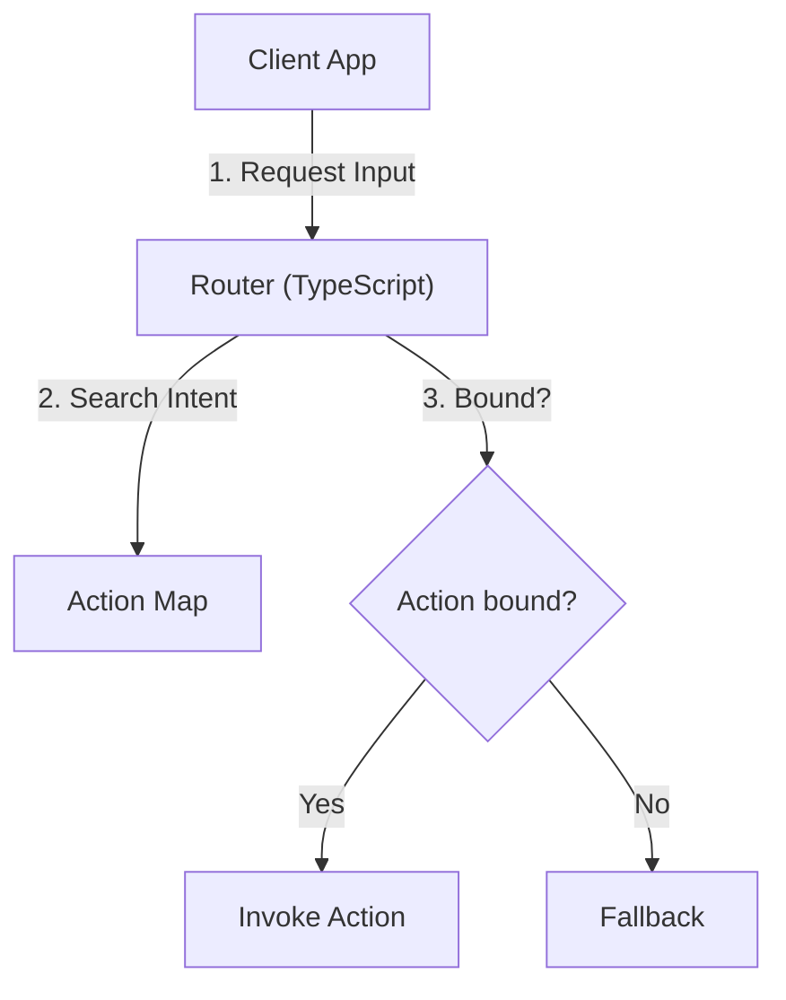

# Claude Code 風 文書作成 Skill (Document Authoring Skill)

本スキルは、Anthropic / Claude Code の高度なテクニカルライティング規範および表現ガイドラインに従い、情報密度が高く構造化された技術ドキュメントを作成・編集・推敲するための汎用ガイドラインです。

---

## 1. コア設計原則 (Core Document Principles)

1. **結論ファースト (Conclusion First)**
   - 冒頭に概要・目的・結論（TL;DR または Key Takeaways）を置き、読者が30秒で全体像を把握できるようにします。
2. **情報の高密度化と無駄の排除 (High Density, Low Noise)**
   - 挨拶、冗長な前置き、「〜について説明します」といった無意味な繋ぎ言葉を排除し、事実・仕様・根拠に直接切り込みます。
3. **視覚的構造化 (Visual Structure)**
   - 長文の箇条書きを避け、**表 (Tables)** や **Mermaid ダイアグラム**、**GitHubアラート (Alerts)** を積極的に活用してスキャナビリティを高めます。
4. **曖昧さの徹底排除 (Unambiguous Specification)**
   - 「適切な処理をする」「必要に応じて設定する」などの定性表現を排し、具体的コード・設定値・コマンド・条件式を記述します。
5. **トレーサビリティ (Traceability)**
   - ソースコードや関連ファイルを参照する場合は、必ず `file://` スキームを用いたハイパーリンク（例: `src/rankings.ts#L10-L25`（リポジトリの中のファイルは相対パス。リポジトリの外のファイルだけ `file://` の絶対パス））を記載します。

---

## 2. GitHub Flavored Markdown (GFM) スタイル規約

### 2.1 ヘッダー階層規約
- **`<h1>` はドキュメント全体で1つのみ**（最上部のタイトル）。
- 章は `##` (H2)、節は `###` (H3) を使用。見出しレベルの飛び飛び（H2の直下にH4など）は禁止。

### 2.2 GitHub アラートの使い分け
強調したい重要事項は GitHub アラート構文を使用します。連置やネストは避けます。

```markdown
> [!NOTE]
> 背景文脈や補足的な仕様説明

> [!TIP]
> パフォーマンス向上策や実装のベストプラクティス

> [!IMPORTANT]
> 開発・運用時に必ず守るべき必須要件

> [!WARNING]
> 非互換性リスク、パフォーマンス悪化、ビルド破壊の懸念

> [!CAUTION]
> データ損失、セキュリティホール、壊滅的な破壊リスク
```

### 2.3 コードブロックと差分表示
すべてのコードブロックには必ず言語識別子を指定します。コード変更を説明する場合は `diff` ブロックを使用します。

```diff
- void OldMethod();
+ void NewMethod(int priority);
```

### 2.4 Mermaid ダイアグラム規約
複雑なシステムアーキテクチャ、状態遷移、シーケンス図は Mermaid で可視化します。
※ ノードラベル内に丸括弧 `()` や特殊文字を含む場合は必ず引用符 `"` で囲んで構文エラーを防止してください。



---

## 3. 文書タイプ別 構造テンプレート

作成するドキュメントの種別（YAML frontmatter の `type`）に応じて、最適な構成を採用します。

### YAML フロントマター（必須規約）

作成するすべてのマークダウンファイルの先頭には、以下のメタデータを付与します。

```yaml
---
generated_by: Claude {現在のモデル名}
date: YYYY-MM-DD
type: spec | design | architecture | guide | reference | report
project: <リポジトリの名前>
---
```

---

### A. 技術仕様書・設計書 (spec / design / architecture)
システムや新機能の構造、データフロー、インターフェースを定義する場合。

```markdown
# 【機能名/システム名】技術仕様書

> Generated by Claude {現在のモデル名} — {YYYY年M月D日}

## 1. 概要と目的 (Overview & Goals)
- **目的**: 解決する課題とゴール
- **対象読者**: 開発者・アーキテクト
- **非対応事項 (Non-Goals)**: 今回扱わないスコープ外の仕様

## 2. システムアーキテクチャ (Architecture)
（Mermaidダイアグラム、コンポーネント構成図、モジュール一覧表）

## 3. 詳細仕様 & データ構造 (Detailed Specs)
（データ構造、クラス定義、API仕様、入出力形式、状態遷移）

## 4. エッジケース & エラーハンドリング (Edge Cases & Fallbacks)
（例外処理、入力エラー、タイムアウト時の挙動）

## 5. トレードオフ & 代替案の検討 (Trade-offs & Alternatives)
| アプローチ | メリット | デメリット | 採否理由 |
|---|---|---|---|
| 案A（採用） | 〜〜 | 〜〜 | 〜〜 |
| 案B | 〜〜 | 〜〜 | 〜〜 |

## 6. 検証・テスト計画 (Verification Plan)
（動作確認用のテストケース、実行コマンド）
```

---

### B. 手順書・開発ガイド (guide / procedure)
開発環境構築、ビルド手順、運用手順などを説明する場合。

```markdown
# 【タスク名】開発・運用ガイド

> Generated by Claude {現在のモデル名} — {YYYY年M月D日}

## 前提条件 (Prerequisites)
- OS / ツール / 依存環境の要件一覧

## 全体手順フロー (Workflow Summary)
1. 【ステップ1】〇〇の準備
2. 【ステップ2】〇〇の実行
3. 【ステップ3】動作検証

## 詳細手順 (Detailed Steps)

### ステップ 1: 〇〇の設定
```bash
# 実行コマンド
node scripts/test.mjs
```

> [!IMPORTANT]
> コマンド実行時に〇〇のエラーが出た場合は、△△を設定してください。

## トラブルシューティング (Troubleshooting)
| 現象 | 原因 | 対策 |
|---|---|---|
| エラー code X | 設定漏れ | 〜〜を実行 |
```

---

## 4. 推敲・自己校正チェックリスト (Quality Self-Lint)

文書を作成・編集した後、最終出力の前に以下の品質条件を満たしているかチェックします。

- [ ] **無駄な口語・挨拶の排除**: 「こんにちは」「以上で説明を終わります」等の冗長表現はないか？
- [ ] **単一H1ルール**: Document全体で `#` (H1) は1つだけになっているか？
- [ ] **具体的表現の徹底**: 「適切に」「適宜」「十分な」といった曖昧語が具体的な数値やロジックに置き換わっているか？
- [ ] **表・図の活用**: 3項目以上の比較やリストがマークダウン表になっているか？
- [ ] **コード言語指定**: すべての ``` ブロックに言語（`ts`, `json`, `bash`, `mermaid` 等）が明示されているか？
- [ ] **ハイパーリンクの完全性**: 参照ファイル・ソースコードへのリンクが `file://` スキームで正しく記述されているか？
- [ ] **YAMLフロントマターと署名フッター**: `generated_by` や免責付きのモデル署名が正しく配置されているか？

---

## 5. 置き場（このリポジトリ）

| 書くもの | 置き場 |
|---|---|
| 作業中に参照する仕組み・設計の正（実装を変えたら直す） | `docs/guides/working/` |
| 手順（実行順と通過条件） | `docs/guides/procedures/` |
| 方針・決定 | `docs/guides/decisions/` |
| その時点の記録（更新しない） | `docs/reports/YYYY/MM/DD/NN-<title>.md`（番号の決め方は `save-report` スキル） |

置き場の正は CLAUDE.md の「置き場」。`src/` の中に `.md` を置かない（コードと文書を混ぜない）。`docs/inspecs/` は人が書く入力の文書の置き場なので、読むだけで書かない。
