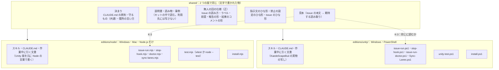

# Issue 駆動キット 基本設計 — Unity 版（Windows・PowerShell）と Node 版（Windows・Mac・Node.js だけ）を分けて入れ、利用者が選ぶ

> Generated by Claude Opus 5.5 — 2026年10月23日

| 項目 | 内容 |
|---|---|
| 状態 | 基本設計・**決めること D1〜D12 は全部決定**（D2・D7・D12 はユーザーの指定、残りは 2026-10-23 ユーザー「おすすめで決めて」で推しの案に決定）。**K1・K2 済み**（2026-10-23。キットのリポジトリ [`mkanakureon/issue-driven-kit`](https://github.com/mkanakureon/issue-driven-kit)・公開（MIT）・K2 の確かめは 7 章の後ろ）。**K3〜K6 の仕事も済み**（キット自身に Node 版を入れ、キットの Issue #1〜#5 を無人の回で回して、5 件とも 1 回目で合格。2026-10-23 14:06〜14:33）。残りは人が Mac で確かめる K-6・K-7。K3（Node 版の見本のプロジェクト）から |
| 元 | このリポジトリの Issue 駆動の一式（記録 23/02）・一般化の手順書 `issue-driven-repo-setup.md` |
| 版 | **Unity 版**：Windows・PowerShell（いまのこのリポジトリの形）／**Node 版**：Windows と Mac・**PowerShell を使わず Node.js の脚本だけ**・テストは vitest |
| 最初に入れる先 | Unity 版 → このリポジトリ（同じ形になることの確かめ）／Node 版 → 作者の rpg-online-cloudflare（private・TypeScript・Cloudflare Workers・D1）。**2026-10-23 に外れた**：入れるのは作者が手で行い、Node 版の確かめはキット自身に入れて行った |
| 変えた所 | 初版（同じ日）は「芯は PowerShell 7 で共通、Node は差し替え部品」だった。ユーザーの決定（2026-10-23「Unity は Windows 依存 PS を使う、vitest のほうは PS は使わない、node 関連のスクリプトだけでできるはず、2 つ区別して入れて、利用者は選択できるようにする」）で、**脚本は版ごとに別に作り、決まりと文書だけを共有する**形に書き直した |

---

## 1. ゴールと合格の条件

### 1.1 ゴール

このリポジトリでうまくいった Issue 駆動の設定・スキル・脚本・文書を、**もれなく**キットにする。キットは **Unity 版と Node 版の 2 つ**を持ち、利用者は自分のリポジトリに合う方を選んで入れる。Node 版は PowerShell を一切使わず、Windows と Mac の両方で動く。最初の到達点は、**rpg-online-cloudflare で、Mac の無人の回が Issue を 1 件合格させること**。

### 1.2 合格の条件

| # | 条件 | 測り方 | 機械／人 |
|---|---|---|---|
| K-1 | 共有の部品（決まり・スキル・文書・ひな形・仕様）が全部入っている（4 章の一覧が全部ある） | 一覧の各パスが存在するかを脚本で見る | 機械 |
| K-2 | **Node 版に PowerShell が出てこない**：`.ps1` が 0 本、脚本・設定・スキル・ひな形・手順書に `pwsh`・`powershell` が 0 件 | 検索して 0 件 | 機械 |
| K-3 | **2 つの版の無人の回が、同じ Issue の本文を同じに読む**（合格の条件の行・確認コマンド・守るファイル・前提） | 共有の見本（Issue の本文 → 期待する読み取りの JSON。Unity 版の見本と Node 版の見本）を両方の版で読ませて比べる。ほかの版の確認コマンドの塊は読まない | 機械 |
| K-4 | Unity 版を空のフォルダーに入れると、このリポジトリと同じ部品の組ができる（名前を埋めた後の差が、決めた所だけ） | 比べる脚本 | 機械 |
| K-5 | Node 版のテストの入口が、全部・0 件・わざと落とすの 3 つで、期待どおりの `Result:` 行と終了コードを返す | 見本と rpg-online-cloudflare で回す | 機械 |
| K-6 | Node 版を rpg-online-cloudflare に入れた後、点検が NG 0・DryRun が終了コード 0 | **Windows（この PC）と Mac の両方**で回す | 機械（Mac は人が実行） |
| K-7 | rpg-online-cloudflare で、**Mac** の無人の回が Issue を 1 件、1 回目の起動で合格させる | 結果のコメント | 機械（人が Mac で起動） |
| K-8 | 利用者が、どちらの版を選べばよいかを読んで決められ、選んだ版だけを入れられる | 人が説明書を読む・入れる脚本が版を選ばせる | 人＋機械 |

---

## 2. 対象のリポジトリとこの PC の事実（2026-10-23 に確かめた）

| 項目 | 事実 |
|---|---|
| rpg-online-cloudflare の履歴 | 4 コミット（2026-10-22 15:16〜15:20）。最後は `38d2fcb` |
| 中身 | `src/worker.ts`（104 行）・`scripts/cli-mock.mjs`・`migrations/0001_initial.sql`・`docs/` に設計 5 本と ADR 1 本・`wrangler.jsonc` |
| `package.json` | `type: module`・`engines.node >=22`・scripts は `dev`・`db:migrate:local`・`cli:smoke`・`typecheck`。**devDependencies は `typescript`・`wrangler` だけ。vitest もテストも無い** |
| Claude Code の設定 | `CLAUDE.md`・`.claude/` が無い |
| 置き場の名前 | 小文字（`scripts/`・`docs/`・`docs/adr/`） |
| 開発の場所 | ADR 0001：Mac（MacBook Air M1）で先に開発する |
| 決まりに近い物 | README「無認証 API のデプロイは行わない」・`APP_ENV=disabled` が既定・D1 の ID はダミー |
| この PC | Windows 11。Node.js 22.14.0・npm 11.4.2（D7 で入れた）・PowerShell 7.6.7・gh 2.103.0・Claude Code 2.1.307 |
| clone | `C:\Users\<you>\Documents\Projects\rpg-online-cloudflare`（読むだけ・変更なし） |

---

## 3. 全体の形

### 3.1 共有する物と、版ごとに作る物



**一つの契約は一か所で**（原則 5）を守るため、無人の回の決まり（Issue のどこを読むか・ラベルの意味・報告の形）は `shared/` の**仕様の文書に 1 回だけ書き**、2 つの版の脚本はそれを実装する。2 つの実装がずれていないかは、共有の見本（K-3）で毎回確かめる。

**スキル・`CLAUDE.md`・作業中に引く文書は、版ごとに写しを持つ**（K1 で実物を見て決めた。2026-10-23）。Unity に固有の言葉（コマンドの例・`.meta`・EditMode など）がこれらに 300 か所以上あり、ひな形の穴埋めにすると、動いた文を大きく書き換えることになるため。共有にするのは、版に依らない**原則と進め方の決まり**（`shared/claude-md/`。両方の版の `CLAUDE.md` に同じ文で入ることを試験で見る）と、仕様の正・見本・説明書・事例。**説明書・読み物・事例は利用先に写さない**（元のリポジトリの記録への相対リンクが切れるため。利用者はキットの中で読む）。

### 3.2 利用者の選び方

| 選ぶ版 | 向いているリポジトリ | 動く OS | 要る道具 | 入れ方 |
|---|---|---|---|---|
| **Unity 版** | Unity のプロジェクト | Windows | Claude Code・git・gh・PowerShell 7・Unity | `pwsh editions\unity\install.ps1 -Target <リポジトリ>` |
| **Node 版** | Node.js＋TypeScript のプロジェクト（テストは vitest） | Windows・Mac | Claude Code・git・gh・Node.js 22.14.0／npm 11.6.2 | `node editions/node/install.mjs --target <リポジトリ>` |

入れる脚本は、選んだ版の物だけを写す。もう片方の版の脚本は利用先に入らない（Node 版の利用先に `.ps1` が 1 本も入らない＝K-2）。

### 3.3 2 つの版の対応

| 役目 | Unity 版 | Node 版 |
|---|---|---|
| 無人の回の本体 | `Scripts/issue-run.ps1` | `scripts/issue-run/issue-run.mjs` |
| Stop hook | `.claude/issue-run/stop-hook.ps1`（設定から `pwsh -NoProfile -File` で呼ぶ） | `.claude/issue-run/stop-hook.mjs`（設定から `node` で呼ぶ） |
| 点検 | `Scripts/issue-run-doctor.ps1` | `scripts/issue-run/doctor.mjs` |
| レーン同期 | `Scripts/Sync-Lanes.ps1` | `scripts/issue-run/sync-lanes.mjs` |
| テストの入口 | `Scripts/unity-test.ps1` | `scripts/test.mjs`（`npm test` から呼ぶ） |
| Issue の確認コマンド | ```` ```pwsh ```` の塊（`pwsh -NoProfile -Command` で回す）。守るファイルは `# 守る: <パス>` | ```` ```js ```` の塊（ES モジュールとして `node` で回す。D9）。守るファイルは `// 守る: <パス>` |
| 確認コマンドの手伝い | なし（PowerShell の書き方） | `scripts/issue-run/check-lib.mjs`（テストの入口を回す・ファイルがあるか・git の状態を見る、など。確認コマンドが使うので守るファイルになる） |
| 使用中の判定 | Unity エディタがそのフォルダーを開いているか | 使用中にしない（`wrangler dev` が動いていれば知らせだけ。D5） |
| 眠らせない | `SetThreadExecutionState`（Windows の API） | Mac：`caffeinate -i -w <自分の PID>` を子のプロセスで起動。Windows：Node だけでは止められないので、点検で電源の設定を知らせる（D10） |
| 置き場の名前 | `Scripts/`・`Docs/Guides/`・`Docs/Reports/`・`Docs/InSpecs/`・`Logs/IssueRun/` | `scripts/`・`docs/guides/`・`docs/reports/`・`docs/inspecs/`・`.issue-run/logs/`（D4） |
| ファイルの頭書き | C# | TypeScript |
| 改行・文字コード | LF・PowerShell 5.1 のために BOM 付き | LF・BOM 無し |

### 3.4 入れる脚本の約束（導入ガイドの手順 3 が使う）

| 引数（Unity 版／Node 版） | 動き |
|---|---|
| `-Target <パス>`／`--target <パス>` | 入れる先のリポジトリ（git の作業場所の直下）。無ければ止まる |
| `-DryRun`／`--dry-run` | 写すファイルの一覧と、既にあるファイルとの差（横に置く予定も）だけを出す。何も書かない |
| `-Update`／`--update` | 既に入っている版を、キットの今の版に上げる。利用先で手を入れたファイル（`CLAUDE.md` の「プロジェクト」など）は上書きせず、差を出して止まる |
| （なし） | 初めて入れる。**既にあるファイルは上書きしない**。利用先が手を入れる物（Node 版 `CLAUDE.md`、Unity 版 `CLAUDE.md`・`.gitignore`・`.gitattributes`）がぶつかったら、既にある物は残し、キットの物を `CLAUDE.kit.md` のように `.kit` を付けた名前で横に置いて（拡張子の無い名前・点で始まる名前は後ろに付ける。`.gitignore.kit`）、残りを入れる。横に置いた物は、利用先の物に足してから消す（Claude Code が人と会話で）。それ以外のファイルがぶつかったら、その一覧を出して**何も書かずに**止まる（`Result: FAIL (ぶつかる N 件)`。部分的に入れない） |

どちらも、終わりに `.issue-kit/version`（キットの元のコミット・版・入れた日時。Node 版はキットのリポジトリ `owner/name` も。キットの `origin` から読む）を書き、最後の行に `Result: PASS／FAIL` を出す。入れるのはファイルを写すことだけで、**コミット・push・パッケージの追加はしない**（Node 版の vitest の追加は、導入ガイドの手順 3 で Claude Code が行う）。

---

## 4. もれなく入れる物の一覧

### 4.1 shared/（2 つの版で同じ）

| 物 | 元（このリポジトリ） | 共有にするときの直し |
|---|---|---|
| 共通の決まり | `CLAUDE.md` の「原則」と、4.4 の「進め方の決まり」 | `shared/claude-md/principles.md`・`conventions.md`。両方の版の `CLAUDE.md` に同じ文で入る（原則 1 の「起動中の Unity の停止」は「起動中のツール〔エディタ・開発サーバーなど〕の停止」に言い換えた） |
| 無人の回の仕様 | `Docs/Guides/Working/issue-run.md`・`Scripts/issue-run.ps1` の中の決まり | **新しく「仕様の正」の文書にする**：本文の読み方（`## 合格の条件` の行・確認コマンドの塊・守るファイルの印・`## 前提`）・ラベル 4 つ・回数と時間の上限・報告ファイルの形・結果のコメントの形（`・HEAD <sha>）` を含む）・まとめの形 |
| 指示文のひな形 | `.claude/issue-run/prompt.md` | 「確かめ方」「承認が要る操作」の版ごとの行を差し込む |
| 禁止の設定のひな形 | `.claude/issue-run/settings.json` | Stop hook の起動の行と、人の入力の置き場を版ごとに埋める |
| Issue のひな形 | `.github/ISSUE_TEMPLATE/claude-run.md` | 確認コマンドの塊の言語（pwsh／js）を版ごとに |
| 説明書・読み物 | `issue-driven-guide-for-teams.md`・`issue-driven-prompt-manual.md`・`prompt-suggestions-guide.md`・`issue-driven-repo-setup.md`・`issue-driven-kit-install-guide.md`・`why-suggestions-worked.md` | そのまま写す（`shared/manuals/`・`shared/reading/`）。**利用先には写さない**。版の選び方（3.2）は K6 で足す。正は公開まで KaedeScapeBuii（`shared/SOURCE.md`） |
| 事例 | 記録 22/01〜15・23/01・23/02・`kaedescape-case-study.md` | 公開の前に、パス・アカウント名・メールアドレスを人が確かめる |
| 見本 | 新しく作る | このリポジトリの Issue #1〜#13 の本文と、それを読んだ結果（条件の行数・確認コマンド・守るファイル・前提）。確認コマンドの塊は版ごとに 2 通り |

### 4.2 editions/unity/

いまのこのリポジトリの**スキル 9 本・`CLAUDE.md`（「プロジェクト」を穴埋めにしたひな形）・作業中に引く文書 9 本・脚本**をそのまま入れる（28 件＋`CLAUDE.md`）。テストのアセンブリ（`Assets/Tests/`）は作品ごとなので入れない（導入ガイドの手順 3 で作らせる）：`issue-run.ps1`・`stop-hook.ps1`・`issue-run-doctor.ps1`・`Sync-Lanes.ps1`・`unity-test.ps1`・`unity-test-procedure.md`・Unity の `.gitignore`・`.gitattributes`・守るもの（`.meta`・シーンの YAML・エディタを止めない）。新しく `install.ps1` を書く。

### 4.3 editions/node/

| 物 | 中身 |
|---|---|
| `issue-run.mjs` | `issue-run.ps1` と同じ動き（3.3・仕様の正）を Node.js の標準の部品（`child_process`・`fs`・`path`・`os`）だけで書く。`gh`・`git`・`claude` は子のプロセスで呼ぶ。指示文は標準入力から渡す |
| `stop-hook.mjs` | 報告ファイルの「## 結果: 合格」と守るファイルの指紋（SHA-256、`crypto`）だけを見て、`{"decision":"block"}` を返す |
| `doctor.mjs` | 道具（`node` の版・`gh auth status`・`claude --version`・`git`）・`origin`・キットの版（`.issue-kit/version` をキットのリポジトリの既定のブランチの最新と比べ、違えば・読めなければ WARN。9 章）・ラベル・部品・設定（裸の `CLAUDE.md` の禁止が無いか）・テストの入口・眠らせない設定 |
| `sync-lanes.mjs` | `Sync-Lanes.ps1` と同じ順（レーン → main → 各レーン） |
| `check-lib.mjs` | 確認コマンドから使う手伝い（テストの入口を回す・テストの名前がそろっているか・ファイル・git の状態） |
| `test.mjs` | `package.json` の `issueKit.testRunner` で仕組みを選ぶ（欄が無ければ vitest。`node` なら `issueKit.testFiles` を `node --test` で回す）。結果を JUnit の XML に書かせ、件数を数えて `Result:` 行を出す。`--filter` で絞る（vitest の `-t`・`node --test` の `--test-name-pattern`）。0 件は FAIL |
| `vitest.config.ts` の断片 | D3 |
| `install.mjs` | 共有の部品と Node 版の部品を写し、名前を埋め、`.issue-kit/version` に元のコミットとキットのリポジトリを書く |
| 守るもの | `package-lock.json` を手で直さない・`migrations/` の既存のファイルを書き換えない（足すだけ）・`wrangler.jsonc` に本番の値を入れない・**`wrangler deploy` をしない**（無認証の API をデプロイしない） |
| `node-test-procedure.md` | テストの入口の使い方・結果の読み方 |
| `.gitignore` の断片 | `.issue-run/`・テストの出力 |

### 4.4 記憶やその場の判断にしか無かった決まり（共有の `CLAUDE.md` に書く）

| 決まり | いまの場所 |
|---|---|
| 人が書く入力の文書の置き場は 1 か所。Claude は読むだけ | 記憶・`CLAUDE.md` |
| 作業のたびにその日の記録に追記する（任意） | 記憶だけ |
| 人の言葉が要る次の一手は、返答の最後に「『<言い方>』と言ってもらえれば」の形で 1 つ書く | どこにも無い（読み物 `why-suggestions-worked.md`） |
| 決めることには推しの案を必ず付ける | どこにも無い |
| 設計書を了承する前に、別のエージェントに見直させる | 手順書の勧めだけ |
| 実装の Issue を作る前に確認コマンドを 1 回回し、ツールが作るファイルを先にコミットする | 一般化の手順書 4 章 |
| 確認コマンドは、後ろの行まで偽の状態で回して確かめる | 事例集・ガイド 6.6 |

---

## 5. Node 版を Windows と Mac で動かすための決まり

| 所 | 決まり |
|---|---|
| 依存 | **Node.js の標準の部品だけ**（npm のパッケージを使わない。D11）。vitest は利用先の `devDependencies` |
| 子のプロセス | `spawn` に引数の配列で渡す。Windows では `claude`・`gh` が `.cmd`／`.exe` のことがあるので、点検と同じ探し方で実体を見つけてから起動する（`shell: true` で文字列を組み立てない） |
| パス | `path.join`。比べるときと Issue に書くときは `/` にそろえる |
| 文字コード | 子のプロセスの出力は UTF-8 で読む。Windows の既定の文字コード（CP932）で化けないことを点検で確かめる（kaedevn 2026-10-14 の化けの件） |
| 改行 | LF。Issue の本文の CRLF は読むときに LF にそろえる |
| 大文字と小文字 | 置き場の名前は利用先に合わせる（rpg-online-cloudflare は小文字）。Mac の既定は大文字と小文字を区別しないが git は区別するので、同じ名前を大文字違いで作らない |
| 眠らせない | Mac は `caffeinate`。Windows は点検で知らせる（D10） |
| 確かめ | この PC（Windows）で K-5・K-6 を回す。Mac は人が回す（期待する出力を手順書に書く） |

---

## 6. 決めること

| # | 決めること | 推し・決定 | ほかの案 | 理由 |
|---|---|---|---|---|
| D1 | キットを置く場所 | **決定：新しいリポジトリ `mkanakureon/issue-driven-kit`**（初めは private。2026-10-23 ユーザー「キット　は公開リポジトリにする」で**公開（MIT）**にした。公開は 1 コミットのきれいな履歴から始め、開発の途中の履歴は private の `issue-driven-kit-dev` に残す）。利用先には写しを入れ、元のコミットを `.issue-kit/version` に残す | このリポジトリの中／利用先に直接 | 共有の部品を 1 か所に保つ。古い写しに気づける |
| D2 | 脚本の言語 | **決定（2026-10-23 ユーザー）：Unity 版は PowerShell（Windows）、Node 版は Node.js だけ（PowerShell を使わない）** | — | 利用先の技術に合わせる。Node 版の利用者に PowerShell を入れさせない |
| D3 | Node 版のテスト | **決定：vitest。Worker の試験は `@cloudflare/vitest-plugin`**。版の組み合わせは入れるときに公式の案内で確かめ、固定する | 素の vitest だけ | ロードマップの失敗ケースは Worker と D1 を通して試すのが本物に近い |
| D4 | Node 版の置き場の名前 | **決定：利用先に合わせて小文字**。脚本は `scripts/issue-run/`、文書は `docs/guides/`・`docs/reports/`・`docs/inspecs/`、ログは `.issue-run/logs/`（git に入れない）。既存の `docs/` の 6 本と `docs/adr/` は触らない | Unity 版と同じ大文字 | 大文字と小文字の問題（5 章）。既存の置き方を壊さない |
| D5 | Node 版の使用中の判定 | **決定：使用中にしない**（`wrangler dev` が動いていれば知らせだけ） | 8787 番が使われていれば BLOCKED | vitest の Workers の試験は分けた環境で動く（入れるときに確かめる） |
| D6 | 最初の Issue（rpg-online-cloudflare） | **決定：文書 1 件 → 試験 2 件**。1：テスト計画（ロードマップの失敗ケース 8 つを試験の名前の表に）。2：`/health` と `GET` の正常系。3：スコア投稿の異常系 | いきなり実装 | このリポジトリの #1〜#3 と同じく、仕組みの確かめと中身の失敗を混ぜない |
| D7 | Node.js と npm の版 | **決定：Node.js 22.14.0（2026-10-23 ユーザー）・npm 11.6.2（2026-10-26、Issue #5）**。npm は 11.4.2 では `npm install --save-dev vitest@4` が `edgesOut` の誤りで落ち、11.6.2 では通る（Windows・Mac で確かめた）ので上げた。Windows と Mac を同じ版にする。利用先の `package.json` の `engines` と `.nvmrc` に書く | — | 両方の OS を同じ版で確かめる |
| D8 | 作る順 | **決定：K1〜K4 は会話の中で作り、K5（最初の Issue）から利用先で Issue 駆動** | 全部会話／全部 Issue | キットが入る前は無人の回が無い |
| D9 | Node 版の確認コマンドの書き方 | **決定：```` ```js ```` の塊（ES モジュール）**。無人の回が一時ファイル（`.issue-run/logs/<回>/check-<番号>.mjs`）に書いて `node` で回し、終了コード 0 で合格。守るファイルは `// 守る: <パス>`。手伝いは `check-lib.mjs` から読み込む | ```` ```sh ````（Mac と Windows で書き方が変わる）／`npm run` の名前だけ書く（Issue ごとの確かめが書けない） | Windows と Mac で同じに動く。いまの ```` ```pwsh ```` と同じ「本文に確かめを全部書く」形を保てる |
| D10 | 長く回す間、PC を眠らせない | **決定：Mac は `caffeinate -i -w <PID>`。Windows は Node だけでは止められないので、点検で「電源とスリープ」の設定を知らせる** | Windows だけ PowerShell を呼ぶ（D2 に反する） | D2 を守る |
| D11 | Node 版の脚本の依存 | **決定：npm のパッケージを使わない**（標準の部品だけ） | `execa`・`yaml` などを使う | 利用先の `package.json` を汚さない。版の食い違いが起きない |
| D12 | 版の数と選び方 | **決定（2026-10-23 ユーザー）：Unity 版と Node 版の 2 つを分けて入れ、利用者が選ぶ** | — | — |

---

## 7. 作る順

| 段 | 何をするか | どこで | 合格の条件 |
|---|---|---|---|
| K1 | キットのリポジトリを作る。`shared/` と Unity 版を切り出し、無人の回の仕様の正と見本を書く。`install.ps1` | 会話 | K-1・K-4（**済み** 2026-10-23・`d838249`） |
| K2 | Node 版の脚本（`issue-run.mjs`・`stop-hook.mjs`・`doctor.mjs`・`sync-lanes.mjs`・`check-lib.mjs`・`test.mjs`・`install.mjs`） | 会話 | K-2・K-3（この PC）（**済み** 2026-10-23。Windows で確かめた。Mac は K4） |
| K3 | Node 版の見本のプロジェクト（小さな vitest のプロジェクト）で、テストの入口と DryRun を回す | 会話 | K-5（見本）・K-6（この PC） |
| K4 | rpg-online-cloudflare に入れる（ブランチ）。vitest を足し、`engines`・`.nvmrc` に版を書く | 会話＋人（Mac で点検） | K-5（対象）・K-6（Windows と Mac） |
| K5 | 最初の Issue 3 件（D6）を作り、**Mac で無人の回を起動する** | 利用先（Issue 駆動）＋人 | K-7 |
| K6 | 導入ガイド `../Manuals/issue-driven-kit-install-guide.md`（先に書いた。利用者から見た形の正）を、作った物に合わせて仕上げる。事例の個人の情報を確かめる（公開するなら） | 会話＋人 | K-8 |

### 7.1 K2 で確かめたこと（2026-10-23・Windows 11・Node.js 22.14.0）

| 確かめたこと | 結果 |
|---|---|
| キットの試験（`npm test`） | 18 本が通る。K-2（Node 版に `.ps1`・`pwsh`・`powershell` の実行が無い。Claude の道具を断る `PowerShell(…)` の行だけは許す）・K-3（見本 13 件を Unity 版と同じに読む。合格の条件の行・確認コマンド・前提・守るファイルの全部）・入れる脚本（DryRun・本番・2 回目は 0 件・ぶつかると上書きせず FAIL・`--update`・`.gitignore` に 1 行だけ足す）・Stop hook（押し返す・守るファイル・上限・点検の印）・テストの入口（vitest が無ければ FAIL） |
| rpg-online-cloudflare の一時の clone に入れる | 30 件を写した。既にある `scripts/cli-mock.mjs`・`docs/` の 6 本とぶつからない |
| 点検（`doctor.mjs`） | 道具・ログイン・origin・部品・設定（deny 62 個・Stop hook は node）が OK。NG は vitest が無いこと（K4 で足す）だけ |
| `issue-run.mjs --dry-run` | origin からリポジトリを読み、対象 0 件で終了コード 0。KaedeScapeBuii の #13 を読ませると、合格の条件 9 行・確認コマンド「なし」（pwsh の塊なので）で起動しない |
| 確かめていないこと | Mac での動き（K4）・`claude -p` を起動する本番の回（K5）・vitest がある状態のテストの入口（K3） |

K2 で仕様を 1 か所直した：Node 版の確認コマンドは、記録として `issue-<番号>-check.mjs` に書き、回すときは `node --input-type=module` の標準入力から渡す（一時ファイルを `node <ファイル>` で回すと、`import './scripts/…'` がログの置き場から解決されてしまうため）。
---

## 8. 人がすること

| いつ | すること | 外への書き込み |
|---|---|---|
| D1 の了承の後 | キットのリポジトリを作ってよいか（「作って」） | GitHub にリポジトリを作る |
| K4 | 利用先へのブランチの push・PR | push |
| K4・K5 | **Mac で**：Node.js 22.14.0・npm 11.6.2 にそろえる・`brew install gh`・`gh auth login`・`claude setup-token`・点検・無人の回の起動（**PowerShell は要らない**） | — |
| K6 | 公開するなら、事例の中の個人の情報を確かめる | — |

---

## 9. 危ないこと

| 危ないこと | 対策 |
|---|---|
| 2 つの版の無人の回が、だんだん違う動きになる | 決まりは仕様の正に 1 回だけ書く。共有の見本（K-3）を、どちらかを変えるたびに両方で回す |
| Node 版の無人の回は、まだ一度も動いていない新しい実装 | Unity 版で動いた 655 行を、仕様の正と見本で 1 つずつ写す。K-7 が通るまで「動いた」と言わない |
| Mac で一度も動かしていない | K-6・K-7 を人が Mac で確かめるまで「両対応」と言わない（原則 4） |
| `@cloudflare/vitest-plugin` と vitest の版の組み合わせ | K4 で入れるときに公式の案内で確かめて固定する（Mac では vitest 5.0.3・`@cloudflare/vitest-plugin` 1.4.0 で通った。workerd が受け付ける `compatibility_date` には版ごとの上限がある） |
| 利用先は「無認証 API をデプロイしない」リポジトリ | Node 版の指示文と禁止の設定で `wrangler deploy` を断る |
| 写しが古くなる | `.issue-kit/version`。点検でキットの最新と比べて知らせる |
| Windows で長く回す間に眠る | 点検で電源の設定を知らせる（D10） |

---

> この文書は Claude Opus 5.5 が生成しました。内容の正確性は人間のレビューを経て確認してください。
>
> Claude Opus 5.5 — Anthropic
