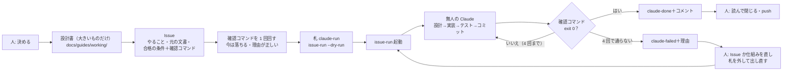

# Issue 駆動の開発 — 全体の整理と再現の手順（常設）

**このプロジェクトの開発は、GitHub の Issue に「何を・どの合格の条件まで」を書き、無人の Claude Code がその合格の条件を機械の判定で満たすまで進める形で回す。** この文書は、その形の全体（誰が何をするか・部品・1 件の流れ・どの文書が何の正か）と、別の PC・別の作業場所で同じものを**再現する手順**の正。細部はそれぞれの正の文書に置き、ここには写さない（CLAUDE.md 原則 5）。

仕組みは Issue 駆動キット（Node 版）から入れた。入れた版は `.issue-kit/version`。無人の回の決まりの正はキットの `shared/spec/issue-run-spec.md`。

> [!TIP]
> **初めて読む方へ**: この文書は「仕組みの地図」で、1〜5 章で全体、**8 章で使い方**、6〜7 章で別の PC に同じものを作る手順を書いている。実際に 1 件回してみたいだけなら、8 章 → `docs/guides/procedures/issue-goal-setting.md` の 6 章（例）の順に読むとよい。

## 1. 考え方（4 つ）

| # | 考え方 | どこで守るか |
|---|---|---|
| 1 | **合否は機械が決める。** AI の「できました」も人の「良さそう」も合否に使わない。使うのは Issue の確認コマンドの終了コードだけ | `issue-run.mjs`（確認コマンドを実行）・Stop hook・守るファイルの指紋 |
| 2 | **正は文書、Issue は札。** 設計は文書に書き、Issue は「どの文書のどこを、どの合格の条件まで」を指す | `issue-goal-setting.md` 1 章・CLAUDE.md の置き場 |
| 3 | **止まる原因を仕組みで塞ぐ。** 「止まるな」と書くのでなく、止まる原因ごとに設定・hook・スクリプトで塞ぐ | `issue-run.md`「止まらない仕組み」 |
| 4 | **人は決めることと確かめることだけ。** 合格の条件を決め、Issue を書かせ、終わった後に確かめて閉じる・push する | 下の 2 章 |

## 2. 誰が何をするか

| 誰 | やること | やらないこと |
|---|---|---|
| **人（ユーザー）** | **プロンプトで指示する**（何を作るか・決めること・「作って」「進めて」「コミットして」「pushして」）・Claude Code が書いた設計書と Issue の下書きを読んで了承する・`issue-run.mjs` を起動する・結果を確かめる・ログインなど画面の操作・**入力の文書を `docs/inspecs/` に置く**（人が書く文書はここだけ） | 文書を書く（`docs/inspecs/` の入力の文書のほかは、全部 Claude Code が書く）・無人の回の途中で答える |
| **対話の Claude Code**（会話のセッション） | **文書を全部書く**: 設計書・Issue（合格の条件と確認コマンドを含む）・手順書・記録。確認コマンドを 1 回回して「今は落ちる」を見る・人の「作って」で Issue を作る・`--dry-run`・結果の読み解き・失敗の直し・仕組みの直し | 人の指示なしに Issue を作る・push する・`docs/inspecs/` を書き換える |
| **無人の Claude**（`claude -p`・1 件 1 セッション） | Issue を読む → 設計（要れば）→ 実装 → テスト → 判定役に判定させる → コミット → 報告ファイル | 質問・push・Issue への書き込み・直下の CLAUDE.md と `.claude/` の書き換え・デプロイ（deny で断られる） |
| **判定役**（無人の Claude が呼ぶ別のエージェント） | 実行結果のログと差分を読んで、合格の条件ごとに判定を書く | 確認コマンドを回す・実装する |
| **`issue-run.mjs`** | 起動前の点検・Issue を拾う・守るファイルの指紋・Claude の起動と再開・確認コマンドを 1 回実行・コメントとラベル・まとめ | 判定を上げる・下げる（終了コードをそのまま使う） |

## 3. 部品

| 部品 | 役目 | 正の説明 |
|---|---|---|
| `scripts/issue-run/issue-run.mjs`（と `lib.mjs`・`proc.mjs`） | 無人実行の本体（Node.js・Windows と Mac） | `docs/guides/working/issue-run.md` |
| `scripts/issue-run/check-lib.mjs` | 確認コマンドから使う手伝い | `docs/guides/procedures/issue-goal-setting.md` 4 章 |
| `.claude/issue-run/prompt.md` | 無人の Claude への指示文 | `issue-run.md` |
| `.claude/issue-run/settings.json` | deny・Stop hook・env（自動更新を止める・時間切れを 90 分に） | 同上 |
| `.claude/issue-run/stop-hook.mjs` | 報告が「合格」で守るファイルが無傷になるまで終わらせない | 同上 |
| `.github/ISSUE_TEMPLATE/claude-run.md` | Issue のひな形 | `issue-goal-setting.md` |
| `scripts/test.mjs` | 確認コマンドが呼ぶテストの入口（vitest・`Result:` 行・0 件は FAIL） | `docs/guides/procedures/node-test-procedure.md` |
| `scripts/issue-run/doctor.mjs` | 再現の点検（道具・ログイン・origin・ラベル・部品・設定・vitest・眠らせない） | この文書の 6 章 |
| `.claude/skills/design-cycle/` | 回し方（ゴール → 合格の条件 → 設計 → 実装 → テスト → 振り分け → 判定） | そのスキル |
| `.claude/skills/github-issue/` | 会話の中で Issue を作る・見る・回す | そのスキル |
| `docs/guides/decisions/test-plan.md` | 用語・テストレベル・合格基準・中断基準・欠陥管理 | その文書 |

## 4. 1 件の流れ



大きいものは 2 回に分ける（1 回目は設計書を書く Issue → 人が読んで了承 → 2 回目は設計書を「守る」にして実装の Issue）。段は「## 前提」でつなぐ。書き方の細部は `issue-goal-setting.md`。

## 5. どの文書が何の正か

| 知りたいこと | 正 |
|---|---|
| Issue の書き方（ゴール・合格の条件・確認コマンド・守るファイル・例・札を付ける前の確かめ・終わった後の読み方） | `docs/guides/procedures/issue-goal-setting.md` |
| 無人実行の仕組み（止まらない仕組み・ラベル・引数・ログ） | `docs/guides/working/issue-run.md` |
| テストの回し方・結果の読み方 | `docs/guides/procedures/node-test-procedure.md` |
| 合格基準・欠陥の扱い・中断 | `docs/guides/decisions/test-plan.md` |
| 回し方（設計・実装・テスト・判定） | `.claude/skills/design-cycle/SKILL.md` |
| GitHub（リポジトリ・push） | `docs/guides/working/github-repo.md` |
| 全体と再現 | この文書 |

## 6. 再現（別の PC・別の作業場所で同じものを動かす）

### 6.1 決めた道具の版

| 道具 | 版 | 入れ方（Windows ／ Mac） |
|---|---|---|
| Node.js | **22.14.0**（`.nvmrc`） | `winget install --id OpenJS.NodeJS.22 --version 22.14.0 -e` ／ 公式の配布か版を選べる道具 |
| npm | **11.6.2** | `npm install -g npm@11.6.2`（どちらも） |
| git | 新しいもの | `winget install --id Git.Git -e` ／ `xcode-select --install` |
| GitHub CLI | 新しいもの | `winget install --id GitHub.cli -e` ／ `brew install gh` |
| Claude Code | 新しいもの | https://code.claude.com の手順 |
| 無人の回のモデル | `claude-opus-5-5` | `issue-run.mjs --model` の既定（対話の既定に引きずられない） |

キットでは、Windows 11 で Node.js 22.14.0 を使って確かめた（npm 11.6.2 で vitest 4 を足せることも確かめた）。Mac は macOS 15.8.1（arm64）で Node.js 22.14.0・npm 11.6.2・git 2.39.5・gh 2.103.0・Claude Code 2.1.309 を使って確かめた。npm を 11.6.2 にしたのは、前に決めた版では `npm install --save-dev vitest@4` が落ちるため。

### 6.2 ゼロからの手順

1. 道具を入れる（6.1）。入れた後は**新しい窓を開く**（古い窓の PATH には入らない）。
2. `gh auth login`。ブラウザが開かなければ、出たコードを https://github.com/login/device に入れる。
3. `git clone <このリポジトリ>` → `npm install`。Windows でパスの上限（260 字）に当たるなら `git config --global core.longpaths true` を先に。
4. 無人用の長期トークン: `claude setup-token` → 環境変数 `CLAUDE_CODE_OAUTH_TOKEN` に入れる → 新しい窓。
5. `node scripts/issue-run/doctor.mjs --run-tests` → 最後の行が `Result: PASS`。WARN は 6.3 を見て直す。
6. `node scripts/issue-run/issue-run.mjs --dry-run`。

### 6.3 点検の読み方（`doctor.mjs`）

| 出たもの | 意味 | 直し方 |
|---|---|---|
| `NG node`・`WARN node` | Node.js の版が違う | 6.1 の版にそろえる |
| `NG gh の PATH` | 窓が古い | 新しい窓で回す |
| `NG gh のログイン` | ログインしていない・権限 repo が無い | `gh auth login`・`gh auth refresh -s repo` |
| `WARN 長期トークン` | 無人の回が途中で認証切れになることがある | 6.2 の 4 |
| `WARN ラベル` | `claude-run` などがまだ無い | `issue-run.mjs` の最初の実行で作られる。先に Issue に札を付けたいなら `gh label create claude-run` |
| `WARN キットの版: 古い` | 入っている一式（`.issue-kit/version` のコミット）が、キットのリポジトリの既定のブランチの最新と違う。行にキットの最新の短い SHA が出る | 7 章の手順で入れ直す（`node <キット>/editions/node/install.mjs --target . --update`） |
| `WARN キットの版`（読めない・リポジトリが無い・版のファイルが無い） | GitHub を読めない（`gh` のログイン・ネット）か、古い `install.mjs` で入れたので比べる相手が分からない | `gh` を直してもう一度回す。リポジトリが無いなら 7 章で入れ直すと書かれる |
| `WARN 作業ツリー` | 未コミットがある | コミットしてから回す（無人の回のコミットと混ざる） |
| `NG 設定` | deny が足りない・裸の `CLAUDE.md` の deny がある・Stop hook が無い | キットの `editions/node/files/.claude/issue-run/settings.json` と比べる（7 章） |
| `NG vitest`・`NG node_modules` | vitest が入っていない | `npm install -D vitest` ・ `npm install` |
| `WARN 眠らせない`（Windows） | Node だけでは PC の眠りを止められない | 電源につなぎ、「電源とスリープ」で眠らない設定にする |

### 6.4 結果を再現できるようにしておくもの

無人の回は毎回ちがう文章を書くので、**同じ文字の結果**は再現しない。再現するのは「同じ Issue・同じ確認コマンドなら、同じ合否の判定になる」こと。そのために残すもの:

| 残すもの | どこに | なぜ |
|---|---|---|
| Issue の本文（合格の条件・確認コマンド） | GitHub | 判定そのもの。後で直したらコメントに「## 対応」で残す |
| 守るファイルの開始時の指紋・各回の JSON・確認コマンドの写しと出力 | `.issue-run/logs/<日時>/`（git に入らない） | その回で何が起きたかの証拠。消える前に要るものはまとめに写る |
| まとめ | `docs/reports/YYYY/MM/DD/NN-issue-run.md`（git に入る） | 合格・不合格・断られたツール・各 Issue の報告 |
| Issue のコメント | GitHub | 頭の行に `HEAD <sha>`。その版に戻せば同じ確認コマンドをもう一度回せる |
| 仕組みの版 | `.issue-kit/version`（キットの元のコミット） | 仕組みを直すと判定が変わりうる |
| 道具の版 | この文書の 6.1・`.nvmrc`・`package-lock.json` | Claude Code は勝手に更新される。無人の回は `DISABLE_AUTOUPDATER=1` で止めている |

## 7. キットとの揃え方

仕組みの元は Issue 駆動キット。キットに直しが入ったら、こちらにも入れる。

直しが入ったかは点検で分かる。`install.mjs` は `.issue-kit/version` にキットのリポジトリ（`owner/name`）と元のコミットを書き、`doctor.mjs` がそのリポジトリの既定のブランチの最新のコミットを読んで（`gh api` で読むだけ）比べる。同じなら `OK キットの版`、違えば `WARN キットの版: 古い …`（キットの最新の短い SHA と入れ直すコマンド）、読めなければ `WARN`。どれも NG にはせず、自動で入れ直すこともしない。`WARN … 古い` が出たら下の手順で入れ直す。

1. キットを `git pull` する。**手元の古い clone から入れない**（元のリポジトリで、手元が 196 コミット遅れていて古い版を持ってきたことがある）。
2. `node <キット>/editions/node/install.mjs --target . --update --dry-run` で、上がるファイルと、こちらで手を入れたファイル（`CLAUDE.md` など）の差を見る。
3. `--dry-run` を外して入れ直し、`doctor.mjs --run-tests` と `issue-run.mjs --dry-run` で確かめてコミットする。

## 8. 使い方（人がやること）

### 8.1 毎回の流れ

```text
① 決める        何を作るか。方針が決まっていないものは Issue にしない
② 設計書を書く   大きいものだけ（「設計書を書く」Issue にしてもよい）
③ Issue を書く   会話の中で「イッシュを作って」（github-issue スキル）。GitHub の New issue でひな形「Claude に無人で進めさせる」からでもよい
④ 試す          確認コマンドを 1 回回して「まだ作っていないから」落ちるのを見る → node scripts/issue-run/issue-run.mjs --dry-run
⑤ 起動          node scripts/issue-run/issue-run.mjs   （人が作業していない作業場所を選ぶ）
⑥ 確かめる      docs/reports/…/NN-issue-run.md と Issue のコメント → 閉じる・push する
```

### 8.2 Issue に書く欄

| 欄 | 書くこと | 必須 |
|---|---|---|
| やること | ゴールを 1 文（誰が・何を見て・どう判断するか）。90 分 × 4 回で終わる大きさ | ○ |
| 元の文書 | 設計書のパスと節 | ○ |
| 合格の条件 | 機械で測れる箇条書き ＋ ```js の確認コマンド（終了コード 0 で合格） | ○ |
| 前提 | 先に済んでいるべき Issue（`- #1`） | 任意 |
| 先に決めておくこと | AI が迷いそうな点 | 任意 |
| やらないこと | 範囲の外（見た目の判定・デプロイなど） | 任意 |

確認コマンドの最小の形:

```js
// 守る: test/rankings.test.ts
import { runTests, requireTests, done } from './scripts/issue-run/check-lib.mjs';
runTests();
requireTests(['マイナスのスコアなら 400 を返す']);
done();
```

テストのファイルを「守る」に入れるのが要。入れないと、AI がテストの期待値を実装に合わせて直せてしまう。書き方の細部・例・札を付ける前の確かめは `issue-goal-setting.md`。

### 8.3 会話の中で使うスキル

| 言うこと | 動くスキル |
|---|---|
| 「設計、実装、テストのループで」「合格判定して」 | design-cycle |
| 「イッシュを作って」「イッシュを実行して」 | github-issue |
| 「コミットして」「pushして」「PRを出して」 | commit・push・pr |
| 「レポート書いて」「設計書書いて」 | save-report・document-authoring |
| 「レーン同期して」 | lane-sync |
