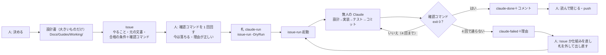

# Issue 駆動の開発 — 全体の整理と再現の手順（常設）

**このプロジェクトの開発は、GitHub の Issue に「何を・どの合格の条件まで」を書き、無人の Claude Code がその合格の条件を機械の判定で満たすまで進める形で回す。** この文書は、その形の全体（誰が何をするか・部品・1 件の流れ・どの文書が何の正か）と、別の PC・別の作業場所で同じものを**再現する手順**の正。細部はそれぞれの正の文書に置き、ここには写さない（CLAUDE.md 原則 5）。

元は kaedevn（UE）で 2026-10-13〜21 に形にしたもの。作り上げた過程は `Docs/Reports/2026/10/22/03-issue-driven-history.md`、成功の記録となぜ成功したかは同じ日の `02`。

> [!TIP]
> **初めて読む方へ**: 言葉（Issue・確認コマンド・Stop hook・deny など）はリポジトリの `README.md` の「言葉の説明」にある。この文書は「仕組みの地図」で、1〜5 章で全体、**8 章で使い方**、6〜7 章で別の PC に同じものを作る手順を書いている。実際に 1 件回してみたいだけなら、8 章 → `Docs/Guides/Procedures/issue-goal-setting.md` の 6 章（例）の順に読むとよい。

## 1. 考え方（4 つ）

| # | 考え方 | どこで守るか |
|---|---|---|
| 1 | **合否は機械が決める。** AI の「できました」も人の「良さそう」も合否に使わない。使うのは Issue の確認コマンドの終了コードだけ | `issue-run.ps1`（確認コマンドを実行）・Stop hook・守るファイルの指紋 |
| 2 | **正は文書、Issue は札。** 設計は文書に書き、Issue は「どの文書のどこを、どの合格の条件まで」を指す | `issue-goal-setting.md` 1 章・CLAUDE.md の置き場 |
| 3 | **止まる原因を仕組みで塞ぐ。** 「止まるな」と書くのでなく、止まる原因ごとに設定・hook・スクリプトで塞ぐ | `issue-run.md`「止まらない仕組み」 |
| 4 | **人は決めることと確かめることだけ。** 合格の条件を決め、Issue を書き、終わった後に確かめて閉じる・push する | 下の 2 章 |

## 2. 誰が何をするか

| 誰 | やること | やらないこと |
|---|---|---|
| **人（ユーザー）** | **プロンプトで指示する**（何を作るか・決めること・「作って」「進めて」「コミットして」「pushして」）・Claude Code が書いた設計書と Issue の下書きを読んで了承する・`issue-run.ps1` を起動する・結果を確かめる・ログインやアセットの取り込みなど画面の操作・**入力の文書を `Docs/InSpecs/` に置く**（人が書く文書はここだけ） | 文書を書く（`Docs/InSpecs/` の入力の文書のほかは、全部 Claude Code が書く）・無人の回の途中で答える |
| **対話の Claude Code**（このセッションのような会話） | **文書を全部書く**: 設計書・Issue（合格の条件と確認コマンドを含む）・手順書・記録。確認コマンドを 1 回回して「今は落ちる」を見る・人の「作って」で Issue を作る・`-DryRun`・結果の読み解き・失敗の直し・仕組みの直し | 人の指示なしに Issue を作る・push する・`Docs/InSpecs/` を書き換える |
| **無人の Claude**（`claude -p`・1 件 1 セッション） | Issue を読む → 設計（要れば）→ 実装 → テスト → 判定役に判定させる → コミット → 報告ファイル | 質問・push・Issue への書き込み・直下の CLAUDE.md と `.claude/` の書き換え（deny で断られる） |
| **判定役**（無人の Claude が呼ぶ別のエージェント） | 実行結果のログと差分を読んで、合格の条件ごとに判定を書く | 確認コマンドや Unity を回す・実装する |
| **`issue-run.ps1`** | 起動前の点検・Issue を拾う・守るファイルの指紋・Claude の起動と再開・確認コマンドを 1 回実行・コメントとラベル・まとめ | 判定を上げる・下げる（終了コードをそのまま使う） |

## 3. 部品

| 部品 | 役目 | 正の説明 |
|---|---|---|
| `Scripts/issue-run.ps1` | 無人実行の本体（pwsh 7） | `Docs/Guides/Working/issue-run.md` |
| `.claude/issue-run/prompt.md` | 無人の Claude への指示文 | 同上 |
| `.claude/issue-run/settings.json` | deny 50 個・Stop hook・env（自動更新を止める・時間切れを 90 分に） | 同上 |
| `.claude/issue-run/stop-hook.ps1` | 報告が「合格」で守るファイルが無傷になるまで終わらせない | 同上 |
| `.github/ISSUE_TEMPLATE/claude-run.md` | Issue のひな形 | `Docs/Guides/Procedures/issue-goal-setting.md` |
| `Scripts/unity-test.ps1` | 確認コマンドが呼ぶテストの入口（`Result:` 行・0 件は FAIL・エディタが開いていれば BLOCKED） | `Docs/Guides/Procedures/unity-test-procedure.md` |
| `Scripts/issue-run-doctor.ps1` | 再現の点検（道具・ログイン・origin・ラベル・部品・設定・Unity） | この文書の 6 章 |
| `.claude/skills/design-cycle/` | 回し方（ゴール → 合格の条件 → 設計 → 実装 → テスト → 振り分け → 判定） | そのスキル |
| `.claude/skills/github-issue/` | 会話の中で Issue を作る・見る・回す | そのスキル |
| `Docs/Guides/Decisions/test-plan.md` | 用語・テストレベル・合格基準・中断基準・欠陥管理 | その文書 |

## 4. 1 件の流れ



大きいものは 2 回に分ける（1 回目は設計書を書く Issue → 人が読んで了承 → 2 回目は設計書を「守る」にして実装の Issue）。段は「## 前提」でつなぐ。書き方の細部は `issue-goal-setting.md`。

## 5. どの文書が何の正か

| 知りたいこと | 正 |
|---|---|
| Issue の書き方（ゴール・合格の条件・確認コマンド・守るファイル・例・札を付ける前の確かめ・終わった後の読み方） | `Docs/Guides/Procedures/issue-goal-setting.md` |
| 無人実行の仕組み（止まらない仕組み・ラベル・引数・ログ） | `Docs/Guides/Working/issue-run.md` |
| テストの回し方・結果の読み方 | `Docs/Guides/Procedures/unity-test-procedure.md` |
| 合格基準・欠陥の扱い・中断 | `Docs/Guides/Decisions/test-plan.md` |
| 回し方（設計・実装・テスト・判定） | `.claude/skills/design-cycle/SKILL.md` |
| GitHub（リポジトリ・push） | `Docs/Guides/Working/github-repo.md` |
| 全体と再現 | この文書 |

## 6. 再現（別の PC・別の作業場所で同じものを動かす）

### 6.1 動いたことを確かめた組み合わせ（2026-10-22）

| 道具 | 版 | 入れ方 |
|---|---|---|
| Windows | 11 Home 10.0.26200 | — |
| Claude Code | 2.1.307 | https://code.claude.com の手順 |
| PowerShell 7 | 7.6.7 | `winget install --id Microsoft.PowerShell -e`（ストア形式で入り、`pwsh` は `%LOCALAPPDATA%\Microsoft\WindowsApps\`） |
| Git for Windows | 2.55.0.windows.5 | `winget install --id Git.Git -e` |
| GitHub CLI | 2.103.0 | `winget install --id GitHub.cli -e` |
| Unity | 6000.6.6f1（d20c9ac777da） | Unity Hub（版は `ProjectSettings/ProjectVersion.txt`） |
| 無人の回のモデル | `claude-opus-5-5` | `issue-run.ps1 -Model` の既定（対話の既定に引きずられない） |

この組み合わせで確かめたこと: `unity-test.ps1` が `Result: PASS  EditMode 1/1`・無い名前の `-Filter` で `Result: FAIL  EditMode 0/0`・`issue-run.ps1 -DryRun` が origin から `mkanakureon/KaedeScapeBuii` を読む・`issue-run-doctor.ps1 -RunTests` が `Result: PASS`。**無人の本番の回（`claude -p` の起動）はまだ回していない。** 起動前の点検（認証・Stop hook・deny）は本番の起動のときに `issue-run.ps1` 自身が行う。

### 6.2 ゼロからの手順

1. 道具を入れる（6.1 の表の `winget`）。入れた後は**新しい窓を開く**（古い窓の PATH には入らない）。
2. `gh auth login`。ブラウザが開かなければ、出たコードを https://github.com/login/device に入れる。
3. `git clone https://github.com/mkanakureon/KaedeScapeBuii.git`。Windows のパスの上限（260 字）に当たるなら `git config --global core.longpaths true` を先に（kaedevn の clone で、長い名前の画像が書けず台帳が壊れた）。
4. 無人用の長期トークン: `claude setup-token` → `[Environment]::SetEnvironmentVariable('CLAUDE_CODE_OAUTH_TOKEN','<トークン>','User')` → 新しい窓。
5. Unity Hub で `ProjectVersion.txt` の版を入れ、エディタを閉じたまま `pwsh -NoProfile -File Scripts/unity-test.ps1 -CompileOnly`（最初の取り込みで `Library/` ができる。数分）。
6. `pwsh -NoProfile -File Scripts/issue-run-doctor.ps1 -RunTests` → 最後の行が `Result: PASS`。WARN は 6.3 を見て直す。
7. `pwsh Scripts\issue-run.ps1 -DryRun`。

### 6.3 点検の読み方（`issue-run-doctor.ps1`）

| 出たもの | 意味 | 直し方 |
|---|---|---|
| `NG pwsh` | PowerShell 7 が無い | 6.1 |
| `NG gh の PATH` | 窓が古い | 新しい窓で回す |
| `NG gh のログイン` | ログインしていない・権限 repo が無い | `gh auth login`・`gh auth refresh -s repo` |
| `WARN 長期トークン` | 無人の回が途中で認証切れになることがある | 6.2 の 4 |
| `WARN ラベル` | `claude-run` などがまだ無い | `issue-run.ps1` の最初の実行で作られる。先に Issue に札を付けたいなら `gh label create claude-run` |
| `WARN 作業ツリー` | 未コミットがある | コミットしてから回す（無人の回のコミットと混ざる） |
| `NG 設定` | deny が足りない・裸の `CLAUDE.md` の deny がある・Stop hook が無い | kaedevn の `origin/main` の `.claude/issue-run/settings.json` と比べる（7 章） |
| `NG Unity` | プロジェクトの版のエディタが無い | Unity Hub・環境変数 `UNITY_EXE` |
| `WARN Unity の使用中` | この作業場所をエディタが開いている | 閉じるか、別の worktree で回す |

### 6.4 結果を再現できるようにしておくもの

無人の回は毎回ちがう文章を書くので、**同じ文字の結果**は再現しない。再現するのは「同じ Issue・同じ確認コマンドなら、同じ合否の判定になる」こと。そのために残すもの:

| 残すもの | どこに | なぜ |
|---|---|---|
| Issue の本文（合格の条件・確認コマンド） | GitHub | 判定そのもの。後で直したらコメントに「## 対応」で残す |
| 守るファイルの開始時の指紋・各回の JSON・確認コマンドの出力 | `Logs/IssueRun/<日時>/`（git に入らない） | その回で何が起きたかの証拠。消える前に要るものはまとめに写る |
| まとめ | `Docs/Reports/YYYY/MM/DD/NN-issue-run.md`（git に入る） | 合格・不合格・断られたツール・各 Issue の報告 |
| Issue のコメント | GitHub | 頭の行に `HEAD <sha>`。その版に戻せば同じ確認コマンドをもう一度回せる |
| 仕組みの版 | `Scripts/issue-run.ps1` の頭のコメント（kaedevn のどの版から持ってきたか）・この文書の 6.1 | 仕組みを直すと判定が変わりうる |
| 道具の版 | この文書の 6.1 | Claude Code は勝手に更新される（このセッションの途中でも 2.1.306 → 2.1.307）。無人の回は `DISABLE_AUTOUPDATER=1` で止めている |

## 7. kaedevn との揃え方

仕組みの元は kaedevn。kaedevn で直しが入ったら、Unity 側にも入れる。

1. kaedevn で `git fetch`。**作業フォルダーでなく `origin/main` を見る**（2026-10-22 に手元が 196 コミット遅れていて、古い版を持ってきた）。
2. `git log origin/main --format='%h %ad %s' --date=short -- Scripts/issue-run.ps1 .claude/issue-run Docs/Guides/Working/issue-run.md Docs/Guides/Procedures/issue-goal-setting.md .claude/skills/design-cycle .github/ISSUE_TEMPLATE` で、前に持ってきた版（`issue-run.ps1` の頭のコメントの SHA）より後の直しを見る。
3. `git show origin/main:<パス>`（Git Bash は `MSYS_NO_PATHCONV=1`）で取り出し、Unity 向けの変更（`issue-run.ps1` の頭のコメントの 4 点）を当て直す。
4. `issue-run-doctor.ps1 -RunTests` と `-DryRun` で確かめ、頭のコメントの SHA を書き換えてコミットする。

## 8. 使い方（人がやること）

### 8.1 毎回の流れ

```text
① 決める        何を作るか。方針が決まっていないものは Issue にしない
② 設計書を書く   大きいものだけ（「設計書を書く」Issue にしてもよい）
③ Issue を書く   GitHub の New issue でひな形「Claude に無人で進めさせる」。会話の中なら「イッシュを作って」（github-issue スキル）
④ 試す          確認コマンドを自分で 1 回回して「まだ作っていないから」落ちるのを見る → pwsh Scripts\issue-run.ps1 -DryRun
⑤ 起動          pwsh Scripts\issue-run.ps1   （Unity で開いていない作業場所を選ぶ）
⑥ 確かめる      Docs/Reports/…/NN-issue-run.md と Issue のコメント → 閉じる・push する
```

### 8.2 Issue に書く欄

| 欄 | 書くこと | 必須 |
|---|---|---|
| やること | ゴールを 1 文（誰が・何を見て・どう判断するか）。90 分 × 4 回で終わる大きさ | ○ |
| 元の文書 | 設計書のパスと節 | ○ |
| 合格の条件 | 機械で測れる箇条書き ＋ ```pwsh の確認コマンド（終了コード 0 で合格） | ○ |
| 前提 | 先に済んでいるべき Issue（`- #1`） | 任意 |
| 先に決めておくこと | AI が迷いそうな点 | 任意 |
| やらないこと | 範囲の外（見た目の判定・PlayMode など） | 任意 |

Unity での確認コマンドの最小の形:

```powershell
[Console]::OutputEncoding = [System.Text.Encoding]::UTF8
# 守る: Assets/Tests/EditMode/PlayerMotorTests.cs
pwsh -NoProfile -File Scripts/unity-test.ps1 -Filter 'KaedeScapeBuii.Tests.PlayerMotorTests'
if ($LASTEXITCODE) { exit 1 }
exit 0
```

テストの `.cs` を「守る」に入れるのが Unity での要。入れないと、AI がテストの期待値を実装に合わせて直せてしまう。書き方の細部・例・札を付ける前の確かめは `issue-goal-setting.md`。

### 8.3 会話の中で使うスキル

| 言うこと | 動くスキル |
|---|---|
| 「設計、実装、テストのループで」「合格判定して」 | design-cycle |
| 「イッシュを作って」「イッシュを実行して」 | github-issue |
| 「コミットして」「pushして」「PRを出して」 | commit・push・pr |
| 「レポート書いて」「設計書書いて」 | save-report・document-authoring |
