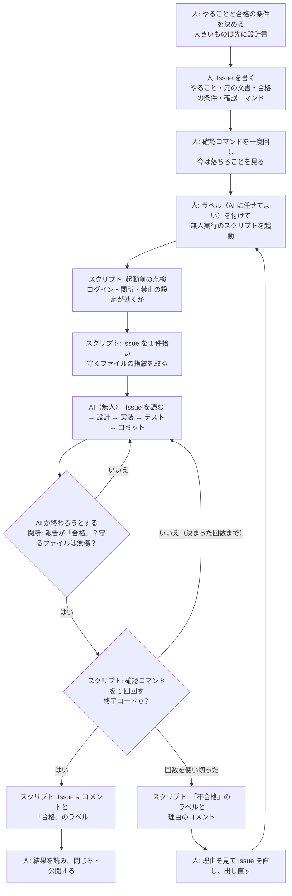
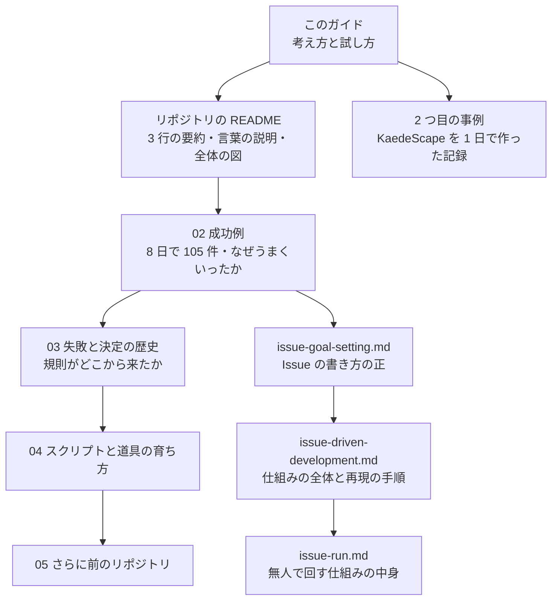

# はじめての Issue 駆動 — 生成AIに「合格するまで」任せる開発の進め方（Web アプリ・業務アプリのチーム向け）

この文書は、Web アプリや業務アプリを作るチームが、生成AIに慣れていなくても、自社の案件で「Issue 駆動」を試せるようにするための説明書です。0〜6 章では、考え方・準備・合格の条件の決め方・確認コマンドの書き方を、7〜12 章では、Issue の書き方・無人で回す仕組み・結果の読み方・自社の案件で試す手順・チームでの運用・よくある失敗を説明します。付録 A〜E には、用語集・Issue のひな形・チェックリスト・よくある質問・このリポジトリの文書の案内を置きます。

> [!NOTE]
> この文書の数字と事実は、このリポジトリの記録から引いています。引いた先は本文の中に「（02 §1.2）」のように書きます。「事例 §4.6」は 2 つ目の事例の読み物 `Docs/Guides/Reading/kaedescape-case-study.md` の節です。02〜05 は `Docs/Reports/2026/10/22/` の下の記録、`issue-goal-setting.md` は `Docs/Guides/Procedures/`、`issue-driven-development.md` は `Docs/Guides/Working/` の文書です。

---

## 0. はじめに

### 0.1 この文書を読む人

この文書は、次の方を思い浮かべて書きました。

- **開発者**: Web アプリ（ブラウザで動く画面と、その裏のサーバー）や業務アプリ（社内の受発注・在庫・勤怠などの仕組み）を作っている方。生成AIを補完や質問には使っているが、「仕事をまるごと任せる」のはまだ怖い、という方を含みます。
- **PM（プロジェクトマネージャー）**: 開発の段取りと品質に責任を持つ方。AI に任せると「本当に終わったのか」が分からなくなるのでは、と心配している方。
- **発注側の方**: 開発を外に頼む側の方。「何をもって完成とするか（検収の基準）」を先に決める立場の方。

生成AIを使った開発に慣れていない方でも読めるように、専門の言葉は初めて出たときに短く説明します。プログラムを書かない方は、2 章・3 章・5 章を中心に読めば、何をする仕組みで、人が何を決めればよいかが分かります。

### 0.2 この文書の読み方

| 知りたいこと | 読む章 | 目安 |
|---|---|---|
| Issue 駆動とは何か | 1 章 | 10 分 |
| なぜわざわざ仕組みにするのか | 2 章 | 10 分 |
| 人と AI と仕組みが、どの順に何をするか | 3 章 | 10 分 |
| 試す前にそろえるもの | 4 章 | 15 分 |
| 「合格の条件」をどう決めるか | 5 章 | 15 分 |
| 「確認コマンド」をどう書くか（例つき） | 6 章 | 20 分 |
| Issue の 1 枚をどう書くか（例つき） | 7 章 | 20 分 |
| 無人で回す仕組みと、自社に移すときに差し替える所 | 8 章 | 15 分 |
| 終わった後の報告の読み方・失敗の直し方 | 9 章 | 15 分 |
| 自社の案件での試し方・やめどき | 10 章 | 15 分 |
| チームでの役割・レビュー・セキュリティ・費用 | 11 章 | 15 分 |
| よくある失敗と対策 | 12 章 | 10 分 |
| 言葉の意味・そのまま写せる Issue のひな形・点検表・よくある質問・次に読む文書 | 付録 A〜E | 必要なときに |

急ぐ方は、1 章の「ひとことで」と、2 章の表、3 章の図だけ見てください。実際に試す方は、4〜7 章を手元のリポジトリを開きながら読み、10 章の手順で始めてください。

この文書でいう**生成AI**は、文章やプログラムを書く AI のことです。元の事例では Anthropic 社の Claude を、パソコンの中でファイルを読み書きしコマンドを実行できる道具 **Claude Code** から使いました。ほかの AI の道具でも考え方は同じですが、手順と設定は Claude Code に合わせて書いています。

### 0.3 作者の経験と、この文書の元になった事例

作者は 1 年以上、生成AIを使って開発をしてきました。その間に多くの試作を作っています。そのうち、2026 年 2 月から始めたリポジトリ（kaedevn-monorepo）は、それより前の試作の経験をもとにしたもので、2026-02〜07 に 2,308 件のコミットを積みました（05 §0）。ここで、終了コード（プログラムが終わるときに返す数。0 が成功）で合否を決める検査や、AI に会話なしで作業させる実験（`claude -p` で 1 章分を exit 0 で完走）を先に試しています（05 §0）。

その上に、2026 年 6 月から別のプロジェクト（kaedevn。ゲームエンジン Unreal Engine を使うゲーム開発）で、Issue 駆動を形にしました。2026-10-14〜21 の 8 日間に、AI に任せる札を付けた Issue 105 件がすべて合格しました。無人の実行は 106 回で、そのうち合格が 95 回、合格した 95 回のうち 94 回は 1 回目の起動で合格し、1 件の時間の中央値は 20 分でした（02 §0・§1.2）。

ただし、この数字は「何もない所から 8 日で出た」ものではありません。数か月かけて積んだテストの入口（178 ファイルの脚本など）の上に流した結果です（02 §3.1・§5.2）。新しいプロジェクトで同じ速さがすぐ出るわけではありません。この点は 2 章と 4 章でもう一度触れます。

元の事例はゲーム開発ですが、仕組みの中心（合格の条件を機械で確かめるまで AI を終わらせない）は、ゲームエンジンに依りません（02 §9.1）。この文書では、ゲームの話は「元の事例」として触れるだけにし、例は Web アプリと業務アプリに寄せます。

**2 つ目の事例（2026-10-22 に追記）。** この文書を書いた日（2026-10-22）のうちに、同じ仕組みを移したこのリポジトリで、撮影ツール KaedeScape を**空のプロジェクトから** 1 日で作りました。基本設計 → 設計書を書かせる Issue → 実装の Issue を段に分ける → EXE → 人が触る → 見直しの段、の順で、Issue 13 件が全部合格し、無人の回は合わせて約 3 時間でした。上で書いた「積んだテストの入口」が無い所からでも、設計書にテストの表を先に書けば、テストと実装を一緒に Issue で作れることを 1 回示しています。詳しくは読み物 `kaedescape-case-study.md` にあります。この文書では「2 つ目の事例」として引きます（事例 §番号）。

### 0.4 この文書で使う主な言葉

| 言葉 | 意味 |
|---|---|
| Issue（イシュー） | GitHub などに置く「やること」の札。1 枚に 1 つの仕事を書く。仕事の依頼票 |
| 合格の条件 | その仕事が終わったと言える条件。**人が先に決める**。検収の基準 |
| 確認コマンド | 合格の条件を機械で確かめる、数行の小さなプログラム。終了コードが 0 なら合格 |
| 無人実行 | 人が見ていない間に、AI が Issue を読んで作業し、確認コマンドが通るまで続けること |
| 判定役 | 作った AI とは別の AI。結果を見て、条件ごとの判定を書く |

ほかの言葉は、出てきたところで説明します。

### 0.5 この文書が約束しないこと

この文書は、元の事例で実際に起きたことと、そこから出来た決まりを説明します。次のことは約束しません。

- **同じ率と速さ。** 元の事例は、1 人の開発者・Windows・PowerShell・日本語の文書という条件での結果です。ほかの人・ほかの環境で同じ率になるかは、まだ分かっていません（02 §5.2）。
- **完全な無人。** 合格しなかった回は、人が Issue や仕組みを直して出し直しています。「人が見て直す」ことも仕組みの一部です（02 §5.2）。
- **正しさ。** 合格は「確認コマンドが通った」ことであり、作った物が正しいことの保証ではありません。5 章の最後でもう一度説明します。

---

## 1. Issue 駆動とは

### 1.1 ひとことで

**Issue 駆動とは、「何が通れば合格か」を人が先に機械で確かめられる形で書き、AI にはそれが通るまで作業を続けさせる進め方**です。

ふつう、AI に「この画面に検索を付けて」と頼むと、AI はそれらしいコードを書いて「できました」と言います。けれど、その「できました」は AI の感想です。本当に動くのか、ほかの画面を壊していないのかは、誰かが確かめるまで分かりません。

Issue 駆動では、頼むときに次の 3 つを Issue に書きます。

1. **やること**: 何を作るか・直すかを 1 文で。
2. **合格の条件**: 終わったと言える状態を箇条書きで。
3. **確認コマンド**: 合格の条件を機械で確かめる数行のプログラム。

AI は Issue を読み、設計・実装・テストを自分で回します。そして、確認コマンドが成功（終了コード 0）にならない限り、作業を終えられません。終わったかどうかを決めるのは AI の言葉ではなく、コマンドの結果です。

### 1.2 たとえで言うと

AI を「腕はいいが、放っておくと早合点する新人」と考えると分かりやすくなります（README の「言葉の説明」と同じたとえです）。

- 新人に「いい感じにしておいて」と頼むと、新人は自分の思う「いい感じ」で止めて報告に来ます。
- そこで、頼むときに**検収の基準**を渡します。「この一覧表のこの欄がこう出たら終わり。出なければ帰らないで続けて」。
- さらに、新人が基準そのものを書き換えられないようにします（検収の基準の紙は、新人の机には置かない）。
- 新人が自分で判断できない所は「元に戻せて、影響が小さいほう」を選ばせ、何を選んだかを報告に書かせます。

Issue 駆動は、この段取りを、GitHub の Issue と、いくつかのスクリプトと、AI の道具の設定で形にしたものです。

### 1.3 「Issue」を使う理由

Issue は、GitHub（プログラムの変更の記録を置くネット上の場所）や、同じような仕組みにある「やることの札」です。多くの開発チームがすでにバグや要望の管理に使っています。

Issue を作業の単位にすると、次のよい点があります。

- **1 枚に 1 つの仕事**なので、AI に渡す範囲がはっきりする。
- **ラベル**（札に付ける色つきの印）で「AI に任せてよい」ものを選べる。元の事例では `claude-run` というラベルを使いました。
- 結果を **Issue のコメント**に残せるので、後から誰でも経緯を読める。
- 本文を書き直せば、次の実行から新しい条件で回る。

元の事例では、Issue の本文の形がそろっていきました。109 件の見出しを数えると、「やること」108・「元の文書」108・「合格の条件」107・「やらないこと」109・「先に決めておくこと」100 件でした（02 §4）。決まった形があるので、書く人も読む AI も迷いません。

### 1.4 人がやること・AI がやること

| 誰 | やること |
|---|---|
| 人 | 何を作るかを決める。合格の条件を決める。Issue を書く。終わった後に結果を確かめ、閉じる・公開する |
| AI | Issue を読む。設計・実装・テストをする。確認コマンドが通るまで直す。報告を書く |
| 仕組み（スクリプト） | Issue を拾って AI を起動する。AI が終わろうとしたら、合格かどうかを確かめる。確認コマンドを回す。結果を Issue に書く |

人の仕事は「始める前」と「終わった後」に集まります。その間は、人が見ていなくても進みます。元の事例では、人がやったのは「何をもって合格とするか」を決める・Issue を書く・終わった後に確かめて閉じる・公開する、だけでした（02 §5.1 ⑨）。

### 1.5 Issue 駆動でないもの

誤解されやすいので、違うものも挙げておきます。

- **AI を賢くする方法ではありません。** AI の腕はそのままで、AI が「できた」と言っても機械の判定が通るまで終われない形を作るものです（02 §0）。
- **人がいらなくなる方法でもありません。** 合格の条件を決めるのは人です。見た目のよさや使い心地のように機械で測れないものは、終わった後に人が判定します。
- **テストを自動で作る道具でもありません。** 確認コマンドの多くは、すでにある自社のテスト（`npm test` や `pytest` など）を呼ぶだけです。テストの入口が先にあるほど、Issue は書きやすくなります。

### 1.6 小さな例

受注の一覧に検索を付ける仕事を、Issue 駆動で頼むと、Issue はおおよそ次の形になります（詳しい書き方は 5〜7 章で説明します）。

- **やること**: 受注の一覧で、顧客名の一部を入れると、その文字を含む受注だけが出るようにする。
- **元の文書**: 受注の画面の設計書の「検索」の節。
- **合格の条件**: 検索のテスト（人が先に書いておく）が通る。既存のテストが全部通る。
- **確認コマンド**: `npm test` と `pytest` を回し、どちらも終了コード 0 なら合格。
- **やらないこと**: 画面の見た目の調整（終わった後に人が見る）。

AI はこの Issue を読み、検索の処理を書き、テストを回し、落ちれば直します。両方のテストが通るまで、「できました」と言っても終われません。

---

## 2. なぜ要るか（AI に任せたときの困りごと）

### 2.1 AI に任せると何が起きるか

生成AIに開発の仕事を任せると、次のような困りごとが起きます。どれも元の事例で実際に起き、ひとつずつ仕組みで塞いできたものです（README の「なぜこの仕組みが要るか」）。

| 困りごと | 何が起きるか | 仕組みでの防ぎ方 |
|---|---|---|
| **早すぎる「できた」** | テストが 1 つ通っただけ、あるいは何も確かめずに「完了しました」と言う | 合格の条件を確認コマンドで書き、それが成功するまで終わらせない |
| **テストを書き換える** | 実装を直す代わりに、テストの期待値を実装に合わせて変えてしまう | 確認コマンドが使うファイルを「守るファイル」にし、中身が変わっていたら合格にしない |
| **途中で止まる** | 区切りのいい所で返事を終える。人がいないとそこで仕事が止まる | 終わろうとしたら関所（Stop hook）が押し返す。止まってもスクリプトが同じ会話を再開する |
| **質問して待つ** | 「A と B のどちらにしますか？」と聞き、誰も答えないので止まる | 質問の道具を取り上げる。決まっていない点は「元に戻せて範囲が小さいほう」を自分で選ばせ、選んだことを報告に書かせる |
| **危ない操作** | ファイルの削除・公開（push）・規則の書き換え | 設定で必ず断る（deny）。公開は人がやる |
| **作った本人が甘く判定する** | 直した所ばかり見て「良くなった」と言う | 判定は別の AI（判定役）にさせる |
| **見つけたものを全部直そうとする** | 本題と関係のない改善を始め、終わらない | 支障のあるものだけ直し、ほかは報告に 1 行残す |

### 2.2 一番大きいのは「早すぎる完了宣言」

この中で一番大きいのは、最初の「早すぎる『できた』」です。AI の道具を作っている Anthropic 社も、長い時間動く AI の一番の失敗として、まだ終わっていないのに勝ったと宣言してしまうこと（早すぎる勝利宣言）を挙げています（README・02 §5.1 ①）。

Web アプリで言えば、たとえば次のような形で起きます。

- 一覧の画面に検索を付けたが、サーバー側の絞り込みは書いておらず、画面だけ検索窓が出ている。AI は「検索を追加しました」と言う。
- 金額の計算を直したが、税の端数の扱いが別の画面と食い違っている。AI は自分が直した画面のテストだけ回して「すべて通りました」と言う。
- 帳票の出力を足したが、既存の帳票のテストが落ちている。AI はそのテストを回していない。

どれも、AI に悪気はありません。頼まれた範囲を、自分の見える所まで確かめて報告しているだけです。だからこそ、**終わりの判定を AI の言葉に任せない**ことが要になります。

### 2.3 「止まるな」と書くだけでは足りない

困りごとへの最初の対策は、たいてい AI への指示文に書くことです。「必ずテストを回してから完了と言ってください」「質問せずに進めてください」。これは一定の効果がありますが、保証にはなりません。

元の事例では、指示ではなく仕組みで塞ぐ形に変えていきました。

- 区切りで返事を終える → 関所（Stop hook。AI が「終わります」と言ったときに呼ばれ、合格していなければ帰さない）と、会話の再開の 2 段。
- 質問する → 質問の道具そのものを使えなくする。
- 承認の要る操作をする → 設定で断り、代わりのやり方を指示文に書いておく。

そのうえで、AI を起動する前に、関所と禁止の設定が本当に効いているかを点検してから始めます（02 §5.1 ②）。設定が壊れていると、AI の道具がそれを黙って無視することがあるためです。

### 2.4 失敗から規則ができた経緯

この仕組みは、1 日で思いついたものではありません。仕組みを形にした 2026-10-14 までの 2 か月あまりに、次のような失敗がありました（03 §0〜§2）。

- 2026-08-17 に、検査を回して直すループを 35 コミット回しても終わらなかった。検査を増やすと合格の線が動き、いつまでも収束しなかったためです。
- 2026-09-08〜22 に、AI に試させて直すループを 21 回回しても終わらなかった。判定のプログラムはすべて合格を出していたのに、AI の感想を根拠に不合格として扱い続けたためです。記録には「改善が無駄だったのではない。それを21回の試行で見つけたことが無駄だった」とあります。
- 2026-10-13 に、画面の見た目を確かめる作業で、作った本人の AI の判定は「劣る所 0 か所」、別の判定役の AI は「劣る所 15 か所」でした。

ここから「終わりのある合格の定義」「合否はスクリプトの出力だけで決める」「感想で合否を上書きしない」「見つけたものを自動で仕事にしない」「判定は作った本人がしない」という規則ができ、Issue 駆動の部品になりました。

### 2.5 チームにとっての意味

この困りごとは、AI でなく人の新人に頼んだときにも起きるものです。違うのは、AI は**速く、たくさん、休まず**作業することです。そのぶん、確かめの仕組みが無いと、確かめていない「できました」が速く、たくさん積み上がります。

逆に言えば、合格の条件を先に決め、機械で確かめる形さえ作れば、AI の速さをそのまま使えます。元の事例では、利用の上限や禁止の設定の事故が直った後の 2 日間（54 件）は、合格しなかった回が 0 でした（02 §5.1 ⑧）。

PM や発注側の方にとっては、**検収の基準を先に文字にする**習慣そのものが、AI を使うかどうかに関係なく役に立ちます。Issue 駆動は、その基準を「機械が読める形」まで落とすことを求めるだけです。

---

## 3. 全体の流れ

### 3.1 1 件の Issue が合格するまで

1 件の Issue が、書かれてから閉じられるまでの流れを図にします（README の「全体の流れ」を、チーム向けに言葉を直したものです）。



### 3.2 段ごとの説明

**① 決める（人）**

何を作るか、どこまでできたら終わりかを決めます。小さい仕事（バグを 1 つ直す・文言を直す）なら Issue だけで足ります。大きい仕事（新しい画面・仕組みの変更）は、先に「設計書を書く」Issue を回し、人が読んで了承してから「実装する」Issue を回す、の 2 回に分けます（issue-goal-setting.md §1）。設計の良し悪しは、人が読まないと決まらないからです。

**② Issue を書く（人）**

やること・元の文書・合格の条件・確認コマンドを書きます。書き方は 5 章と 6 章、1 枚にまとめる書き方は 7 章で説明します。

**③ 確認コマンドを一度回す（人）**

ラベルを付ける前に、確認コマンドを自分で一度回し、**今は落ちる**ことと、**落ちる理由が「まだ作っていないから」**であることを見ます。最初から通るなら、ゴールが書けていません。確認コマンドそのものの誤りで落ちるなら、AI がどう直しても通りません（元の事例 #10・#38。02 §1.3）。

**④ 起動（人）**

ラベルを付け、無人実行のスクリプトを起動します。元の事例では夜や、人が別の作業をしている間に回しました。

**⑤ 起動前の点検（スクリプト）**

AI の道具にログインできているか、関所と禁止の設定が本当に効くかを確かめてから始めます。

**⑥ 守るファイルの指紋を取る（スクリプト）**

確認コマンドが使うファイル（テストのファイルなど）の中身から**指紋**（SHA256 というハッシュ。中身が 1 文字でも変わると別の値になる）を取ります。終わったときに指紋が違えば、合格にしません。AI がテストを書き換えて通すことを防ぐためです。

**⑦ 作業（AI）**

AI は Issue を読み、元の文書を読み、設計・実装・テストを回します。区切りごとにコミット（Git に変更を記録すること）をします。決まっていない点は自分で選び、報告に書きます。

**⑧ 関所（Stop hook）**

AI が「終わります」と言うと関所が呼ばれ、報告ファイルの 1 行目が「合格」か、守るファイルが無傷かを見ます。満たしていなければ押し返し、AI は作業を続けます。

**⑨ 確認コマンド（スクリプト）**

関所を通ると、スクリプトが確認コマンドを**実際に 1 回**回します。終了コードが 0 なら合格です。落ちたら、その出力を付けて同じ会話を再開します。元の事例では、1 回 90 分 × 最大 4 回まででした（README）。

**⑩ 結果（スクリプト → 人）**

合格なら Issue に報告のコメントと「合格」のラベルを付けます。回数を使い切ったら「不合格」のラベルと理由を付けます。人はそれを読み、合格なら閉じて公開し、不合格なら理由を見て Issue を直して出し直します。

### 3.3 合格は 3 つがそろったときだけ

まとめると、合格になるのは次の 3 つがそろったときだけです（02 §5.1 ①）。

1. AI が書いた報告ファイルの 1 行目が「## 結果: 合格」。
2. 守るファイルの中身が、始めたときのまま（指紋が同じ）。
3. Issue の確認コマンドを**スクリプトが実際に実行して**、終了コードが 0。

1 だけなら AI の自己申告です。2 と 3 があるので、自己申告だけでは通りません。元の事例では、合格しなかった 11 回のうち、AI が満たしていないのに「合格」と書いて通ったものは 0 回でした（02 §5.1 ①）。

### 3.4 いくつもの Issue を順に回す

大きな仕事は段に分け、2 段目から先の Issue に「前提」として前の段を書いておきます。番号の小さい順に回るので、1 段目が合格すると同じ実行の中で 2 段目が始まります（issue-goal-setting.md §5.2）。途中で 1 件つまずいても、後ろの段は前提待ちで止まるだけで、壊れた土台の上に積み上がることはありません。

元の事例では、確認の重い段が約 1 時間、軽い段が約 30 分で、7〜8 時間なら 6〜8 件、数時間なら 2〜3 件を積む目安でした（issue-goal-setting.md §5.1）。1 回の起動で 21 件が合格した回もあります（02 §1.2）。

---

## 4. 始める前の準備（道具・リポジトリ・権限・安全）

### 4.1 道具

元の事例で使った道具は次のとおりです（issue-driven-development.md §6.1）。いまの仕組みは Windows と PowerShell を前提にしています。Mac や Linux で動かすには分ける作業が要ります（02 §9.5）。

| 道具 | 何に使うか |
|---|---|
| Claude Code | AI がファイルを読み書きし、コマンドを実行する道具。会話なしで 1 回動かす起動方法（`claude -p`）を無人実行に使う |
| PowerShell 7（`pwsh`） | 無人実行のスクリプトと確認コマンドを書く言葉 |
| Git | 変更の記録。AI の変更をいつでも戻せるようにする |
| GitHub と GitHub CLI（`gh`） | Issue を置く場所と、それをコマンドで読み書きする道具 |
| 自社のテストの道具 | `npm test`・`pytest` など。確認コマンドから呼ぶ |

無人で長く回すときは、途中で認証が切れないように、無人用の長期のトークン（ログインの代わりになる合いことば）を用意します（issue-driven-development.md §6.2）。元の事例でも、無人の認証が切れていて始まらなかった Issue が 1 件ありました（02 §1.2 の #9）。

### 4.2 リポジトリ

**テストの入口を先に用意します。** これが準備の中で一番大事で、一番時間がかかる所です。

元の事例の成功の理由の 1 つは、「1 コマンドで回り、最後の 1 行で合否が分かる」テストの入口が、数か月かけて積んであったことでした（02 §5.1 ④）。確認コマンドは既存の入口を呼び、数行を足すだけで済みました。逆に、この入口が薄いプロジェクトでは、Issue ごとに確かめ方を一から書くことになり、同じ速さは出ません（02 §5.2・§6）。

Web アプリ・業務アプリで言えば、次のようなものが「入口」になります。

| 確かめたいこと | 入口の例（自社のコマンドに置き換える） |
|---|---|
| 画面の部品・関数の単体テスト | `npm test` |
| サーバーの処理・業務ロジックのテスト | `pytest` |
| 型やコードの書き方の検査 | `npm run lint`・`npm run typecheck` など |
| 組み立て（ビルド）が通るか | `npm run build` など |
| 起動したサーバーが答えるか | `curl` で決まった URL を呼ぶ |

大事なのは次の 3 点です（02 §3.3 の型）。

1. **1 コマンドで回る。** AI が迷わずに呼べる。
2. **終了コードで合否が分かる。** 成功なら 0、失敗なら 0 以外。画面の文字を読まなくても判定できる。
3. **速い。** 何分もかかる確かめは、最後の段だけにする。元の事例では、毎回の確かめを重い組み立てから軽い CLI に変えたことで 1 件の時間が縮みました（02 §5.1 ④・04 §0）。

もう 1 つ、**業務ロジックを画面やデータベースから切り離しておく**と、速く確かめられます。元の事例でも、ゲームの中身をゲームエンジンから切り離し、エンジンを起動せずに数秒〜数分でテストできるようにしていました（02 §3.3）。Web アプリなら、金額の計算や状態の移り変わりを、画面やデータベースにつながない関数として書いておく、ということです。

### 4.3 文書の置き場

AI が「どれが正しい情報か」で迷わないように、文書の置き場を決めておきます。元の事例では、次のように分けていました（このリポジトリの CLAUDE.md の「置き場」）。

| 置き場 | 置くもの |
|---|---|
| 作業中に参照する文書 | 仕組み・設計の正。実装を変えたらここを更新する |
| 手順書 | 作業の順番と通過条件 |
| 決定 | 方針と決定。変わったらここを更新する |
| 記録 | その日の記録。後から書き換えない |

Issue は「どの文書のどこを、どの合格の条件まで」を指す札で、設計そのものは書きません（02 §4）。一つの決まりごとは一か所にだけ書きます。同じことが二か所に書いてあると、AI はどちらかを選ぶしかなく、それが食い違いの元になります。

### 4.4 権限

AI に渡す権限は、**狭めるだけで広げない**のが基本です。元の事例では、次の操作を設定（deny）で必ず断りました（`.claude/issue-run/settings.json`）。

- 人への質問（無人なので誰も答えない）
- 公開（`git push`）・ブランチの切り替え・履歴の書き換え
- Issue へのコメント・ラベル・閉じる（スクリプトと人がやる）
- ファイルの削除（`rm` など。Git が追跡しているものは `git rm` で戻せる形にさせる）
- プロジェクトの規則のファイルと、AI の設定そのものの書き換え

断られた操作の代わりのやり方（たとえば削除の代わりに `git rm`）を指示文に書いておくと、AI はそこで止まらずに進めます。

注意点もあります。禁止の範囲を広く書きすぎると、作る物の中にある同じ名前のファイルまで書けなくなります。元の事例では、規則のファイルを「どの深さでも」禁止にしていたため、製品のひな形の中にある同じ名前のファイルが書けず、5 回が合格しませんでした。リポジトリの一番上だけに効く形に直して解決しています（02 §1.3）。

### 4.5 安全

AI に作業させる場所と、人が作業する場所を分けます。

- **作業の場所を分ける。** 元の事例では Git の worktree（同じリポジトリを別のフォルダーにもう一つ展開したもの）を使い、人と AI が同じファイルを取り合わないようにしました。
- **公開は人がやる。** AI のコミットは手元に残り、人が結果を確かめてから公開（push）します。間違っていれば、Git で戻せます。
- **本番の環境に触らせない。** 本番のデータベースや、お客様の情報に届く鍵を、AI の作業場所に置かない。確かめは手元のテスト用の環境でします。本番への配備のように人が手でやるものは、Issue にしてもよいですが、AI に任せる札は付けません（issue-goal-setting.md §5.2）。
- **費用と上限を見る。** 長く回すと、AI のサービスの利用上限に当たることがあります。元の事例では、上限の知らせを見分けられず、残りの回数を 0 分で使い切った事故が 5 回ありました（02 §1.3）。

### 4.6 準備の点検表

- [ ] 道具（AI の道具・Git・GitHub CLI・PowerShell 7）が入り、ログインできる
- [ ] 無人用の長期のトークンを用意した
- [ ] テストの入口が 1 コマンドで回り、終了コードで合否が分かる
- [ ] 設計・手順・決定・記録の置き場が決まっている
- [ ] 禁止の設定が効くことを、起動前の点検で確かめた
- [ ] AI の作業場所が人の作業場所と分かれていて、本番の鍵が置かれていない

---

## 5. 合格の条件の決め方

### 5.1 ゴールを 1 文で書く

合格の条件を書く前に、ゴール（やること）を 1 文で書きます。「誰が・何を見て・どう判断するか」まで書くと、条件が自然に決まります（issue-goal-setting.md §2）。

| 悪い | 良い |
|---|---|
| 検索を付ける | 受注の一覧で、顧客名の一部を入れると、その文字を含む受注だけが出る |
| テストを強くする | 金額の計算のテストが、端数の切り捨てと切り上げの両方を確かめる |
| 画面を使いやすくする | （無人には向かない。人が触って決める） |

「使いやすく」「きれいに」のように、人の感じ方で決まるものは、無人の Issue のゴールにしません。後で説明するように、機械で測れない条件を入れると、AI は自分で「合格」と書くしかなくなるからです。

### 5.2 良い合格の条件の 3 つの要素

Anthropic 社の公式の文書は、良い完了の条件に次の 3 つを挙げています（issue-goal-setting.md §3.1）。

1. **測れる終わりの状態が 1 つ** — テストの結果・終了コード・件数・ファイルがあるか。
2. **確かめ方** — どのコマンドで、何が出たら合格か。
3. **途中で変えてはいけないもの** — テスト・既存のデータ・ほかの機能。

受注の一覧の検索の例で書くと、次のようになります。

- 終わりの状態: 検索のテスト（新しく書いたもの）と、既存のテストが全部通る。
- 確かめ方: `npm test` と `pytest` が両方とも終了コード 0。
- 変えてはいけないもの: 既存のテストのファイル・受注のデータの形。

### 5.3 入れてよい条件・入れない条件

合格の条件には、**機械で測れるものだけ**を入れます（issue-goal-setting.md §3.2）。

| 種類 | 例 | 無人の Issue では |
|---|---|---|
| 機械（コマンドで合否が出る） | テストが通る・組み立てが通る・決まった URL が 200 を返す・文書に決まった節がそろっている | 合格の条件に入れ、確認コマンドで全部確かめる |
| AI の判定 | 手本の画面と並べて、見た目が同じか | 合格の条件に入れない。「判定役にさせて報告に書く（合否には入れない）」と書く |
| 人の判定（実感） | 使いやすいか・読みやすいか・お客様が納得するか | 合格の条件に入れない。終わった後に人がやる |

機械で測れない条件を入れると、AI は自分の感想で「合格」と書くしかなくなります。それが、2 章で説明した「早すぎる勝利宣言」そのものです。

見た目や使い心地を確かめたいときは、「画面の撮影と記録まで。判定はしない」と「やらないこと」に書き、終わった後に人が見ます。AI の判定を参考にしたいときは、判定役にさせて報告に書かせ、合否には入れません。

### 5.4 箇条書きと確認コマンドを 1 対 1 にする

合格の条件の箇条書きの 1 行ずつが、確認コマンドのどこかで確かめられるようにします。確かめられない行は書きません（書くなら「やらないこと」へ）（issue-goal-setting.md §3.3）。

よくある失敗は、箇条書きに「既存の機能を壊さない」と書いたのに、確認コマンドでは新しいテストしか回していない、という形です。この場合、AI は新しいテストだけ通して合格になります。「既存の機能を壊さない」を確かめたいなら、確認コマンドで既存のテストも全部回します。

### 5.5 大きさを決める

1 つの Issue で確かめる「終わりの状態」は 1 つか 2 つにします（issue-goal-setting.md §5.1）。「設計書の 4 章を全部」ではなく「4.2 節だけ」のように切ります。

元の事例では、1 件は 90 分 × 4 回で終わる大きさにしていました（02 §5.1 ③）。結果として、合格までの時間の中央値は 20 分でした。回数を使い切って合格しない Issue は、たいてい大きすぎます。そのときは分けて出し直します。

大きいものは、次の 2 回に分けます（issue-goal-setting.md §1）。

1. **設計書を書く Issue**: 合格の条件は「設計書があり、決まった節（ゴール・合格の条件・確認コマンドの案・テストの名前の一覧）がそろっている」。
2. 人が設計書を読んで直し、了承する。
3. **実装する Issue**: 設計書を「守るファイル」にして、設計書のとおりに作る。合格の条件は設計書に書いた確認コマンド。

設計書を守るファイルにしておくと、AI は実装の都合で設計を書き換えられません。設計を変えたくなったら合格にならず、理由が報告に残ります。設計の直しは人が決めます。

### 5.6 先に決めておくこと

AI が迷いそうな点は、「先に決めておくこと」に書きます。たとえば、日付の表示の形・エラーのときの文言・どのライブラリを使うか、などです。書かなかった点は、AI が「元に戻せて範囲が小さいほう」を選び、報告の「選んだこと」に戻し方と一緒に書きます（02 §5.1 ⑥）。

人は報告の全部を読まなくても、「選んだこと」だけ見て、違っていれば戻せます。違っていたら、「先に決めておくこと」に正しい決定を書き足して出し直します。

### 5.7 発注側・PM の方へ

合格の条件は、受託開発の**検収の基準**とほぼ同じものです。違いは、それを機械が読める形まで落とすことだけです。

発注側の方が「何ができていれば受け取るか」を箇条書きにし、開発者がそれを確認コマンドに直す、という分担もできます。箇条書きと確認コマンドが 1 対 1 になっていれば、発注側の方は確認コマンドの中身を読まなくても、箇条書きの各行が機械で確かめられていることを信頼できます。

ただし、「合格」は「確認コマンドが通った」であって、「正しい」ではありません（02 §5.2）。確認コマンドが弱ければ、弱いまま合格します。条件を書く人の目が、そのまま品質の上限になります。

---

## 6. 確認コマンドの書き方（Web アプリと業務アプリの例）

### 6.1 確認コマンドとは

確認コマンドは、Issue の「合格の条件」の中に書く、数行の小さなプログラムです。リポジトリの一番上のフォルダーで実行され、**終了コードが 0 なら合格**です（issue-goal-setting.md §4）。元の事例では PowerShell 7 で書き、Issue の本文に `pwsh` のコードブロックとして置きました。

確認コマンドを書くときは、**確認コマンドがゴールそのものになる**と思って書きます。無人の AI は、確認コマンドが通るまで終われません。逆に言えば、確認コマンドが通れば終わります。確認コマンドに書き忘れたことは、確かめられません。

以下の例のコマンド（`npm test`・`pytest`・`curl` など）は一般的な形です。**自社のコマンド・パス・URL に置き換えて**使ってください。

### 6.2 基本の形

```pwsh
[Console]::OutputEncoding = [System.Text.Encoding]::UTF8

npm test
if ($LASTEXITCODE) { Write-Host 'npm test が落ちた'; exit 1 }

pytest
if ($LASTEXITCODE) { Write-Host 'pytest が落ちた'; exit 1 }

exit 0
```

押さえる点は次のとおりです（issue-goal-setting.md §4.2）。

- **先頭で出力の文字コードを UTF-8 にする。** 日本語の Windows では、そのままだと出力が化けて、判定を読み違えることがあります。元の事例の Issue はほぼ全部これで始まります（02 §8）。
- **1 つ呼ぶごとに終了コードを見る。** `$LASTEXITCODE` が 0 以外なら、すぐに `exit 1` で終えます。見ないと、前のコマンドが落ちていても最後のコマンドの結果で合格になってしまいます。
- **落ちたときは理由を出す。** `Write-Host` で書いた理由が AI に渡り、次に何を直すかの手がかりになります。
- **最後は `exit 0`。**

### 6.3 Web アプリの例

**例 1: 画面とサーバーのテストと、組み立て**

```pwsh
[Console]::OutputEncoding = [System.Text.Encoding]::UTF8
# 守る: tests/test_order_search.py
# 守る: web/src/orders/OrderSearch.test.ts

Push-Location web
npm test
$code = $LASTEXITCODE
if (-not $code) { npm run build; $code = $LASTEXITCODE }
Pop-Location
if ($code) { Write-Host '画面のテストか組み立てが落ちた'; exit 1 }

pytest tests/test_order_search.py
if ($LASTEXITCODE) { Write-Host '検索のテストが落ちた'; exit 1 }

pytest
if ($LASTEXITCODE) { Write-Host '既存のテストが落ちた'; exit 1 }

exit 0
```

`# 守る:` の行は、元の事例の仕組みで「このファイルは変えさせない」という印です。検索のテストを人が先に書いてコミットし、守るファイルにしておけば、AI はテストでなく実装の側を直すしかありません。

**例 2: 起動したサーバーが答えるか**

```pwsh
[Console]::OutputEncoding = [System.Text.Encoding]::UTF8
# サーバーは手元のテスト用の設定で起動しておく前提（起動のしかたは自社のものに置き換える）
$code = curl.exe -s -o NUL -w '%{http_code}' 'http://localhost:8000/api/orders?customer=test'
if ($code -ne '200') { Write-Host "検索の API が $code を返した（200 を期待）"; exit 1 }
exit 0
```

サーバーを起動して確かめる形は、起動の失敗や待ち時間で不安定になりがちです。できれば、例 1 のように**サーバーを起動しないテスト**（API の処理を直接呼ぶテスト）で確かめ、起動して確かめるのは最後の段だけにします。

### 6.4 業務アプリの例

**例 3: 金額の計算を直す（直す前と結果が変わらないことも見る）**

業務アプリでは、「直した所は変わり、ほかは前と同じ」を確かめたい場面がよくあります。元の事例では、Issue を書いた時点の版のファイルを `git show <版>:<パス>` で取り出し、同じ入力で回して比べていました（issue-goal-setting.md §4.2）。

```pwsh
[Console]::OutputEncoding = [System.Text.Encoding]::UTF8
# 守る: tests/test_tax_rounding.py
# 守る: tests/fixtures/invoices_before.json

pytest tests/test_tax_rounding.py
if ($LASTEXITCODE) { Write-Host '端数の扱いのテストが落ちた'; exit 1 }

# 端数の扱い以外の請求書は、直す前の出力（人が先に残したもの）と同じであること
$out = Join-Path $env:TEMP "invoice-check-$(Get-Random)"
New-Item -ItemType Directory $out | Out-Null
python -m billing.export --input tests/fixtures/invoices.csv --output "$out/after.json"
if ($LASTEXITCODE) { Write-Host '請求書の出力が失敗した'; exit 1 }
$before = Get-Content tests/fixtures/invoices_before.json -Raw
$after = Get-Content "$out/after.json" -Raw
if ($before -ne $after) { Write-Host '端数の扱い以外の請求書の出力が変わった'; exit 1 }

pytest
if ($LASTEXITCODE) { Write-Host '既存のテストが落ちた'; exit 1 }
exit 0
```

試しに作る出力は、`$env:TEMP`（一時フォルダー）の下に乱数つきのフォルダーを作って置きます。Git が管理しているファイルを汚さないためです（02 §8）。

**例 4: 文書だけの仕事**

設計書や手順書を書かせる Issue でも、確認コマンドで「決まった節がそろっているか」を確かめられます。

```pwsh
[Console]::OutputEncoding = [System.Text.Encoding]::UTF8
# 書かせる文書は変数で指す（そのまま書くと守るファイルになって書けない）
$dir = 'docs/design'; $d = "$dir/order-search-design.md"
if (-not (Test-Path $d)) { Write-Host "まだ無い: $d"; exit 1 }
$t = Get-Content $d -Raw -Encoding utf8
foreach ($h in '## 0. ゴールと合格の条件', '確認コマンド', 'テストの名前') {
    if ($t -notmatch [regex]::Escape($h)) { Write-Host "無い: $h"; exit 1 }
}
if (git status --porcelain -- src tests) { Write-Host 'コードを変えている（文書だけの Issue）'; exit 1 }
exit 0
```

最後の行は、「文書だけの Issue なのに、コードのフォルダーを変えていないか」を見ています。守るファイルはファイル単位でしか効かないので、フォルダーごと変えさせたくないときは `git status --porcelain -- <フォルダー>` で見ます（02 §8）。

### 6.5 守るファイルと、直させるファイル

元の事例の仕組みでは、**確認コマンドに出てくる、Git が管理しているファイルは、自動で守られます**（issue-goal-setting.md §4.4）。始めたときから中身が変わっていたら、合格になりません。確認コマンドで使わないが守りたいファイルは、`# 守る: <パス>` の行で足します。

ここに落とし穴が 2 つあります（02 §8）。

| 落とし穴 | 何が起きるか | 避け方 |
|---|---|---|
| 直させたいファイルのパスを、確認コマンドにそのまま書く | 自動で守られ、AI が書けなくなる | 例 4 のように変数を通して指す |
| 直す必要のある記述があるファイルを「守る」に入れる | 直しても直さなくても合格しない | 作業で直すファイルは守らない。元の事例 #7 は 4 回とも合格できなかった |

テストのファイルは、基本的に守ります。守らないと、AI がテストの期待値を実装に合わせて書き換えて通せてしまいます。テストそのものを書かせる Issue では、テストを守らずに、「既存のテストを消さない・弱めない」を条件にして、テストの件数を確認コマンドで見ます（issue-goal-setting.md §4.4）。

### 6.6 確認コマンドを書いたら、自分で一度回す

ラベルを付ける前に、確認コマンドを**自分で一度回します**（issue-goal-setting.md §7）。見るのは次の 2 つです。

1. **今は落ちる。** まだ作っていないのだから、落ちるのが正しい。最初から通るなら、ゴールが書けていません。
2. **落ちる理由が「まだ作っていないから」になっている。** `Write-Host` の理由を読みます。確認コマンドそのものの誤り（パスの書き間違い・必ず当たる判定）で落ちていないかを見ます。

元の事例では、判定の 1 行が出力先のパスに必ず当たってしまう誤りと、試しに作るデータが空で必ず誤りを出す誤りの 2 件が、4 回の実行を使い切りました。どちらも Issue の本文を直して出し直しています（02 §1.3）。AI に渡す前の数分の確かめで、数時間の空回りを防げます。

**ただし、これだけでは最初に落ちる行より後ろが試されていません。** 2 つ目の事例では、確認コマンドの後ろの方の 1 行に誤り（変数が空になり、必ず「ファイルが無い」と判定する）がありました。試したときは前の行（「まだ作っていない」）で落ちていたので気づけず、実装もテストも全部正しいのに 4 回とも落ちました（事例 §5）。そこで、**通る形の偽の状態**（全部が通った形の偽のテスト結果・偽の説明書など）を作って、確認コマンドを後ろまで 1 段ずつ回します（事例 §4.6）。

| 状態 | 落ちてほしい所 |
|---|---|
| いまのまま | 最初の条件（例: 「テストが無い」） |
| 偽のテスト結果を入れる | 次の条件（例: 「古いコードが残っている」） |
| それも飛ばす | その次（例: 「説明書に新しい言葉が無い」） |
| 全部を偽にする | 最後まで届いて exit 0 になる |

### 6.7 確認コマンドを書くときの点検表

- [ ] 先頭で出力の文字コードを UTF-8 にしている
- [ ] 呼んだコマンドごとに終了コードを見ている
- [ ] 落ちたときに理由を `Write-Host` で出している
- [ ] 合格の条件の箇条書きの 1 行ずつを、どこかで確かめている
- [ ] 新しいテストだけでなく、既存のテストも回している
- [ ] 変えさせたくないファイル（特にテスト）を守っている
- [ ] 直させたいファイルを変数で指している
- [ ] 試しに作るものを一時フォルダーに置いている
- [ ] 自分で一度回し、「まだ作っていないから」落ちることを見た
- [ ] 最初に落ちる行より後ろも、通る形の偽の状態で回して、最後まで届くことを見た
- [ ] コマンド・パス・URL を自社のものに置き換えた

---

## 7. Issue の書き方

### 7.1 欄と、それぞれに書くこと

5 章と 6 章で、合格の条件と確認コマンドの決め方を説明しました。この章では、それを Issue の 1 枚にまとめる書き方を説明します。元の事例の Issue のひな形は、次の欄でできています（issue-goal-setting.md §5・リポジトリの `.github/ISSUE_TEMPLATE/claude-run.md`）。

| 欄 | 書くこと | 必須 | 書くときのこつ |
|---|---|---|---|
| タイトル | 何をするかを 1 行 | ○ | 一覧で見て、どの仕事か分かる言葉にする |
| 前提 | 先に済んでいるべき Issue（`- #12` のように） | 任意 | 段に分けた仕事の 2 段目から先に書く。前の段が合格するまで始まらない |
| やること | ゴールを 1 文（誰が・何を見て・どう判断するか） | ○ | 5.1 の「良い」の形。90 分 × 4 回で終わる大きさにする |
| 元の文書 | 設計書・仕様書・画面の定義のパスと節 | ○ | 設計そのものは Issue に書かず、文書を指す（4.3） |
| 合格の条件 | 機械で測れる箇条書き ＋ 確認コマンド | ○ | どちらかが無い Issue は、元の仕組みでは起動しません（issue-run.md「考え方」） |
| 先に決めておくこと | AI が迷いそうな点の答え | 任意 | 書かなかった点は、AI が「元に戻せて範囲が小さいほう」を選びます（5.6） |
| やらないこと | 範囲の外 | 任意 | 見た目の判定・本番への配備・ライブラリの追加など、AI に手を出させたくないもの |
| 次の段 | この後に続く Issue の予定 | 任意 | 仕組みは読みません。後で読む人のための道しるべです（issue-goal-setting.md §5.2） |

元の事例で 109 件の見出しを数えると、「やること」「元の文書」「合格の条件」「やらないこと」はほぼ全部の Issue にあり、「前提」は 41 件、「次の段」は 22 件にありました（02 §4）。必須の欄だけでも動きますが、**「やらないこと」を毎回書く**と、AI が範囲の外に手を広げにくくなります。

### 7.2 大きさの決め方

1 件の大きさは、元の事例では「90 分の起動を最大 4 回で終わる」が上限でした（issue-goal-setting.md §5）。実際の合格までの時間の中央値は 20 分です（02 §1.2）。上限いっぱいの仕事を書くのではなく、**上限の何分の 1 かで終わる仕事**を書くと、失敗しても取り返しやすくなります。

大きさを決めるときの目安は次のとおりです（issue-goal-setting.md §1・§5.1）。

- **確認コマンドで確かめる「終わりの状態」が 1 つか 2 つ。** 3 つ以上あるなら分けます。
- **「設計書の 4 章を全部」ではなく「4.2 節だけ」。**
- **新しい画面・新しい仕組みは 2 回に分ける。** 1 回目は「設計書を書く」Issue、人が読んで了承し、2 回目は設計書を守るファイルにして「実装する」Issue（5.5）。
- **段に分けたら「前提」でつなぐ。** 1 段目が合格すると、同じ実行の中で 2 段目が始まります（3.4）。

### 7.3 例 1: バグ修正（Web アプリ・ログイン画面のバリデーション）

よくある場面です。ログイン画面で、メールアドレスの形が誤っていても送信ボタンが押せてしまい、サーバーで初めてエラーになる、というバグを直します。テスト（画面の部品のテストと、ブラウザを動かす E2E テスト。E2E は End to End の略で、利用者と同じ操作を最初から最後まで通して確かめるテスト）は、人が先に書いてコミットしておきます。

````text
タイトル: ログイン画面で、形の誤ったメールアドレスでも送信できてしまう

## やること
ログイン画面で、メールアドレスの形が誤っているときは送信ボタンが押せず、欄の下にエラーの文言が出るようにする。

## 元の文書
docs/screens/login.md の「入力の検査」の節

## 合格の条件
- 形の誤ったメールアドレスでは送信できず、エラーの文言が出る（LoginForm.test.ts の新しいテスト）
- 正しい形なら、これまでどおり送信できる（e2e/login.spec.ts）
- 既存の画面のテストが全部通る

```pwsh
[Console]::OutputEncoding = [System.Text.Encoding]::UTF8
# 守る: web/src/login/LoginForm.test.ts
# 守る: web/e2e/login.spec.ts
Push-Location web
npm test -- src/login/LoginForm.test.ts
$code = $LASTEXITCODE
if (-not $code) { npx playwright test e2e/login.spec.ts; $code = $LASTEXITCODE }
if (-not $code) { npm test; $code = $LASTEXITCODE }
Pop-Location
if ($code) { Write-Host 'ログインのテストか既存のテストが落ちた'; exit 1 }
exit 0
```

## 先に決めておくこと
- エラーの文言は docs/screens/login.md の表のとおり（新しく作らない）
- 検査は画面とサーバーの両方でする。サーバー側の検査はすでにあるので変えない

## やらないこと
- 画面の見た目の調整（終わった後に人が見る）
- パスワードの欄の検査（別の Issue）
````

見るところは 3 つです。テストの 2 ファイルを `# 守る:` に入れて、AI がテストの期待値を変えて通せないようにしていること。新しいテストだけでなく、最後に `npm test` で既存のテストを全部回していること（5.4）。エラーの文言を「先に決めておくこと」で文書に結び、AI に文言を作らせないこと、です。`npm test -- <ファイル>` のように 1 ファイルだけ回す書き方は、使っているテストの道具によって違うので、**自社のコマンドに置き換えて**ください。

### 7.4 例 2: API の追加（Web アプリ・一覧 API にページ送りを足す）

受注の一覧を返す API が全件を一度に返していて、件数が増えると遅くなる、という場面です。`page` と `per_page` を受け取り、決まった件数ずつ返すようにします。

````text
タイトル: 受注の一覧 API にページ送りを足す

## 前提
- #21（ページ送りの仕様を設計書に書く Issue）

## やること
受注の一覧 API が page と per_page を受け取り、その範囲の受注と全体の件数を返すようにする。

## 元の文書
docs/api/orders.md の「一覧」の節（#21 で書いたページ送りの仕様）

## 合格の条件
- page・per_page を付けると、その範囲だけが返り、全体の件数が付く（tests/api/test_orders_paging.py）
- 付けないときは、これまでと同じ形で返る（既存のテスト）
- 範囲の外の page では、空の一覧と全体の件数が返る（同じテストのファイル）

```pwsh
[Console]::OutputEncoding = [System.Text.Encoding]::UTF8
# 守る: tests/api/test_orders_paging.py
# 守る: docs/api/orders.md
pytest tests/api/test_orders_paging.py
if ($LASTEXITCODE) { Write-Host 'ページ送りのテストが落ちた'; exit 1 }
pytest
if ($LASTEXITCODE) { Write-Host '既存のテストが落ちた'; exit 1 }
exit 0
```

## 先に決めておくこと
- per_page の既定と上限は docs/api/orders.md のとおり
- データベースの表の形は変えない

## やらないこと
- 画面の側のページ送り（次の段の Issue）
- 起動したサーバーでの確かめ（終わった後に人が curl で見る）
````

ここでは、設計書（`docs/api/orders.md`）を守るファイルにしています。前の段で人が了承した仕様を、AI が実装の都合で書き換えられないようにするためです（5.5）。

起動したサーバーを `curl` で呼んで確かめたいときは、6.3 の例 2 のように HTTP の状態の番号を見るか、`curl` の `-f`（`--fail`）を使います。`-f` を付けると、サーバーが 400 番台・500 番台を返したときに `curl` 自身が 0 以外の終了コード（22）で終わるので、`$LASTEXITCODE` で合否を見られます。付けないと、エラーの頁が返っても `curl` は 0 で終わることがあるので注意してください。

### 7.5 例 3: 画面や帳票の改修（業務アプリ・月次の CSV に列を足す）

経理の担当者が毎月取り出す売上の CSV に、「担当部署」の列を足してほしい、という依頼です。帳票の改修は、**足した列のほかは前と同じ**であることが大事です。

````text
タイトル: 月次の売上の CSV に「担当部署」の列を足す

## やること
月次の売上の CSV の右端に「担当部署」の列を足し、ほかの列の名前・順番・中身は変えない。

## 元の文書
docs/reports/monthly-sales.md の「列の定義」の表

## 合格の条件
- CSV の見出しが、元の列の後ろに「担当部署」が付いた形になっている（tests/test_monthly_sales_csv.py）
- 試しのデータで出した CSV から「担当部署」の列を除くと、直す前に人が残した出力と同じ
- 既存のテストが全部通る

```pwsh
[Console]::OutputEncoding = [System.Text.Encoding]::UTF8
# 守る: tests/test_monthly_sales_csv.py
# 守る: tests/fixtures/monthly_sales_before.csv
pytest tests/test_monthly_sales_csv.py
if ($LASTEXITCODE) { Write-Host '列のテストが落ちた'; exit 1 }

$out = Join-Path $env:TEMP "sales-check-$(Get-Random)"
New-Item -ItemType Directory $out | Out-Null
python -m reports.monthly_sales --month 2026-09 --input tests/fixtures/sales.json --output "$out/after.csv"
if ($LASTEXITCODE) { Write-Host 'CSV の出力が失敗した'; exit 1 }
$after = Import-Csv "$out/after.csv" | Select-Object * -ExcludeProperty '担当部署' | ConvertTo-Csv
$before = Import-Csv tests/fixtures/monthly_sales_before.csv | ConvertTo-Csv
if (Compare-Object $before $after) { Write-Host '担当部署のほかの列が変わった'; exit 1 }

pytest
if ($LASTEXITCODE) { Write-Host '既存のテストが落ちた'; exit 1 }
exit 0
```

## 先に決めておくこと
- 部署が空の受注は、空の欄にする（「未設定」などの文字を入れない）
- 文字コードと改行は、今の CSV と同じ

## やらないこと
- 画面での帳票の表示の変更
- 過去の月の CSV の作り直し
````

「直す前と同じ」は、6.4 の例 3 と同じ考え方です。人が直す前の出力を残してコミットし、守るファイルにします。CSV のように列を足す改修では、比べる前に足した列を除いておくと、「足した列のほかは変わっていない」を 1 回で確かめられます。

### 7.6 書いた後に、札を付ける前に

Issue を書いたら、札（AI に任せてよいというラベル）を付ける前に、次を確かめます（issue-goal-setting.md §7）。6.7 の点検表と合わせて使ってください。

- [ ] やることが 1 文で、終わりの状態が 1 つか 2 つ
- [ ] 元の文書のパスが実在する
- [ ] 合格の条件の箇条書きが、全部機械で測れて、確認コマンドのどこかで確かめている
- [ ] 確認コマンドを自分で一度回し、「まだ作っていないから」落ちることを見た
- [ ] テストと、了承した設計書が守るファイルに入っている
- [ ] 見た目・使い心地・お客様の判断が要るものは「やらないこと」に入っている
- [ ] 元の仕組みでは `-DryRun`（実際には AI を起動せず、拾う Issue・守るファイル・渡す指示文だけ見る試し）で、条件の行数と守るファイルが期待どおり

---

## 8. 無人で回す

### 8.1 考え方: 続けるかどうかを AI に決めさせない

無人で回すときの考え方は 1 つです。**続けるかどうかを、AI 本人に決めさせない。外側の仕組みが決める。**

元の事例では、最初は「進められるところまで進めて」と AI に頼んで寝る、というやり方でした。これでは一晩もちませんでした。AI は区切りのいい所で返事を終え、そこで仕事が止まるからです。記録には「続けるかどうかを Claude 本人に決めさせている限り、一晩はもたない。続けるかどうかは外側の仕組みが決める形にする」とあります（03 §3.1）。

そこで、次の形にしました（issue-run.md・03 §3）。

1. 外側のスクリプトが、札の付いた Issue を 1 件ずつ拾う。
2. 1 件ごとに、新しい AI のセッション（会話）を 1 つ起動する。前の Issue の会話を引きずらない。
3. AI が終わろうとすると関所（Stop hook）が呼ばれ、報告が「合格」で守るファイルが無傷でなければ押し返す。
4. 関所を通ると、スクリプトが確認コマンドを 1 回だけ実際に回す。落ちれば、その出力を付けて同じ会話を再開する。
5. 決まった回数で通らなければ「不合格」の札を付け、次の Issue に進む。

公式にも、別の小さいモデルが会話を読んで完了を判定する方法（`/goal`）があります。元の事例でこれを使わなかったのは、その判定役がコマンドを実行できず、会話に出た出力しか見ないためです（03 §3.3）。確認コマンドを**実際に実行して**判定するほうが、実行しないと分からないこと（組み立てが通るか・テストが通るか）に強い、という判断でした。

### 8.2 部品と役目

元の仕組みの部品は次のとおりです（issue-driven-development.md §3・issue-run.md「部品」）。

| 部品 | 役目 |
|---|---|
| 無人実行のスクリプト（`Scripts/issue-run.ps1`） | 起動前の点検・Issue を拾う・守るファイルの指紋・AI の起動と再開・確認コマンドを 1 回実行・コメントとラベル・まとめ |
| 指示文（`.claude/issue-run/prompt.md`） | 無人の AI に渡す文。「質問しない」「決まっていない点は自分で選んで書く」「判定は別の AI に」など |
| 設定（`.claude/issue-run/settings.json`） | 禁止の設定（deny）50 個・関所・自動更新を止める・コマンドの時間切れを 90 分に |
| 関所（`.claude/issue-run/stop-hook.ps1`） | 報告が「合格」で守るファイルが無傷になるまで、返事を終えさせない |
| Issue のひな形 | 7.1 の欄 |
| テストの入口 | 確認コマンドが呼ぶもの。元の事例（Unreal Engine）では 178 ファイルの脚本と 2 本の CLI、この Unity 版では `Scripts/unity-test.ps1`（02 §3.1・§5.1 ④） |

起動は、人が窓（ターミナル）から次のように行います。

```powershell
pwsh Scripts\issue-run.ps1 -DryRun     # 試し。AI は起動しない
pwsh Scripts\issue-run.ps1             # 札の付いた Issue を全部、番号の小さい順に
pwsh Scripts\issue-run.ps1 -Issue 12   # 1 件だけ
```

1 回の起動の上限（90 分）・再開の回数の上限（4 回）・1 回に回す件数の上限（20 件）は引数で変えられます（issue-run.md「起動」）。

### 8.3 止まる原因と、塞ぎ方

無人で回すと、AI は思わぬ所で止まります。元の事例では、止まる原因を 1 つずつ書き出し、それぞれ別の手当てをしました（issue-run.md「止まらない仕組み」）。

| 止まる原因 | 塞ぎ方 |
|---|---|
| 区切りで返事を終える | 関所で押し返す（合計 30 回まで）。それでも終わったら、スクリプトが同じ会話を再開する |
| 確認の画面が出て待つ | 確認を出さずに断る設定にする。断られた知らせが AI に返るだけ |
| 質問して待つ | 質問の道具を使えなくする |
| 承認の要る操作（削除・公開・Issue への書き込みなど） | 禁止の設定で必ず断る。代わりのやり方を指示文に書く |
| コマンドが途中で時間切れ | 時間切れを 90 分に延ばす |
| 実行中に AI の道具が更新される | 自動更新を止める |
| 認証切れ・利用上限 | 起動前の点検で止める。上限は待ってやり直す |
| ネットの切断 | **まだ塞いでいない。** 2 つ目の事例では、1 回の切断で再開の 4 回を数分で使い切り、結果のコメントも書けずに止まった（事例 §5）。人が作りかけを片づけて出し直す。夜に長く回すなら、接続の誤りを回に数えずに待つ形を足すこと |
| 設定が読まれていない | 起動前に、関所が呼ばれることと禁止が効くことを実際に確かめる |
| パソコンのスリープ・窓の選択で出力が止まる | 動いている間だけスリープを止め、窓の簡易編集モードを切る |
| 開発の道具（エディタ）が同じフォルダーを使っている | 使っていない作業場所を選んで起動する |

関所の押し返しを合計 30 回にしているのには理由があります。AI の道具の側に、ツールを呼ばずに 8 回続けて押し返されると関所を無視して終わる、という決まりがあるためです（03 §3.3）。それを超えた分は、外側のスクリプトの再開で受け止めます。

### 8.4 元の仕組みは Windows・PowerShell・Unity 向け

正直に書いておきます。**元の仕組みは、Windows のパソコン 1 台で、PowerShell 7 から動かす前提で作られています。** 確認コマンドは PowerShell で書き、テストの入口は Unity（元は Unreal Engine）のゲームエンジンのための脚本です。「使っている間」の判定も、ゲームエンジンのエディタが同じフォルダーを開いているかどうかを見ています（issue-run.md の冒頭の表）。

Web アプリ・業務アプリのチームの多くは、Mac や Linux で開発し、CI（Continuous Integration。変更のたびにサーバーで自動でテストを回す仕組み）で確かめているはずです。元の事例でも、仕組みの中でゲームエンジンに依るのは「使用中の判定」と「テストの入口の名前」だけで、ほかは依らない、と整理しています（02 §9.1）。ただし、Windows の機能（スリープ止め・窓の簡易編集モード）と PowerShell には依っており、Mac・Linux で動かすなら分ける必要があります（02 §9.5）。

### 8.5 自社に移すときに差し替える所

自社の環境に移すときに、何を差し替えるかを表にします。**ここでは「何を」だけを書きます。** ファイルごとの持っていき方と手順は [`issue-driven-repo-setup.md`](issue-driven-repo-setup.md) にあります。

| 差し替える所 | 元の仕組み | 自社で差し替えるもの（例） |
|---|---|---|
| **テストの入口** | `Scripts/unity-test.ps1`（最後の行 `Result:`・テストが 0 件なら不合格・使用中なら BLOCKED） | `npm test`・`npx playwright test`・`pytest`・`npm run build` など。**1 コマンド・終了コードで合否・テストが 0 件なら不合格**の 3 点をそろえる |
| **使用中の判定** | Unity エディタがその作業場所を開いているか | 同じポートでサーバーが動いているか・同じテスト用のデータベースを人が使っているか・同じフォルダーで人が作業しているか |
| **禁止の設定** | 直下の規則のファイル・AI の設定・削除・公開・Issue への書き込み・履歴の書き換えなど | 上の全部に加えて、本番の環境へつながるコマンド（配備・本番のデータベースへの接続）・秘密の情報のファイル（`.env` など）・費用の掛かる外部のサービスの呼び出し |
| 確認コマンドの言葉 | PowerShell 7（`pwsh`） | 自社でそろえやすいもの。PowerShell 7 は Mac・Linux にもあるので、そのまま使う手もある。sh・bash に寄せるなら、Issue のひな形と仕組みの読み取りも合わせる |
| 動かす場所 | 手元の Windows 1 台 | 手元の Mac・Linux、または CI。CI では毎回まっさらな作業場所になるので、「使用中の判定」より、作業場所を分ける形が素直 |
| 眠らせない手当て | スリープ止め・窓の簡易編集モードを切る | Mac なら眠らせない設定、CI なら不要 |
| 認証の置き場 | 利用者の環境変数に無人用の長期のトークン | CI の秘密の変数。誰のアカウントで動くかを社内で決める（11 章） |
| ログの置き場 | 作業場所の中の追跡しないフォルダー | 同じく追跡しない場所か、CI の成果物 |

一番大事なのは、最初の 3 行です。とくに**テストの入口**は、ここが弱いと何を差し替えても同じ速さは出ません（4.2・02 §5.1 ④・§5.2）。

テストの入口が「終了コードで合否」になっているかは、差し替える前に手で確かめられます。たとえば Mac・Linux の窓で次のようにします。

```bash
npm test; echo "npm test の終了コード: $?"
pytest; echo "pytest の終了コード: $?"
```

成功したら 0、わざとテストを 1 つ壊したら 0 以外が出ることを、両方見てください。0 以外が出ないなら、確認コマンドからは合否が分かりません。

### 8.6 CI で回すことについて

公式にも、GitHub の Issue に AI を呼ぶ言葉を書くと、クラウドの Linux で AI が動いて変更の提案（プルリクエスト）まで作る道具（GitHub Actions の claude-code-action）があります。元の事例では、手元の Windows でゲームエンジンを組み立てる用途に合わないので採りませんでした（03 §3.3）。

Web アプリ・業務アプリでは、テストがもともと CI の Linux で回っていることが多いので、CI で回す形のほうが合うこともあります。その場合でも、この文書の考え方はそのまま使えます。**確認コマンドを実際に実行して合否を決める・判定に使うファイルを守る・続けるかどうかを外側が決める**、の 3 つです。どの道具を使っても、この 3 つが満たされているかを確かめてから任せてください。

---

## 9. 結果の読み方と直し方

### 9.1 終わった後に見るもの

無人の実行が終わったら、人は次の順に見ます（issue-run.md「終わった後に見るもの」・issue-goal-setting.md §8）。

1. **まとめ**: 1 回の起動で回した Issue の一覧。合格しなかったものが先に並びます。元の事例では `Docs/Reports/YYYY/MM/DD/NN-issue-run.md` に書かれ、8 日で 26 本ありました（02 §1.1）。
2. **Issue のコメント**: Issue ごとの報告。スクリプトが、AI の書いた報告ファイルをそのままコメントにします。
3. **ログ**: 中身の記録（各回の会話の情報・確認コマンドの出力・守るファイルの指紋）。まとめとコメントで分からないときだけ見ます。

ふだんは 1 と 2 で足ります。

### 9.2 報告の形

報告は毎回同じ形です（02 §7）。

```text
issue-run.ps1: **PASS** — 8 分・1 回・コミット 1 件・作業場所 <作業場所>（<ブランチ>・HEAD <版>）・ログ <ログの場所>

## 結果: 合格
| 合格の条件 | 判定 | 根拠（コマンドと結果） |
## やったこと
## コミット
## 選んだこと（自分で決めた点・違っていたときの戻し方）
## やらなかったこと・断られた操作
## 未採用の改善（気づいたがブロッカーでないもの。直さない）
```

1 行目はスクリプトが書きます。合否・かかった分・起動の回数・コミットの数・どの作業場所のどの版（`HEAD`）か、が分かります。2 行目から下は AI が書きます。

### 9.3 読む順と、見るところ

報告は全部読まなくてかまいません。次の順で、上から必要なところまで読みます。

| 順 | 見る所 | 何を見るか |
|---|---|---|
| 1 | 1 行目 | 合格か。起動が 1 回で済んだか。回数が多いなら、Issue が大きすぎるか、書き方に穴がある |
| 2 | 判定の表 | 合格の条件の 1 行ずつに、コマンドと結果の根拠があるか。「確かめた」とだけ書いて結果の無い行は疑う |
| 3 | **選んだこと** | AI が自分で決めた点と、戻し方。**ここが一番大事です。** 違っていたら、書かれた戻し方で戻す |
| 4 | やらなかったこと・断られた操作 | 範囲の外として残したもの・禁止の設定で断られたもの。断られた操作が多いなら、Issue か禁止の設定が実情に合っていない |
| 5 | 未採用の改善 | AI が気づいたが直さなかったもの。良いものは人が選んで次の Issue にする |

「選んだこと」の例です（02 §7 の #26）。「組み込みの名前は小文字の a b c d にした。違っていたら `Validate.cpp` の `isBuiltinSelfFlag` を直す」。Web アプリなら、「一覧の並びの既定は新しい順にした。違っていたら `orders/query.py` の `DEFAULT_SORT` を直す」のような形になります。人はこの数行だけ見て、合っているか、違えばどこを戻せばよいかが分かります。

合格した後は、差分も見ます。報告の 1 行目の版から、何が変わったかを手元で確かめます。

```bash
git log --oneline -5                # AI のコミットを見る
git show --stat HEAD                # 最後のコミットで変わったファイル
git diff HEAD~3 -- src tests        # 範囲を決めて中身を見る（数は自社の場合に合わせる）
```

### 9.4 合格したときにすること

1. 「選んだこと」が合っているかを見る。違っていたら、戻し方で戻し、「先に決めておくこと」に正しい決定を書き足して、「合格」の札を外す。次の実行でやり直されます（issue-goal-setting.md §8）。
2. 見た目や使い心地など、「やらないこと」に回した判定を人がする。
3. 良ければ公開（push）し、Issue を閉じる。元の事例では、閉じる前に「合格（claude-done）を確認して閉じる（日付 ユーザー指示）」とコメントしていました（02 §8）。誰がいつ確かめたかが残ります。

### 9.5 失敗のパターンの表

合格しなかった Issue には「不合格」の札と理由のコメントが付きます。理由ごとの直し方は次のとおりです（issue-goal-setting.md §8・02 §1.3）。

| 報告や札に出るもの | 何が起きたか | 直し方 |
|---|---|---|
| 合格の条件か確認コマンドが無い | Issue の書き漏れ。起動していない | 書き足す |
| 回数を使い切った | 大きすぎる。または確認コマンドが通らない形 | 分ける。確認コマンドを自分で回して、落ちる理由を見直す |
| 守るファイルを変えようとした | 設計か確認コマンドが実情に合っていない。または直す必要のある記述が守るファイルにある（元の事例 #7） | 作業で直すファイルを守るから外す。設計の誤りなら、人が設計書を直す |
| 確認コマンドが、作る側をどう直しても通らない | 確認コマンドそのものの誤り（元の事例 #10・#38・2 つ目の事例 #11） | Issue の本文の確認コマンドを直して出し直す。後ろの行まで偽の状態で試す（6.6） |
| 回数を数分で使い切り、結果のコメントも無い | ネットの切断（2 つ目の事例 #7） | 中身の不合格ではない。作りかけを片づけ、札を戻して出し直す（8.3） |
| テストが全部「使用中」で止まった | 人が同じ作業場所を開発の道具で開いていた | 閉じるか、別の作業場所で出し直す |
| 最後の返事が利用上限の知らせ | 中身の不合格ではない（元の事例 #21・#31・#32・#35・#39） | 条件を変えずに札を外して出し直す |
| 権限で断られて、1 か所だけ書けなかった | 禁止の範囲が広すぎる（元の事例 #15・#33・#34・#38・#40） | 報告に用意された中身を人が入れてコミットする。続くなら禁止の範囲を狭める |

元の事例の 11 回の失敗は、すべてこの表のどれかでした（02 §1.3）。2 つ目の事例の 2 回の失敗も同じです（事例 §5）。なお、無人用の認証が切れていると、Issue はそもそも始まりません。元の事例では 1 件（#9）がこれで、人が会話の中で直接片づけました（02 §1.2）。起動前の点検と長期のトークンで防ぎます（4.1）。**AI の腕が足りなくて通らなかった回はありません。** どの回も、AI は「何が足りないか・どう直せば通るか」を報告に書いて止まっていました。

### 9.6 直して出し直す

直したら、札を外して出し直します。そのとき、Issue のコメントに何を直したかを残します。元の事例の形は次のとおりです（issue-goal-setting.md §8）。

- 見出し「## 対応（日時・どのセッションから）」
- 直したこと
- 「本文の合格の条件は変えない」（変えたなら、何をどう変えたか）
- 次にどうするか

札の付け外しは、人が GitHub の画面からしても、コマンドでしてもかまいません（AI にはさせません）。

```pwsh
gh issue edit 12 --remove-label claude-failed   # 直した後に、人が札を外す（番号は置き換える）
gh issue view 12 --comments                     # 経緯を読み直す
```

### 9.7 設計の誤りか、実装の誤りか

失敗の理由が「中身」にあるときは、直す前に、設計の誤りか実装の誤りかを分けます（03 §2 の回し方）。

- **設計の誤り・設計の抜け**: 設計書のとおりに作ると、合格の条件を満たせない。→ 人が設計書を直し、了承し直してから出し直す。
- **実装の誤り**: 設計書は正しいが、作り方が違う。→ Issue はそのまま出し直すか、「先に決めておくこと」に作り方の決定を足す。
- **確認コマンドの誤り**: 設計も実装も正しいのに、判定が通らない。→ 確認コマンドを直す。ただし、出力に合わせて合格の条件を緩めるのは、人が方針として決めたときだけです。

**合格した後に、人が触って設計の誤りが見つかることもあります。** 2 つ目の事例では、テストは「右ボタンを押している間だけ見回せる」という設計どおりの動きを正しく確かめて合格していました。ところが作者が触ると、タッチパッドでは右ボタンを押したまま動かせず、見回せませんでした。テストが確かめるのは「設計どおりか」で、「設計が使えるか」ではありません。これは設計の誤りなので、実装を直接いじらず、設計書を直して「見直しの段」の Issue を作り、無人で回しました（事例 §6.1）。

---

## 10. 自社の案件で試す手順

### 10.1 試作の計画を先に書く

いきなり本番の案件で回すのではなく、**試作（パイロット）**として期間と範囲を決めて試します。試作の計画そのものも、この文書の考え方で書きます。つまり、ゴールと合格の条件と、やめる条件を先に決めます。

計画に書くことは次のとおりです。

| 項目 | 書くこと |
|---|---|
| 目的 | 何を知りたいか。例:「自社のこのリポジトリで、小さいバグ修正を無人で合格させられるか」 |
| 範囲 | どのリポジトリ・どの種類の仕事で試すか。本番の環境とお客様の情報には触らない |
| 期間 | いつまで試すか。決めないと、だらだら続きます |
| 人 | Issue を書く人・確認コマンドを読む人・起動する人・結果を読む人（11 章） |
| 測るもの | 10.4 の表 |
| 続ける条件・やめる条件 | 10.6 |

元の事例の 8 日・105 件は、数か月の準備の上に出た数字です（02 §5.2）。試作の目的は「同じ数字を出すこと」ではなく、**自社の条件で、どこが詰まるかを見つけること**に置いてください。

### 10.2 準備の段

試作の最初の段は、AI に任せる前の準備です。4 章の点検表（4.6）を使います。とくに次の 2 つは、試作の最初に人がやります。

1. **テストの入口を 1 本そろえる。** 1 コマンドで回り、終了コードで合否が分かり、数分以内で終わるもの。無ければ、それを作ること自体を最初の仕事にします。
2. **禁止の設定と作業場所を用意する。** AI の作業場所を人の作業場所と分け、本番の鍵を置かない（4.4・4.5）。

テストの入口が終了コードで合否を返すかは、8.5 の方法で確かめます。PowerShell なら次のようにします。

```pwsh
npm test; "npm test の終了コード: $LASTEXITCODE"
pytest; "pytest の終了コード: $LASTEXITCODE"
```

### 10.3 最初の 3 件の選び方

最初の 3 件は、**合格の条件が書きやすく、失敗しても痛くない**ものから選びます。

| 順 | 選ぶもの | 例 | 何を見るためか |
|---|---|---|---|
| 1 件目 | 文書だけの仕事か、テストを足すだけの仕事 | 既存の API の説明書を書く・既存の関数にテストを足す | 仕組みが一回りするか（起動・報告・札・コメント）。中身の難しさを外して、道具の穴を先に見つける |
| 2 件目 | 小さいバグ修正。テストを人が先に書く | 7.3 のログイン画面のバリデーション | 守るファイルが効くか。AI がテストでなく実装を直すか |
| 3 件目 | 2 段に分けた小さな機能 | 7.4 のページ送り（設計書の段 → 実装の段） | 「前提」でつなぐ流れと、設計書を守る形が回るか。人の了承の手間がどれくらいか |

避けるものもあります。

- **見た目や使い心地が合否の中心になる仕事**（画面の配色・文言の言い回し）。機械で測れません（5.3）。
- **本番の環境やお客様のデータに触れる仕事**（配備・データの移し替え）。
- **方針が決まっていない仕事**（どちらの方式にするか）。先に人が決めます（issue-goal-setting.md §1）。
- **テストの入口が無い所の仕事**。確認コマンドが書けません。

3 件とも、札を付ける前に確認コマンドを自分で回し、「まだ作っていないから」落ちることを見てください（6.6）。

### 10.4 測るもの

試作の間は、次の数を Issue ごとに記録します。どれも元の事例の報告とまとめに出る数です（02 §1.2）。

| 測るもの | どこで分かるか | 何が分かるか |
|---|---|---|
| 合格したか | 札とコメント | そもそも回るか |
| 起動の回数（1 回目で合格したか） | コメントの 1 行目 | Issue の書き方と大きさが合っているか |
| かかった分 | コメントの 1 行目 | 1 件の大きさの目安 |
| 失敗の理由 | 9.5 の表のどれか | 仕組みの穴か、書き方の穴か |
| 人がかけた時間 | 人が自分で記録 | Issue を書く・確認コマンドを回す・結果を読む時間。自分で作るより速いか |
| 「選んだこと」を戻した数 | 人が自分で記録 | 「先に決めておくこと」が足りているか |

札の付いた Issue の一覧は、コマンドでも取り出せます。

```pwsh
gh issue list --label claude-done --state all --json number,title,closedAt
gh issue list --label claude-failed --state all --json number,title
```

### 10.5 3 件が終わったら振り返る

3 件が終わったら、記録を見て振り返ります。見るのは次の点です。

- 失敗の理由は 9.5 の表のどれか。同じ理由が 2 回あれば、その日のうちに仕組みか手順に戻す（元の事例の成功の理由 ⑧。02 §5.1）。
- 人がかけた時間のうち、何が一番長かったか。Issue を書く時間が長いなら、ひな形と例（7 章）を自社向けに直す。結果を読む時間が長いなら、報告の形を見直す。
- 「選んだこと」で戻したものは何か。戻したものは、次から「先に決めておくこと」に書く。

振り返りの結果は、日付つきの記録として残します。後で「なぜこう決めたか」が分かります（4.3）。

### 10.6 やめどき

試作には、**やめる条件**を先に決めておきます。元の事例でも、同じ方法で 3 回続けて届かなければ止めて手順の側を見直す、という決まりがありました。記録には「回数を増やして解かない——手順の側に穴がある」とあります（03 §1 の 09-22）。

次のどれかに当たったら、続けるのをやめるか、範囲を狭めて出し直してください。

| やめどき | なぜ |
|---|---|
| 同じ理由の失敗が 3 回続く | 書き方か仕組みに穴がある。回数を増やしても解けない |
| 確認コマンドが書けない仕事ばかりになる | 無人に向かない仕事を選んでいる。人がやる |
| テストの入口が作れない・遅すぎる | 準備の段に戻る。入口を作ることを先の仕事にする |
| 結果を読む・直す時間が、自分で作る時間より長い | 1 件が大きすぎるか、合格の条件が弱い |
| 社内の決まり（セキュリティ・契約）で許されない | 11 章の決まりを先に決める |

逆に、3 件がほぼ 1 回で合格し、人の時間が短く済んだなら、件数を少しずつ増やします。元の事例でも、最初の日は分割の段を数件回して穴を塞ぎ、その後に 1 回の起動で 21 件・18 件を流すようになりました（02 §1.1）。

---

## 11. チームでの運用

### 11.1 役割

元の事例は 1 人の開発者が、方針を決める・Issue を書く・起動する・結果を読む・公開するを全部やっていました（02 §5.2）。チームで使うときは、これを役割に分けます。1 人が複数の役割を持ってもかまいません。

| 役割 | やること | 向いている人 |
|---|---|---|
| 方針を決める人 | 何を作るか・どの方式にするか・合格の条件をどこまで厳しくするかを決める | PM・発注側の方・責任者 |
| Issue を書く人 | やること・元の文書・合格の条件・確認コマンドを書く。AI に下書きさせてもよい | 開発者 |
| Issue を読む人 | 確認コマンドが合格の条件と 1 対 1 か、弱くないかを読む（11.2） | Issue を書いた人と別の開発者 |
| 起動する人 | 札を付け、無人の実行を起動する。作業場所と時間を決める | 開発者 |
| 結果を読む人 | 報告を読み、「選んだこと」を確かめ、公開・閉じる、または直して出し直す | Issue を書いた人か、その仕事に詳しい人 |

元の事例では、人の役割は「何をもって合格とするか」を決める・Issue を書く・終わった後に確かめて閉じる・公開する、だけでした（02 §5.1 ⑨）。チームでも、この範囲を広げないことが大事です。無人の実行の途中で、人が答えたり手を入れたりはしません。

### 11.2 レビュー

チームで使うときのレビューは 2 か所あります。

**① Issue のレビュー（始める前）**

一番効くのはここです。合格は「確認コマンドが通った」であって「正しい」ではありません。**確認コマンドが弱ければ、弱いまま合格します**（02 §5.2）。だから、確認コマンドを書いた人と別の人が、次を読みます。

- 合格の条件の箇条書きの 1 行ずつが、確認コマンドのどこかで確かめられているか（5.4）。
- 既存のテストも回しているか。
- テストと、了承した設計書が守られているか。
- 「今は落ちる」ことを、書いた人が確かめたか。

元の事例でも、確認コマンドの多くは AI（会話の中の AI）が書き、人が読んで了承していました（02 §5.2）。AI に下書きさせてもよいですが、**読んで了承するのは人**です。

**② 成果のレビュー（終わった後）**

AI のコミットを、そのまま本線に入れない運用にします。元の事例では、公開（push）は人がやり、AI にはさせませんでした（4.4）。チームなら、AI の作業は別のブランチでさせ、人がプルリクエスト（変更を本線に入れる前に、ほかの人に見てもらう申し出）を出して、ふだんどおりレビューを受ける形が素直です。リポジトリの設定で、本線へ直接入れられないようにしておくと（ブランチの保護）、うっかり入ることも防げます。

成果のレビューでは、9.3 の順で報告を読んだうえで、差分を見ます。とくに「選んだこと」と、守るファイル以外のテストの変更（消していないか・弱めていないか）を見ます。

### 11.3 セキュリティ

AI に作業させる場所は、**漏れても困らない場所**にします。

- **本番の鍵を置かない。** 本番のデータベース・決済・お客様の情報に届く鍵やパスワードを、AI の作業場所に置かない。テスト用の鍵だけにする（4.5）。
- **秘密の情報のファイルを読ませない。** `.env` など秘密を書いたファイルは、禁止の設定で読み書きを断る（8.5 の表）。
- **AI に外へ書かせない。** 公開・Issue へのコメント・外のサービスへの送信は、禁止の設定で断る。外への書き込みはスクリプトと人がやる（4.4）。
- **Issue に機密を書かない。** Issue の本文とコメントは、AI にも、リポジトリを見られる人全員にも読まれます。お客様の名前・個人の情報・鍵を書かない。元の事例でも、公開の前に Issue の本文などの掃除が要る、と書いています（02 §9.5）。
- **無人用のトークンの持ち主を決める。** 誰のアカウントで動くか、トークンをどこに置き、いつ取り替えるかを決める。
- **AI のサービスに送られるものを確かめる。** AI が読んだファイルの中身は、AI のサービスに送られます。社内の決まりで、どのリポジトリなら AI に読ませてよいかを先に決めます。

禁止の設定は「狭めるだけで広げない」が基本です（4.4）。ただし広く書きすぎると、作る物の中の同じ名前のファイルまで書けなくなります（元の事例 #15 など。02 §1.3）。設定を変えたら、起動前の点検で効いていることを確かめます。

### 11.4 費用

**費用の数字は、元の事例にもまだありません。** どのプランでどれだけ回せるかの記録は無く、「事業にするなら測る」と書かれています（02 §5.2・§9.5）。だから、試作の中で測ってください（10.4）。

分かっていることは次のとおりです。

- 長く回すと、AI のサービスの利用上限に当たります。元の事例では 1 日に 5 件が当たりました（02 §5.2）。
- 上限に当たったときに待たずに進むと、回数を 0 分で使い切ります。元の仕組みは、上限の知らせを見分けて待つように直しました（02 §1.3）。
- 1 回の起動の上限（90 分）・再開の回数（4 回）・1 回に回す件数（20 件）を引数で決められるので、これが使う量の上限になります（issue-run.md「起動」）。

チームで使うなら、誰のプランで回すか、月にどこまで使ってよいか、上限に当たったら誰に知らせるかを決めておきます。

### 11.5 社内の決まり

試作を始める前に、少なくとも次を決めて、決定の置き場（4.3）に書いておきます。

- [ ] AI に読ませてよいリポジトリ・読ませてはいけないリポジトリ
- [ ] 誰が札（AI に任せてよい）を付けてよいか
- [ ] AI のコミットの印（コミットのメッセージに、AI と一緒に作ったことを残すか）
- [ ] AI の作業を本線に入れるまでのレビューの決まり
- [ ] 無人用のトークンの持ち主・置き場・取り替えの時期
- [ ] 費用の上限と、上限に当たったときの連絡先
- [ ] お客様との契約で、AI を使ってよいか・知らせる必要があるか
- [ ] ログ（会話の記録・確認コマンドの出力）をどこにどれだけ残すか

### 11.6 同時に回すとき

元の仕組みは、作業場所（worktree）ごとに 1 本ずつ、同時に動かせます（issue-run.md「起動」）。同じ Issue を 2 つが取り合ったら、両方とも譲ります。チームで同時に回すなら、作業場所を人ごと・仕事ごとに分け、テスト用のデータベースやポートを取り合わないようにします（8.5 の「使用中の判定」）。

---

## 12. よくある失敗と対策

### 12.1 元の事例の失敗を、Web アプリの言葉に置き換える

元の事例で実際に起きた失敗を、Web アプリ・業務アプリで起きる形に置き換えて表にします。左の列が元の事例（出典つき）、中の列が Web アプリなどで起きる形、右の列が対策です。

| 元の事例で起きたこと（出典） | Web アプリ・業務アプリで起きる形 | 対策 |
|---|---|---|
| 終わりのない目標で、35 コミットしても終わらなかった（03 §1 の 08-17） | 「エラーを減らす」「画面を速くする」と頼み、どこまでやっても終わらない | 達成したら終わる条件にする。「この 3 つのテストが通る」「この API が 300 件で 1 秒以内に返る（測るテストを先に書く）」（5.1） |
| 検査を増やすと合格の線が動き、収束しなかった（03 §1 の 08-17） | 途中で「ついでにこれも」と合格の条件を足し続ける | 合格の条件は始める前に決め、途中で変えない。足したくなったら次の Issue にする |
| 判定のプログラムが全部合格を出したのに、AI の感想で不合格にし続け、21 回回しても終わらなかった（03 §1 の 09-08〜22） | テストは全部通ったのに、AI が「まだ改善の余地があります」と言って作業を続ける。人も「なんとなく不安」で出し直す | 合否は確認コマンドの結果だけで決める。感想は観測の記録として報告に書かせ、合否に使わない |
| 作った本人の判定は「劣る所 0」、別の判定役は「劣る所 15」（03 §2） | AI が自分の書いた画面を見て「設計どおりです」と言う | 判定は作った本人にさせない。別の AI か人にさせ、迷ったら低い方 |
| 渡し方を取り違え、何もしないまま「合格」と出ていた（03 §2） | テストが 0 件のまま通る。テストのファイルの名前を間違えて、何も回らずに成功する | テストが 0 件なら不合格にする。たとえば `pytest` は集めたテストが 0 件だと終了コード 5 を返すので、0 以外を全部不合格と読めばよい。テストの道具の「テストが無くても成功」の設定を使わない |
| 組み立てが失敗しても終了コード 0 を返し、成功と読み違えた（03 §1 の 08-13） | `npm test \| tee log.txt` のようにパイプでつなぐと、`tee` の終了コードしか残らず、テストの失敗が消える | 終了コードを消す書き方をしない。bash なら `set -o pipefail`。終了コードを信じられない道具は、最後の行の文字で合否を見る |
| 確認コマンドの誤りで、作る側をどう直しても通らなかった（02 §1.3 の #10・#38） | 確認コマンドの URL のポートの番号の書き間違い。試しのデータが空で、必ずエラーになる | 札を付ける前に自分で一度回し、「まだ作っていないから」落ちることを見る（6.6） |
| 守るファイルの中に、直す必要のある記述があった（02 §1.3 の #7） | 古い API の名前を消す作業なのに、その名前が残る設計書を守ってしまう | 作業で直すファイルは守らない（6.5） |
| 禁止の範囲が広すぎて、作る物の中の同じ名前のファイルが書けなかった（02 §1.3 の #15 ほか） | 「`.env` はどの深さでも禁止」にしたら、ひな形の中の見本の `.env.example` まで書けない | 禁止は狙った場所だけに効く書き方にし、起動前の点検で効き方を確かめる |
| 利用上限の知らせを見分けられず、残りの回数を 0 分で使い切った（02 §1.3 の #21 ほか） | 夜に流したら、上限で全部「不合格」になっていた | 上限は中身の不合格と分ける。条件を変えずに出し直す（9.5） |
| 無人用の認証が切れていて始まらなかった（02 §1.2 の #9） | 夜に起動したが、ログインが切れていて 1 件も動いていない | 無人用の長期のトークンを使い、起動前の点検で止める |
| 起動の後に直した本文が効かず、合格できない形で始まった（03 §3.2 の 12:54） | 実行中に Issue を直したのに、古い本文で回り続ける | 仕組みが 1 件ごとに本文を取り直すかを確かめる。取り直さないなら、実行中に本文を直さない |
| 文字化けで合格の条件が見つからず、どの Issue も起動しなかった（03 §3.2 の 11:59） | 日本語の Issue を読む所で文字コードが合わず、何も始まらない | 確認コマンドと仕組みの読み取りの文字コードを UTF-8 にそろえる（6.2） |
| 重い組み立てを毎回回して、1 回目だけで 45 分かかった（03 §4 の 10-15） | 確認コマンドの中で E2E テストを毎回全部回し、1 件が何時間にもなる | 毎回の確かめは速い単体テストにし、重いものは最後の段だけにする（4.2） |
| 見つけたものを全部その場で直し、21 回が終わらなかった（03 §1 の 09-22） | AI がついでに周りのコードを整え始め、差分が膨らんでレビューできない | 支障のあるものだけ直し、ほかは「未採用の改善」に 1 行。人が選んで次の Issue にする |

### 12.2 失敗から出来た 5 つの決まり

表の失敗は、まとめると次の 5 つの決まりで防げます。元の事例で、失敗のたびに規則として積まれたものです（03 §1・§5・§6・02 §5.1 ⑦）。

1. **終わりのある合格の条件を、始める前に人が決める。** 途中で変えるのは人だけ。
2. **合否は確認コマンドの結果だけで決める。** AI の「できました」でも、人の「なんとなく」でもない。テストが 0 件・終了コードが消える、といった偽の合格を、確認コマンドの側で潰す。
3. **判定は作った本人にさせない。**
4. **見つけたものを自動で仕事にしない。**
5. **失敗は、その日のうちに仕組みと手順に戻す。** 同じ失敗を 2 回しない。

### 12.3 失敗を記録する

自社で試すときも、失敗はこの表の形（何が起きたか・どの Issue か・何を直したか・いつ直したか）で記録してください。元の事例の 11 回の失敗の表（02 §1.3）と、Issue の書き方のこつの表（02 §8）は、どちらもこうして積んだ記録から出来ています。表が育つほど、次の Issue の書き方が良くなります。

出典の文書は次のとおりです。

| 引いたもの | 文書 |
|---|---|
| 合格しなかった 11 回・数字・Issue の書き方のこつ | `Docs/Reports/2026/10/22/02-kaedevn-issue-run-success-case.md`（§1.2・§1.3・§5・§8） |
| 08〜09 月の終わらない失敗・作った本人の判定・規則の積み方 | `Docs/Reports/2026/10/22/03-issue-driven-history.md`（§1〜§6） |
| 確かめを軽い入口に寄せた経緯 | `Docs/Reports/2026/10/22/04-kaedevn-issue-run-build-history.md`（§0） |
| 失敗のときの直し方の正 | `Docs/Guides/Procedures/issue-goal-setting.md`（§8・§9） |

---

## 付録 A 用語集

この文書とリポジトリの記録に出てくる言葉を、五十音や ABC の順ではなく、**仕事の流れの順**（道具 → Issue → 確かめ → 無人の実行 → 結果）に並べます。元の事例はゲーム開発なので、ゲームの言葉は Web アプリ・業務アプリの一般の言葉に置き換え、元の言葉は右の列に分けて書きます（README の「言葉の説明」をもとにしています）。

| 言葉 | 意味 | 元の事例の言葉・たとえ |
|---|---|---|
| 生成AI | 文章やプログラムを書く AI。この文書では Anthropic 社の Claude | 腕はいいが、放っておくと早合点する新人 |
| Claude Code | Claude がパソコンの中でファイルを読み書きし、コマンドを実行できる道具。ターミナル（文字だけの窓）で動く | 新人に自分の机とパソコンを渡すこと |
| セッション | AI の道具との 1 回の会話。無人の実行では、Issue 1 件ごとに新しいセッションを 1 つ起動する | 1 日分の打ち合わせ |
| 会話なしの起動（`claude -p`） | Claude Code を、人とやり取りせずに 1 回動かす起動のしかた。無人の実行はこれを使う | 指示書だけ渡して任せる |
| auto mode | Claude Code が、操作ごとに人へ確認を求めずに進む動き方 | 「いちいち聞かずにやって」 |
| 規則のファイル | リポジトリの一番上に置く、AI が毎回最初に読む規則の紙 | 元の事例では `CLAUDE.md`。職場の「守ること」の貼り紙 |
| スキル | 「コミットして」「レポート書いて」など、仕事ごとの手順書。言われたときに AI が開いて従う | 元の事例では `.claude/skills/<名前>/SKILL.md`。業務マニュアル |
| Git | ファイルの変更を、いつでも戻せる形で記録する仕組み | 日付つきの保存。いつでもその日に戻れる |
| コミット | Git に記録した変更の 1 回分。AI の作業も区切りごとにコミットさせる | 保存の 1 回 |
| リポジトリ | Git で管理しているフォルダー 1 つ分 | 案件ごとの書類棚 |
| ブランチ | 同じリポジトリの中で、本線から分けて変更を積む枝。AI の作業は本線と別の枝でさせるのが素直（11.2） | 下書きの束 |
| 作業場所（worktree） | 同じリポジトリを、別のフォルダーにもう一つ展開したもの。人と AI が同じファイルを取り合わないために使う | 別の机 |
| 公開（push） | 手元のコミットを GitHub などに送ること。元の事例では人だけがやり、AI にはさせない | 書類を共有の棚に出すこと |
| プルリクエスト | 変更を本線に入れる前に、ほかの人に見てもらう申し出 | 回覧と決裁 |
| GitHub | Git の記録をネット上に置く場所。Issue もここにある | 職場の共有サーバー |
| GitHub CLI（`gh`） | GitHub をコマンドで操作する道具 | 共有サーバーの窓口 |
| Issue（イシュー） | GitHub などに置く「やること」の札。1 枚に 1 つの仕事を書く | 仕事の依頼票 |
| ラベル（札） | Issue に付ける色つきの印。仕組みはこれを見て、AI に任せてよい Issue を拾う | 依頼票に押すハンコ |
| `claude-run` / `claude-done` / `claude-failed` | 元の仕組みのラベル。それぞれ「AI に任せてよい」「合格した」「決まった回数で合格しなかった」 | ハンコの 3 種類 |
| 前提・次の段 | Issue の欄。「前提」は先に済んでいるべき Issue、「次の段」は後に続く Issue の予定（7.1） | 段取り表 |
| 設計書 | 何をどう作るかを書いた文書。大きい仕事では、設計書を書く Issue と実装する Issue に分ける（5.5） | 図面 |
| 合格の条件 | その仕事が終わったと言える条件。**人が先に決める** | 検収の基準 |
| 確認コマンド | 合格の条件を機械で確かめる、数行の小さなプログラム。終了コードが 0 なら合格（6 章） | 検収の機械。人の感想ではなく機械が判定する |
| 終了コード | プログラムが終わるときに返す数。0 は成功、それ以外は失敗 | 検収の判子（○か×か） |
| 守るファイル | 確認コマンドが使うファイル。始めたときから中身が変わっていたら合格にしない（6.5） | テストの答案用紙を書き換えさせない |
| 指紋（ハッシュ） | ファイルの中身から計算する短い値。中身が 1 文字でも変わると値が変わるので、守るファイルが無傷かを比べるのに使う | 封印のシール |
| テスト | プログラムが期待どおり動くかを確かめる、別のプログラム | 動作チェック表 |
| 単体テスト | 関数や部品を 1 つずつ確かめる、速いテスト | 元の事例では Unity の EditMode のテスト |
| E2E テスト | 画面を実際に動かして、端から端まで確かめるテスト。遅いので最後の段に回す | 元の事例では Unity の PlayMode のテスト（ゲームを動かす） |
| テストランナー | テストを集めて回し、結果を出す道具。`npm test`・`pytest` の裏で動いているもの | 元の事例では Unity Test Runner |
| テストの入口 | 1 コマンドで回り、終了コードと最後の 1 行で合否が分かる、テストの呼び出し口（4.2） | 元の事例では `Scripts/unity-test.ps1`（最後の行が `Result: PASS` など） |
| ビルド（組み立て） | ソースから動く形を作ること。Web アプリなら `npm run build` など | 元の事例ではゲームエンジンのコンパイル・組み立て |
| 画面なしの実行 | 画面（窓）を出さずに、コマンドだけで道具を動かすこと。CI や無人の実行で使う | 元の事例では Unity・UE の「バッチモード」 |
| 使用中（BLOCKED） | 人が同じ作業場所を使っているので、テストを回さずに止めたという印。合格ではない | 元の事例では「Unity エディタがそのフォルダーを開いている」 |
| CI | Continuous Integration。変更のたびにサーバーで自動でテストを回す仕組み | 元の事例では使わず、手元の Windows で回した（8.6） |
| CLI | コマンドで動かす道具（Command Line Interface）。文字の出力と終了コードで結果が分かるので、AI が使いやすい | 窓口の受付票 |
| PowerShell 7（`pwsh`） | コマンドの言葉の 1 つ。元の仕組みと確認コマンドはこれで書いた。Mac・Linux にもある | 機械に指示を出す言葉。`powershell` は古い 5.1 |
| 無人の実行 | 人が見ていない間に、AI が Issue を読んで作業し、確認コマンドが通るまで続けること | 元の事例では `Scripts/issue-run.ps1`（issue-run）。夜勤の新人に依頼票の束を渡して帰ること |
| 起動前の点検 | 無人の実行を始める前に、ログイン・関所・禁止の設定が効くかを実際に確かめること | 元の事例では `-DryRun` と `Scripts/issue-run-doctor.ps1` |
| 指示文 | 無人の AI に渡す文。「質問しない」「決まっていない点は自分で選んで書く」など（8.2） | 元の事例では `.claude/issue-run/prompt.md` |
| 関所（Stop hook） | AI が「終わります」と言ったときに呼ばれる仕組み。報告が合格で守るファイルが無傷でなければ、終わらせない | 出口の守衛 |
| 禁止の設定（deny） | AI にさせない操作の一覧（削除・公開・規則の書き換えなど）。頭で判断させず、設定で必ず断る | 鍵のかかった部屋 |
| 判定役 | 作った AI とは別の AI。結果を見て、合格の条件ごとに判定を書く | 検査担当の別の人 |
| 報告 | 無人の AI が最後に書くファイル。結果・やったこと・選んだこと・未採用の改善など（9.2） | 作業日報 |
| 選んだこと | 報告の欄。Issue に書いていなかった点を AI が自分で決めたもの。戻し方も一緒に書く | 「勝手に決めましたが、戻すならこう」のメモ |
| 未採用の改善 | 報告の欄。作業中に気づいたが、支障がないので直さなかったもの。人が選んで次の Issue にする | 気づきのメモ |
| 回し方（design-cycle） | ゴール → 合格の条件 → 設計 → 実装 → テスト → 誤りの振り分け → 判定、の順に回す手順 | 元の事例では `.claude/skills/design-cycle/SKILL.md` |
| 利用上限 | AI のサービスが決めた、一定の時間に使える量の上限。当たると待つまで動かない | 元の事例では 1 日に 5 件が当たった（02 §5.2） |
| 長期のトークン | 無人の実行で、ログインの代わりに使う長持ちの合いことば。途中で認証が切れないようにする（4.1） | 夜勤用の合鍵 |
| ゲームエンジン | ゲームを作るための土台の道具。この文書の例では Web アプリのフレームワークに当たる | 元の事例では Unreal Engine（UE）と Unity |

---

## 付録 B Issue のひな形

ひな形は、元の仕組みの Issue のひな形（`.github/ISSUE_TEMPLATE/claude-run.md`）の欄に沿っています。欄の意味は 7.1、書いた後の確かめは付録 C の「Issue を書いた後・札を付ける前」を見てください。

使い方は次のとおりです。

1. 近いひな形を 1 つ選び、外側の枠の中身をそのまま Issue の本文に写します。
2. `<` と `>` で囲んだ所を、自社のパス・コマンド・言葉に置き換えます。置き換え忘れが残らないよう、写した後に `<` で検索してください。
3. 確認コマンドを自分で一度回し、「まだ作っていないから」落ちることを見ます（6.6）。

### B.1 Web アプリ: 画面やサーバーの小さな修正（`npm test` を呼ぶ）

画面の部品とサーバーのテストを人が先に書いてコミットし、AI には実装の側を直させる形です（7.3 と同じ型）。

````markdown
## 前提

<!-- 任意。先に済んでいるべき Issue を「- #12」のように。無ければこの欄ごと消す -->

## やること

<画面の名前>で<何が起きているか>を直し、<期待する動き>にする。

## 元の文書

- <設計書や仕様のパスと節。例: docs/specs/login.md の 2.3「入力の確かめ」>
- 先に書いたテスト: <web/src/login/LoginForm.test.ts>（この Issue では変えない）

## 合格の条件

- 先に書いたテスト <web/src/login/LoginForm.test.ts> が通る（テストは変えない）
- 画面の既存のテスト（`npm test`）が全部通る
- 組み立て（`npm run build`）が通る
- サーバーの既存のテスト（`pytest`）が全部通る

```pwsh
[Console]::OutputEncoding = [System.Text.Encoding]::UTF8
# 守る: <web/src/login/LoginForm.test.ts>

Push-Location <web>
npm test
$code = $LASTEXITCODE
if (-not $code) { npm run build; $code = $LASTEXITCODE }
Pop-Location
if ($code) { Write-Host '画面のテストか組み立てが落ちた'; exit 1 }

pytest
if ($LASTEXITCODE) { Write-Host 'サーバーの既存のテストが落ちた'; exit 1 }

exit 0
```

## 先に決めておくこと

- <エラーのときの文言。例: 「メールアドレスの形が正しくありません」>
- <使ってよいライブラリ。例: 新しいライブラリは足さない>

## やらないこと

- 見た目（色・余白・並び）の判断。画面の撮影までで、判定は人がする
- <本番の環境への配備・本番のデータへの接続>
- パッケージの追加（`package.json` を変えない）
````

### B.2 業務アプリ: 計算や帳票の修正（`pytest` を呼び、直す前と比べる）

直した所は変わり、ほかは前と同じ、を確かめる形です（6.4 の例 3 と 7.5 と同じ型）。直す前の出力は、人が先に残してコミットしておきます。

````markdown
## やること

<帳票や処理の名前>の<何を>を<どう>直す。<直さない所>の出力は変えない。

## 元の文書

- <仕様のパスと節。例: docs/specs/billing.md の 4 章「端数の扱い」>
- 先に書いたテスト: <tests/test_tax_rounding.py>
- 直す前の出力: <tests/fixtures/invoices_before.json>（人が直す前の版で作ったもの）

## 合格の条件

- 先に書いたテスト <tests/test_tax_rounding.py> が通る（テストは変えない）
- <直さない所>の出力が、直す前の出力 <tests/fixtures/invoices_before.json> と同じ
- 既存のテスト（`pytest`）が全部通る

```pwsh
[Console]::OutputEncoding = [System.Text.Encoding]::UTF8
# 守る: <tests/test_tax_rounding.py>
# 守る: <tests/fixtures/invoices_before.json>

pytest <tests/test_tax_rounding.py>
if ($LASTEXITCODE) { Write-Host '先に書いたテストが落ちた'; exit 1 }

$out = Join-Path $env:TEMP "check-$(Get-Random)"
New-Item -ItemType Directory $out | Out-Null
python -m <billing.export> --input <tests/fixtures/invoices.csv> --output "$out/after.json"
if ($LASTEXITCODE) { Write-Host '出力が失敗した'; exit 1 }
if ((Get-Content <tests/fixtures/invoices_before.json> -Raw) -ne (Get-Content "$out/after.json" -Raw)) {
    Write-Host '直さない所の出力が変わった'; exit 1
}

pytest
if ($LASTEXITCODE) { Write-Host '既存のテストが落ちた'; exit 1 }
exit 0
```

## 先に決めておくこと

- <決まりの細かい点。例: 端数は 1 円未満を切り捨て。行ごとではなく請求書の合計で計算する>
- <出力の形。例: 列の順と名前は変えない>

## やらないこと

- <本番のデータベースへの接続・データの移し替え>
- <画面の変更>
- パッケージの追加（`requirements.txt` や `pyproject.toml` を変えない）
````

### B.3 設計書を書かせる（大きい仕事の 1 回目・文書だけ）

大きい仕事を 2 回に分けるときの 1 回目です（5.5）。人が読んで了承した後、2 回目の実装の Issue で、この設計書を守るファイルにします。

````markdown
## やること

<機能の名前>の設計書 <docs/design/xxx-design.md> を書く（段 1/2。実装は次の段）。

## 元の文書

- <要望や仕様のパス。例: docs/requests/2026-10-order-search.md>
- <既存のコードの入口。例: server/orders/ と web/src/orders/>

## 合格の条件

- 設計書があり、「ゴールと合格の条件」「確認コマンドの案」「テストの名前の一覧」の節がそろっている
- コード（<src>・<tests>）を変えていない（文書だけの Issue）

```pwsh
[Console]::OutputEncoding = [System.Text.Encoding]::UTF8
# 書かせる文書は変数で指す（そのまま書くと守るファイルになって書けない）
$dir = '<docs/design>'; $d = "$dir/<xxx-design.md>"
if (-not (Test-Path $d)) { Write-Host "まだ無い: $d"; exit 1 }
$t = Get-Content $d -Raw -Encoding utf8
foreach ($h in 'ゴールと合格の条件', '確認コマンドの案', 'テストの名前の一覧') {
    if ($t -notmatch [regex]::Escape($h)) { Write-Host "節が無い: $h"; exit 1 }
}
if (git status --porcelain -- <src> <tests>) { Write-Host 'コードを変えている（文書だけの Issue）'; exit 1 }
exit 0
```

## 先に決めておくこと

- <方式の決定。例: 検索は既存の一覧 API に引数を足す形にし、新しい API は作らない>

## 次の段

- <実装の Issue（この設計書を守るファイルにする）>

## やらないこと

- 実装・テストのコード
- 方式の選び直し（「先に決めておくこと」のとおりにする。迷った点は設計書の中に書く）
````

### B.4 ひな形を自社向けに直すとき

- **確認コマンドの言葉を変えるとき**（PowerShell をやめて bash にするなど）は、ひな形と、仕組みが本文から確認コマンドを読み取る所を、一緒に直します（8.5）。片方だけ直すと、確認コマンドが見つからずに起動しません。
- **自社でよく出る型**（API の追加・帳票の列の追加・テストを足すだけ など）は、この形で 1 つずつひな形にしておくと、Issue を書く時間が縮みます（10.5）。
- **欄は減らさない**ほうが安全です。とくに「やらないこと」は、毎回書くと AI が範囲の外に手を広げにくくなります（7.1）。

---

## 付録 C チェックリスト

本文の点検表（4.6・6.7・7.6）を、使う場面ごとにまとめ直したものです。印刷して手元に置くか、Issue のコメントに写して使ってください。

### C.1 始める前（チームで 1 回）

- [ ] 試作の目的・範囲・期間・人・測るもの・やめる条件を書いた（10.1）
- [ ] AI に読ませてよいリポジトリと、読ませてはいけないリポジトリを決めた（11.5）
- [ ] お客様との契約で、AI を使ってよいかを確かめた（11.5）
- [ ] 誰が札を付けてよいか・誰が結果を読んで公開するかを決めた（11.1）
- [ ] 費用の上限と、上限に当たったときの連絡先を決めた（11.4）
- [ ] 道具（AI の道具・Git・GitHub CLI・PowerShell 7）が入り、ログインできる（4.1）
- [ ] 無人用の長期のトークンを用意し、持ち主・置き場・取り替えの時期を決めた（4.1・11.3）
- [ ] テストの入口が 1 コマンドで回り、成功で 0・わざと壊して 0 以外を返すのを見た（4.2・8.5）
- [ ] テストが 0 件のときに不合格になることを見た（12.1）
- [ ] 設計・手順・決定・記録の置き場を決めた（4.3）
- [ ] AI の作業場所を人の作業場所と分け、本番の鍵と秘密の情報のファイルを置いていない（4.5・11.3）
- [ ] 禁止の設定が効くことを、起動前の点検で実際に確かめた（4.6・8.3）
- [ ] AI の作業を本線に入れるまでのレビューの決まりと、ブランチの保護を決めた（11.2）

### C.2 Issue を書く前

- [ ] 方針（どの方式にするか）は、人が決め終わっている（10.3）
- [ ] 合格の条件を、機械で測れるものだけで書ける（5.3）
- [ ] 見た目・使い心地が合否の中心になる仕事ではない（5.3）
- [ ] 本番の環境やお客様のデータに触れる仕事ではない（4.5）
- [ ] 90 分 × 4 回で終わる大きさに切った。大きいものは設計書の段と実装の段に分けた（5.5）
- [ ] 変えさせたくないテストを、人が先に書いてコミットした（6.5）
- [ ] 直す前と比べるなら、直す前の出力を人が先に残してコミットした（6.4）

### C.3 Issue を書いた後・札を付ける前

- [ ] やることが 1 文で書けている（5.1）
- [ ] 元の文書のパスが実在する（issue-goal-setting.md §7）
- [ ] 合格の条件の箇条書きの 1 行ずつが、確認コマンドのどこかで確かめられる（5.4）
- [ ] 既存のテストも確認コマンドで回している（5.4）
- [ ] 確認コマンドの先頭で、出力の文字コードを UTF-8 にしている（6.2）
- [ ] 呼んだコマンドごとに終了コードを見て、落ちたときに理由を出している（6.2）
- [ ] 変えさせたくないファイルを守り、直させるファイルは変数で指している（6.5）
- [ ] 作業で直す所のあるファイルを「守る」に入れていない（6.5）
- [ ] 確認コマンドを自分で一度回し、今は落ちる・落ちる理由が「まだ作っていないから」なのを見た（6.6）
- [ ] 「先に決めておくこと」と「やらないこと」を書いた（5.6・7.1）
- [ ] Issue の本文に、お客様の名前・個人の情報・鍵を書いていない（11.3）
- [ ] 別の人が Issue を読み、確認コマンドが弱くないかを見た（11.2）
- [ ] 試しの起動（`-DryRun`）で、条件の行数と守るファイルが期待どおり（7.6）

### C.4 回した後

- [ ] まとめで、合格しなかったものから見た（9.1）
- [ ] 報告の「結果」と、条件ごとの判定と根拠を読んだ（9.3）
- [ ] 報告の「選んだこと」を読み、違うものは戻した（5.6）
- [ ] 「やらなかったこと・断られた操作」を読み、人の手が要るものを片づけた（9.3）
- [ ] 差分で、守るファイル以外のテストを消したり弱めたりしていないかを見た（11.2）
- [ ] 機械で測れない所（見た目・使い心地）を人が確かめた（5.3）
- [ ] 合格しなかったものは、9.5 の表で理由を分け、Issue のコメントに直したことを残して出し直した（9.6）
- [ ] 「未採用の改善」から、次の Issue にするものを人が選んだ（9.3）
- [ ] 起動の回数・かかった分・人がかけた時間を記録した（10.4）
- [ ] 同じ理由の失敗が 2 回あれば、その日のうちに仕組みか手順に戻した（10.5・12.2）

---

## 付録 D よくある質問

答えは、このリポジトリの記録にある事実から書いています。記録に無いこと・元の事例で試していないことは、そう書いています。

### Q1. 費用はどれくらいかかりますか

**まだ分かっていません。** 元の事例にも、どのプランでどれだけ回せるかの記録は無く、「事業にするなら測る」と書かれています（02 §5.2・§9.5）。分かっているのは、長く回すと AI のサービスの利用上限に当たること（元の事例では 1 日に 5 件）と、1 回の起動の上限（90 分）・再開の回数（4 回）・1 回に回す件数（20 件）が使う量の上限になることです（11.4）。試作の中で、1 件あたりの時間と、上限に当たった回数を測ってください（10.4）。

### Q2. ソースコードや社内の情報が外に出ませんか

AI が読んだファイルの中身は、AI のサービスに送られます。だから、**どのリポジトリなら AI に読ませてよいかを、先に社内で決めます**（11.3・11.5）。そのうえで、本番の鍵を作業場所に置かない・秘密の情報のファイルの読み書きを禁止の設定で断る・Issue の本文に機密を書かない、を守ります。AI のサービスの側でデータがどう扱われるかは、契約するプランの条件を、社内の担当の方と確かめてください。元の事例の記録には、この点の調べはありません。

### Q3. 既にあるコード（何年も動いている業務システム）にも使えますか

元の事例も、まっさらなプロジェクトではありません。数か月かけて積んだコードとテストの入口の上で回しています（02 §5.2）。だから「既存のコードだから使えない」ことはありません。ただし、**テストの入口があるかどうか**で、できることが大きく変わります。入口があれば、小さなバグ修正から始められます。何年も前の業務システムで、テストがほとんど無いものに使った記録は、元の事例にはありません（まだ試していません）。

### Q4. テストが無いプロジェクトでは、どう始めればいいですか

**テストの入口を作ることを、最初の仕事にします**（10.2）。確認コマンドは、テストが無いと書けません。最初の 1 件は「既存の関数にテストを足す」のような、合格の条件が書きやすく失敗しても痛くない仕事にします（10.3）。テストを書かせる Issue では、テストを守らずに、「既存のテストを消さない・弱めない」を条件にし、テストの件数を確認コマンドで見ます（6.5）。テストの入口が作れない・遅すぎるなら、無人に任せるのはまだ早い、と考えてください（10.6）。

### Q5. CI（GitHub Actions など）とはどう関係しますか

元の事例は CI を使わず、手元の Windows で回しました。ゲームエンジンの組み立てが CI の Linux に合わなかったためです（03 §3.3）。Web アプリ・業務アプリでは、テストがもともと CI で回っていることが多いので、CI で回す形のほうが合うこともあります（8.6）。どちらで回しても、**確認コマンドを実際に実行して合否を決める・判定に使うファイルを守る・続けるかどうかを外側が決める**、の 3 つがそろっているかを確かめてください。CI で回す形は、元の事例ではまだ試していません。

### Q6. AI が間違えたとき、誰の責任になりますか

AI に責任は持たせられません。元の事例では、**公開（push）と Issue を閉じるのは人だけ**で、AI にはさせませんでした（4.4）。人が結果を読み、公開すると決めた時点で、その変更はふだんの人の変更と同じ扱いになります。だから、チームでは「誰が結果を読んで公開を決めるか」を役割として決めます（11.1）。また、合格は「確認コマンドが通った」であって「正しい」ではないことを、関わる人全員が知っておく必要があります（0.5・02 §5.2）。

### Q7. どれくらいの大きさの仕事を任せられますか

元の事例では、**1 件は 90 分 × 4 回で終わる大きさ**に切っていました。合格までの時間の中央値は 20 分、平均は約 28 分、最長は 281 分でした（02 §1.2・§5.1 ③）。1 つの Issue で確かめる「終わりの状態」は 1 つか 2 つにします（5.5）。それより大きい仕事は、設計書を書く Issue と実装する Issue に分け、さらに段ごとに Issue を分けて「前提」でつなぎます。回数を使い切って合格しないときは、大きすぎることもあります。ただし元の事例の 11 回の失敗には、大きさが原因の回はありませんでした。まず確認コマンドと禁止の設定を疑います（9.5・02 §1.3）。

2 つ目の事例は、この分け方を道具 1 本（設計書 3 本・コード約 2,800 行・テスト約 2,700 行）に当てはめた例です。設計書を書かせる Issue が 2 件（各 28 分）、実装の Issue が 7 件（3〜17 分）、人が触った後の見直しが 1 件（14 分）でした。段ごとに、前の段のテストを全部回して名前を全部見る形にし、前の段を壊した回はありませんでした（事例 §4.1・§4.4）。

### Q8. Claude 以外の AI でもできますか

**まだ試していません。** 元の事例は Claude Code だけで作り、動かしました。考え方（合格の条件を機械で確かめるまで終わらせない）は道具に依りません。ただし、元の仕組みは Claude Code の次の働きに頼っています。会話なしで 1 回動かせる・終わるときに関所を呼べる・操作を設定で必ず断れる・同じ会話を再開できる（8.2・8.3）。ほかの道具で同じことをするなら、この 4 つにあたる働きがあるかを先に確かめてください。

### Q9. Mac や Linux で動きますか

元の仕組みは、Windows と PowerShell 7 を前提にしています（8.4）。スリープ止めと、窓の簡易編集モードを切る所が Windows の機能に依っており、Mac・Linux で動かすなら、そこを分ける必要があります（02 §9.5）。PowerShell 7 そのものは Mac・Linux にもあります。Mac・Linux で動かした記録は、元の事例にはありません（まだ試していません）。

### Q10. 人の手間は本当に減りますか

**減るかどうかは、自社で測ってください。** 元の事例でも、Issue 105 件の本文（1 件 1,200〜10,000 字、多くは 2,000〜4,000 字）・設計書・レビュー・テストの入口は、人と会話の中の AI が作りました（02 §5.2）。減るのは「作業そのもの」と「作業の間ずっと見ていること」で、Issue を書く・確認コマンドを読む・結果を読む時間は残ります。試作では、人がかけた時間を Issue ごとに記録し、自分で作るより速いかを比べます（10.4）。

### Q11. Issue の本文や確認コマンドを AI に書かせてもいいですか

かまいません。元の事例でも、確認コマンドの多くは会話の中の AI が書き、人が読んで了承していました（02 §5.2）。ただし、**読んで了承するのは人**です。確認コマンドが弱ければ、弱いまま合格します。書いた人と別の人が読み、合格の条件と 1 対 1 か・既存のテストも回しているか・今は落ちることを見たか、を確かめます（11.2）。

### Q12. AI がテストを書き換えて、無理に合格させることはありませんか

それを防ぐのが**守るファイル**です。確認コマンドに出てくるファイルは、始めたときから中身が変わっていたら合格になりません（6.5）。人が先にテストを書いてコミットし、守るファイルにしておけば、AI は実装の側を直すしかありません。守るファイルに入っていないテストは書き換えられるので、終わった後の差分で、テストを消したり弱めたりしていないかを見ます（11.2）。

### Q13. 合格したのに、実は間違っていたらどうしますか

起こりえます。合格は「確認コマンドが通った」ことで、正しいことの保証ではありません（0.5）。見つけたら、ふだんのバグと同じように直す Issue を書きます。そのとき、**その誤りを捕まえられなかった確認コマンドの穴**も見て、次の Issue から同じ穴を作らないようにします。元の事例では、失敗のたびに規則と手順書に戻していました（12.2 の 5 番目）。

### Q14. 見た目や使い心地の改善は任せられますか

合否には入れられません。機械で測れない条件を入れると、AI は自分の感想で「合格」と書くしかなくなるからです（5.3）。任せるなら、「画面の撮影と記録まで。判定はしない」と「やらないこと」に書き、終わった後に人が見ます。AI の判定を参考にしたいときは、判定役にさせて報告に書かせ、合否には入れません。

2 つ目の事例では、設計書の合格の条件に「人が見る」行（歩き心地・微調整のしやすさ・知らせの見え方）を、機械の行と分けて置きました。人が触って「タッチパッドで視点が変わらない・微調整が小さすぎる」と言ったら、その言葉を設計書の見直しの表にし、直した操作と値をテストの期待値にして、次の Issue で無人で直しました。感想から合格まで 1 時間半ほどで、無人の回は 14 分でした（事例 §6）。**使い心地そのものは任せられませんが、人の感想を設計に戻した後の直しは任せられます。**

### Q15. 判定役も AI なのに、信用していいのですか

合否を決めるのは判定役ではなく、**確認コマンド**です。判定役は、条件ごとの判定を記録として残す役です（02 §5.2）。それでも判定役を置くのは、作った本人の判定が甘くなるからです。元の事例の実測では、作った本人は「劣る所 0」、別の判定役は「劣る所 15」でした（03 §2）。判定役も同じ種類の AI なので、機械で測れないものの最終判定は人がします。

### Q16. 夜に回して、朝に結果を見る使い方はできますか

元の事例は、それが目的の 1 つでした（8.1）。1 回の起動で 21 件が合格した日もあります（02 §1.2）。気をつけることは、認証の切れ（長期のトークンで防ぐ）・利用上限（待ってやり直す。中身の不合格と分ける）・パソコンのスリープ（動いている間だけ止める）の 3 つです（4.1・8.3）。元の事例でも、最初は数件を回して穴を塞いでから、件数を増やしました（10.6）。夜に流すのは、その後にしてください。

### Q17. 途中で AI に質問されたら、誰が答えるのですか

誰も答えません。だから、**質問の道具を使えなくします**（8.3）。決まっていない点は、AI が「元に戻せて範囲が小さいほう」を自分で選び、報告の「選んだこと」に戻し方と一緒に書きます（5.6）。人は「選んだこと」だけ読み、違っていれば戻して、「先に決めておくこと」に正しい決定を足して出し直します。

### Q18. 何件まで同時に回せますか

元の仕組みは、作業場所（worktree）ごとに 1 本ずつ、同時に動かせます（11.6）。同じ Issue を 2 つが取り合ったら、両方とも譲ります。チームで同時に回すなら、作業場所を人ごと・仕事ごとに分け、テスト用のデータベースやポートを取り合わないようにします。いくつまで同時に回して問題が無いかは、利用上限とパソコンの力で変わります。何本まで同時に回せたかの数は、元の事例の記録にありません。

### Q19. GitHub 以外（GitLab・Backlog・Jira など）でも使えますか

**まだ試していません。** 元の仕組みは、GitHub の Issue とラベルを、GitHub CLI（`gh`）で読み書きしています（8.2）。考え方は Issue の置き場に依りませんが、移すなら、Issue を拾う所・コメントとラベルを付ける所を、その道具のコマンドに差し替えることになります。

### Q20. 日本語以外で Issue を書いてもいいですか

元の事例は、日本語の文書と Issue だけで回しました（02 §5.2）。ほかの言葉で書いた記録はありません（まだ試していません）。日本語で気をつけたのは文字コードで、確認コマンドの先頭で出力を UTF-8 にしないと、日本語の Windows で出力が化けて判定を読み違えました（6.2・02 §8）。

### Q21. 失敗したら、どこから見ればいいですか

まとめで合格しなかった Issue を探し、Issue に付いた理由のコメントと、報告の「結果」から読みます（9.1・9.3）。理由は、たいてい 9.5 の表のどれかです。元の事例の 11 回の失敗も、すべてこの表のどれかで、AI の腕が足りなくて通らなかった回はありませんでした（02 §0・§1.3）。直したら、Issue のコメントに何を直したかを残して、札を外して出し直します（9.6）。

---

## 付録 E このリポジトリの文書の案内

このガイドを読んだ後に、もっと詳しく知りたい方のための案内です。リンクは、このリポジトリの中の文書を指します。

### E.1 読む順



- **考え方を深く知りたい方（PM・発注側の方）**: README → 02 → 03。02 は成果と理由、03 は失敗からどう規則ができたかです。
- **実際に動かしたい方（開発者）**: README → 02 → `issue-goal-setting.md` → `issue-driven-development.md` → `issue-run.md`。
- **仕組みの生い立ちまで知りたい方**: 03 の後に 04 と 05。
- **空のプロジェクトから大きい仕事をどう進めたかを知りたい方**: 2 つ目の事例（`kaedescape-case-study.md`）。設計書を書かせる Issue・段に分けた実装・人が触った後の見直しの流れと、その日の失敗が分かります。

### E.2 文書の一覧

| 読む順 | 文書 | 何が分かるか | 種類 |
|---|---|---|---|
| 1 | リポジトリの README | 3 行の要約・言葉の説明・全体の図・このリポジトリの中身 | 入口 |
| 2 | 02 成功例 | 8 日で 105 件が合格した記録・合格しなかった 11 回・なぜ成功したか・割り引いて見る点 | 記録 |
| 3 | 03 失敗と決定の歴史 | 終わらなかった失敗・作った本人の判定の甘さ・止まる理由を塞いだ経緯 | 記録 |
| 4 | 04 スクリプトと道具の育ち方 | 中心のスクリプトと、確かめを支える CLI がどう育ったか | 記録 |
| 5 | 05 さらに前のリポジトリ | 終了コードで合否を決める検査や、会話なしの起動を先に試した経緯 | 記録 |
| 5' | 2 つ目の事例（kaedescape-case-study.md） | 撮影ツール KaedeScape を空のプロジェクトから 1 日で作った記録（Issue 13 件・人がしたこと・進め方の型・失敗と対策・人が触った後の見直し） | 読み物 |
| 5'' | [プロンプトの手順書（issue-driven-prompt-manual.md）](issue-driven-prompt-manual.md) | 段ごとに Claude Code へ何と打つか。決まった言い方の一覧と通しの例。元は実際に入力した 118 件（うち 47 件は提案そのまま）の記録（23/01） | 説明書 |
| 参考 | KaedeScape の説明書 | 2 つ目の事例で作った道具の、配る説明書（これも Claude Code が書いた） | 説明書 |
| 6 | Issue の書き方（issue-goal-setting.md） | 合格の条件・確認コマンド・守るファイル・札を付ける前の確かめ・失敗のときの直し方の正 | 手順 |
| 7 | 仕組みの全体（issue-driven-development.md） | 誰が何をするか・部品・1 件の流れ・別の PC で同じものを動かす手順 | 仕組みの正 |
| 8 | 無人で回す仕組み（issue-run.md） | 止まらない仕組み・ラベル・起動の引数・終わった後に見るもの | 仕組みの正 |
| 参考 | Issue のひな形（claude-run.md） | 元の仕組みのひな形の欄（付録 B の元） | 部品 |
| 参考 | 回し方（design-cycle） | ゴール → 合格の条件 → 設計 → 実装 → テスト → 判定の手順 | 手順書（AI 向け） |
| 参考 | テスト計画（test-plan.md） | 用語・合格の基準・中断の基準・欠陥の扱い | 決定 |
| 参考 | 立ち上げの 1 日の記録（01） | この Unity 版を立ち上げた日の作業 | 記録 |
| 参考 | 文書の置き場の分け方 | 仕組みの正・手順・説明書・決定・読み物の分け方 | 入口 |
| 参考 | 説明書の一覧 | このフォルダー（使う人に渡す説明書）に何があるか | 入口 |

「記録」は、その日の時点で書いたもので、後から書き換えません。いまの仕組みと食い違うときは、「仕組みの正」と「手順」のほうが正しい情報です（4.3）。

### E.3 この文書の出典の読み方

本文の「（02 §1.2）」は、02 の文書の 1.2 節を指します。「（issue-goal-setting.md §7）」は、その手順書の 7 章です。番号だけの「（5.3）」は、このガイドの中の節です。数字や事実を社内で説明するときは、出典の節まで戻って確かめてください。
