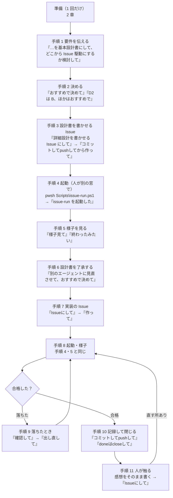

# Issue 駆動のプロンプト手順書 — どの段で、Claude Code に何と入力するか（プロンプト例つき）

> Generated by Claude Opus 5.5 — 2026年10月23日

この手順書は、Issue 駆動で 1 つの機能を「要件 → 設計書 → Issue → 無人の実装 → 合格 → 閉じる」まで進めるときに、**人が Claude Code に入力するプロンプトを、段ごとに例で示す**ものです。チーム向けのガイド [`issue-driven-guide-for-teams.md`](issue-driven-guide-for-teams.md) が「考え方と仕組み」を説明するのに対して、こちらは「**何と入力すればいいか**」に絞っています。

> [!NOTE]
> - **例の出どころ**：このリポジトリで、空のプロジェクトから撮影ツール KaedeScape を EXE まで作ったときに、作者が実際に入力したプロンプト 118 件です（Claude Code の灰色の提案を Tab で入れてそのまま送った「提案そのまま」47 件・提案に言葉を足した「提案に追加」5 件・「自分で入力」64 件など）。全部の原文・入力の仕方と、Claude Code がそれぞれどう処理したかは記録 `Docs/Reports/2026/10/23/01-prompt-log.md` にあります。この手順書の「実例」は、その記録の番号（P54 など）で引いています。
> - **Web アプリ・業務アプリ向け**：例は、Unity の話を受注管理や請求の画面のような一般的な案件に置き換えて書いています。テストの呼び方（`npm test`・`pytest`）は自社のものに置き換えてください。
> - **前提**：Claude Code・git・GitHub CLI（`gh`）・PowerShell 7（`pwsh`）と、このリポジトリの Issue 駆動の一式（2 章）が入っていること。

---

## 0. 3 行で

1. 人が入力するのは、**長いプロンプトが 2 種類**（何を作りたいか・出てきた物への直し）と、**短い決まった言い方**（「Issueにして」「作って」「様子見て」「doneはcloseして」「コミットしてpushして」など）だけです。設計書・Issue・合格の条件・確認コマンド・コードは、Claude Code が書きます。
2. 短い言い方が通じるのは、**決まり（`CLAUDE.md`）とスキル（`.claude/skills/`）が、その言葉で何をするかを決めている**からです。2 章の一式を入れないと、同じ言い方をしても同じ動きになりません。
3. 決まった言い方は、多くの場合、**自分で入力しなくても Claude Code が入力欄に灰色で提案**します。Tab で入れて Enter で送れます。実例では 118 件の入力のうち 47 件がこれで、「コミットしてpushして」「様子見て」は毎回そうでした（1.1）。
4. 無人の回（`issue-run.ps1`）だけは、**人が別の窓でコマンドを実行して起動**します。回っている間は、同じフォルダーで Claude Code に書き換えを頼みません。

---

## 1. 全体の流れと、各段で入力するプロンプト



| 手順 | 人のプロンプト | 外への書き込み | 入力する量の目安 |
|---|---|---|---|
| 1 要件 | 長い文（何を・誰が・どんな入出力・制約） | なし | 200〜400 字 |
| 2 決める | 「おすすめで決めて」など | なし | 数文字 |
| 3 設計書の Issue | 「〜を Issue にして」→「コミットしてpushしてから作って」 | **あり**（Issue を作る・push） | 数文字 |
| 4 起動 | 人がコマンドを実行する →「issue-run を起動した」 | （無人の回が Issue にコメント・ラベル） | 1 行 |
| 5 様子 | 「様子見て」 | なし | 数文字 |
| 6 了承 | 「別のエージェントに見直させて、おすすめで決めて」 | なし | 数文字 |
| 7 実装の Issue | 「Issueにして」→「作って」 | **あり** | 数文字 |
| 9 落ちたとき | 「確認して」→「出し直して」 | **あり**（コメント・ラベル） | 数文字 |
| 10 閉じる | 「コミットしてpushして」「doneはcloseして」 | **あり** | 数文字 |
| 11 人が触る | 触ったままの感想 →「Issueにして」 | なし → あり | 50〜150 字 |

> [!IMPORTANT]
> **外への書き込み**（Issue を作る・閉じる・コメント・ラベル・push）は、人が言葉で頼んだときだけ Claude Code が行う決まりです（`CLAUDE.md` 原則 1）。「Issueにして」は下書きまで、「作って」で初めて GitHub に作ります。この 2 段が、人が中身を見る機会になります。

### 1.1 灰色の提案と Tab

Claude Code は、返答が終わると、入力欄に**次に入力しそうなプロンプトを灰色で表示**します。

| 操作 | 結果 |
|---|---|
| Tab | 灰色の提案が入力欄に入る。そのまま Enter で送れる |
| Tab の後に書き足す | 提案の後ろに自分の言葉を足して送れる（実例 P58「進めて」＋「　コミットしてから」、P82「決めることに1行足して」＋「　それと…文書を作成して」）。会話の記録では、一字でも変えると「自分で入力」と同じ扱いになる |
| 提案を使わずに入力する | 提案は消え、入力した文が送られる |

**提案は、直前の返答の終わりに書かれた次の一手から出ます。** Claude Code はこの手順のどの段でも、返答の最後の行に「作って」「様子見て」のような次の言い方そのものを書きます。すると、その言い方が灰色で出ます。

実例のセッション（記録 23/01 の 1.3）では、次のとおりでした。

| 言い方 | 提案そのまま | 自分で入力した |
|---|---|---|
| コミットしてpushして | 11 | 0 |
| 様子見て | 9 | 0 |
| コミットしてpushしてから作って | 4 | 0 |
| issue-run を起動した | 4 | 1 |
| doneはcloseして | 3 | 1 |
| Issueにして・作って | 4 | 0 |
| 要件・感想・訂正・質問 | 0 | 全部 |

> [!WARNING]
> **Tab の前に、提案が今の段で入力すべき言い方かを見てください。** 提案は直前の返答から推した物で、手順を知っているわけではありません。特に「作って」「doneはcloseして」「コミットしてpushして」は外への書き込みです。Enter の前に、下書きや結果の報告を読んだかを確かめます。提案と違うことをしたいときは、Tab を押さずに自分で入力します（実例 P115：無人の回を待つ間、「様子見て」ではなく文書の検討を頼んだ）。

> [!TIP]
> 提案が出ないとき・違う言い方が出るときは、この手順書の付録 A の言い方をそのまま入力すれば同じ動きになります。提案は便利な近道で、無くても手順は変わりません。提案が出る仕組み・出ない条件・出やすくする設定は [`prompt-suggestions-guide.md`](prompt-suggestions-guide.md) にあります。

---

## 2. 準備（チームで 1 回）

### 2.1 道具を入れる

道具を入れるのも Claude Code に頼めます。ログインのようにブラウザで人が承認する操作だけは、人が `!` を付けて入力します（`!` で始めると、その窓で人のコマンドとして動き、出力が会話に入ります）。ただし無人の回用の長いトークンだけは、Claude Code の外のターミナルで作ります（表の最後の行）。

| やること | プロンプト | 実例 |
|---|---|---|
| GitHub CLI を入れる | `gh を入れて` | P4「いれて」 |
| GitHub にログイン | `! gh auth login`（人が入力する。出たコードをブラウザに入れる） | P5 |
| ブラウザが開かないとき | `ブラウザが開かない？` | P7 |
| PowerShell 7 を入れる | `pwshを入れて` | P17 |
| 無人の回用の長いトークン | プロンプトにしない。Claude Code の外のターミナル（Windows はもう 1 つの PowerShell、Mac はターミナル）で人が `claude setup-token` を回す（`!` を付けて Claude Code の中で回すと、ブラウザで承認した後で止まり、トークンが出ない）。出た値は秘密の値なので会話に貼らないで、自分で環境変数 `CLAUDE_CODE_OAUTH_TOKEN` に入れる | — |

### 2.2 Issue 駆動の一式を自分のリポジトリに入れる

短い言い方が通じるのは、次のファイルがあるからです。**全部を一緒に入れます。**

| ファイル | 役目 |
|---|---|
| `CLAUDE.md` | 決まり（外への書き込みは言われてから・push は明示されたときだけ・合格まで「できた」と言わない など） |
| `.claude/skills/github-issue/` | 「Issueにして」「作って」「様子見て」「出し直して」「doneはcloseして」の意味 |
| `.claude/skills/design-cycle/` | ゴール → 合格の条件 → 設計 → 実装 → テスト → 判定の回し方 |
| `.claude/skills/commit/`・`push/` | 「コミットして」「pushして」の意味 |
| `.claude/skills/document-authoring/`・`save-report/` | 文書・記録の書き方と置き場 |
| `Scripts/issue-run.ps1`・`.claude/issue-run/` | 無人の回の本体・指示文・止まらない仕組み（Stop hook）・禁止の設定 |
| `.github/ISSUE_TEMPLATE/claude-run.md` | Issue のひな形 |
| テストの入口（このリポジトリでは `Scripts/unity-test.ps1`） | 確認コマンドが呼ぶ。自社では `npm test` や `pytest` を呼ぶ脚本に替える |

**プロンプトの例**（このリポジトリを手元に clone した状態で、自社のリポジトリの Claude Code に入力する）：

```text
C:\work\KaedeScapeBuii にある Claude のスキル、設定、設計・実装・テストの手順、
合格の条件、Issue の作成と無人の実行の仕組みを、このリポジトリに当てはまる分だけ全部入れて。
このリポジトリは Node.js（Next.js）の Web アプリで、テストは npm test。
Unity のテストの入口は、npm test を呼んで最後に Result: 行を出す脚本に置き換えて。
特に Issue の無人実行は同じように動くようにしたい。
```

| ポイント | 理由 |
|---|---|
| 元の場所をパスで書く | Claude Code はそこを読んで持ってくる（実例 P2 は、別のリポジトリのパスと GitHub の URL を書いた） |
| 「当てはまる分だけ」 | 元の決まりには Unity 固有の物（`.meta`・シーン）がある。外してもらう |
| 自社の技術とテストの呼び方 | テストの入口を書き換えてもらうため |

**Claude Code がすること**：元のファイルを読み、自社向けに書き直して入れます。そのあと「何を入れたか・確かめられたのはどこまでか」を報告します。実例 P2 では、「テストの実行と無人の回はまだ一度も回していない」と正直に書いていました。

### 2.3 点検する

```text
テストの入口を一度回して、Result: 行が出るか確かめて
```

```text
pwsh Scripts\issue-run.ps1 -DryRun を回して、対象と部品がそろっているか見て
```

実例 P17 では、`pwsh` を入れたついでにテストの入口を初めて回し、**テストが 0 件のときに合格にならないこと**まで確かめていました。点検の脚本 `Scripts/issue-run-doctor.ps1` があるので、「issue-run-doctor を回して」でも一度に見られます。

### 2.4 自分たちの決まりを足す

決まりは、ふつうの言葉で言えば Claude Code が `CLAUDE.md` やスキルに書きます。

| 言ったこと（実例） | Claude Code がしたこと |
|---|---|
| `Docs\InSpecs　人が書く文書はここだけ、ここに保存する、主にインプット文書`（P62） | 記憶に残し、`CLAUDE.md` の置き場の表・スキル・無人の回の禁止の設定に足した |
| `README.md　…要は文書は全部claude code人はプロンプロだけになってる、今までのここやったことに合わせて修正して`（P61） | README の流れの章を、実際のやり方に書き直した |

---

## 3. 手順 1：要件を伝えて、基本設計書を書かせる

### 3.1 プロンプトの形

```text
<何を作るか（誰が、何をするための物か）>
<主な機能・入出力・数字（大きさ・件数・選べる値）>
<使う技術・使わない技術・制約>
<後でやること（今回の範囲の外）>
上記を整理して基本設計書にして、その後どこから Issue 駆動にするか検討して
```

### 3.2 例（Web アプリ）

```text
営業事務の人が、受注の一覧を条件で絞り込んで CSV に書き出せる画面を作る。
条件は期間・取引先・担当者・状態（受付・出荷済み・請求済み）。一覧は 50 件ずつ。
CSV は Shift_JIS と UTF-8 を選べる。列は受注番号・日付・取引先・金額・状態。
画面は今の Next.js の管理画面に足す。API は今の /api/orders を広げる。DB は変えない。
帳票の PDF は後でやる。
上記を整理して基本設計書にして、その後どこから Issue 駆動にするか検討して
```

### 3.3 実例（P54・383 字）

> 各アセットごとにサンプルシーンを歩けるようにする、よくあるワールドを歩くRPG、そしていい場所といい視点で、スクリーンショットをとる、スクリーンショットはfullHD 2K 4K のサイズ、カメラの焦点距離は24,35,50,80,200を選択できるようにする、…上記の整理して基本設計書にしてその後どこからイッシュ駆動にするか検討して

句読点が少なく、思いついた順に書いても、Claude Code は整理してくれます。**数字（解像度・焦点距離）と、後でやること（色の調整）を書いた**のが効きました。

### 3.4 Claude Code がすること

| 書く物 | 中身 |
|---|---|
| 基本設計書 | ゴール・合格の条件（機械で測れる物と人が見る物を分ける）・画面や部品の分け方・作る順 |
| 決めること（D1・D2…） | 答えが決まっていない点を表にし、**どれにも推しの案を付ける** |
| どこから Issue 駆動にするか | 最初の合格（小さくて機械で測れる所）の案 |

### 3.5 人が見るところ

- 決めることの表。推しの案で困る行が無いか。
- 合格の条件のうち、**人が見る物**（見た目・使い心地）が分けてあるか。

### 3.6 直すときのプロンプト

| 直したいこと | プロンプトの例 | 実例 |
|---|---|---|
| 名前 | `Photo ではなく Scape にして。プロジェクト名が背景 Scape を意味してるから` | P55 |
| 範囲・最初の合格 | `テストワールドを2つ作ってそれぞれの EXE が作れることを最初の合格にして、…これいったん文書にする？それともイッシュを書く？` | P57 |
| 決まった言葉を後から足す | `決めることに1行足して` | P82 |

迷ったときは、P57 のように「**文書にする？Issue にする？**」と聞けば、Claude Code が理由つきで答えます（P57 の答えは「決めたことは文書が先、Issue はそのあと」でした）。

---

## 4. 手順 2：決めることを決める

| 決め方 | プロンプト | 実例 |
|---|---|---|
| 全部、推しの案で | `おすすめで決めて` | P66・P102 |
| 1 つ選ぶ | `おすすめで`（直前の比べた表の推し） | P98 |
| 一部だけ変える | `D2 は B にして、ほかはおすすめで` | — |
| 決める前に聞く | `まって一人称のほうがノベルゲームてきな画像は撮りやすい？` | P97 |
| 自分の決定を言う | `KaedeScapeBuii　Buiiはビルトイン、他のレンダリングになるとここが変わるのでこのままでいい` | P86 |
| 進める | `進めて`／`進めて　コミットしてから` | P58・P59 |

**Claude Code がすること**：設計書の「決めること」の行を、決定に置き換えます（例外を足さずに旧文を置き換える決まり）。違っていたら設計書のその行を直すだけで戻せる、と 1 行添えます。

> [!TIP]
> 「おすすめで決めて」が使えるのは、Claude Code が決めることに**必ず推しの案を付ける**からです。推しの案が無い質問（「どうしますか？」だけ）が返ってきたら、「推しの案を付けて」と返してください。

---

## 5. 手順 3：設計書を書かせる Issue を作る

大きい機能は、**設計書を書かせる Issue** と**実装の Issue** に分けます（ガイド 5.5）。

### 5.1 プロンプト

```text
<機能> の詳細設計を書かせる Issue にして
```

基本設計の後に「進めて」と言うだけでも、Claude Code はこの段に進みます（実例 P59）。

### 5.2 Claude Code がすること

1. Issue の下書きを `Logs/IssueDrafts/<題>.md` に書く（ゴール・合格の条件・確認コマンド・守るファイル・先に決めておくこと・やらないこと）。
2. **確認コマンドを自分で 1 回回して、いま落ちること**と、落ちる理由が「まだ書いていないから」であることを確かめる。
3. 下書きを見せて止まる。**GitHub にはまだ作らない。**

### 5.3 人が見るところ

| 見るところ | よい状態 |
|---|---|
| 合格の条件 | 1 行ずつ、確認コマンドのどこかで確かめられる（字数・節・テストの名前の数など） |
| 守るファイル | 変えさせたくない物（基本設計書・手順書）が入っている。書かせる設計書は入っていない |
| 先に決めておくこと | 決めたこと（手順 2）が書いてあり、変えるなら「提案」として書かせる形になっている |

### 5.4 作る

```text
コミットしてpushしてから作って
```

| Claude Code がすること | 理由 |
|---|---|
| 手元の変更をコミットして push する | 無人の回は GitHub の Issue と手元の git を見る。手元に未コミットの変更があると、無人の回のコミットに混ざる |
| Issue を作り、札（`claude-run`）を付ける | 札の付いた Issue だけが無人の回の対象 |
| `issue-run.ps1 -DryRun` で読めるか見る | 合格の条件の行数・確認コマンド・守るファイルを報告する |

「作って」だけでも作りますが、**コミットと push を先に済ませる**この言い方が一番事故がありませんでした（実例 P60・P99・P104・P114）。

---

## 6. 手順 4：無人の回を起動する（人が別の窓で）

無人の回は、1 件で数分〜1 時間かかります。Claude Code の会話の中では回さず、**人が別の PowerShell の窓で**実行します。

```powershell
pwsh Scripts\issue-run.ps1            # 札の付いた Issue を全部、順に
pwsh Scripts\issue-run.ps1 -Issue 12  # 1 件だけ
```

起動したら、会話の窓にこう入力します。

```text
issue-run を起動した
```

**Claude Code がすること**：ログのフォルダー（`Logs/IssueRun/<日時>/`）を読むだけで、起動前の点検が通ったか・どの Issue を進めているかを報告します。そして「**回っている間は、このフォルダーのファイルを書き換えない**」と宣言します。

> [!WARNING]
> 回っている間に、同じフォルダーで文書の直しなどを頼むと、無人の回のコミットに混ざります。実例 P61 では、Claude Code が「直す文を用意だけして、終わってから書き込む」と答えて待ちました。急がない直しは、回が終わるまで預けてください。

`gh` が見つからないと言われたら、その窓で先に `$env:PATH = "C:\Program Files\GitHub CLI;$env:PATH"` を実行します。

---

## 7. 手順 5：様子を見る

| 言い方 | いつ | Claude Code がすること |
|---|---|---|
| `様子見て` | 回っている途中 | ログ・Issue のラベル・コミットを読むだけで、どこまで進んだかを報告する。必要なら無人の Claude の会話の記録まで読む（実例 P63：「設計書を書く前に一時フォルダーで事実を試していた」） |
| `終わったみたい` | 窓に終わりが出たとき | まとめ（`Docs/Reports/…/NN-issue-run.md`）と Issue のコメントを読み、合否・時間・回数・コミット・**無人の回が自分で決めたこと**・未採用の改善を報告する |
| `確認して` | 何が起きたか分からないとき | 同上。落ちていれば原因を振り分ける（手順 9） |

報告を読んだら、次のどれかを入力します。

| 結果 | 次のプロンプト |
|---|---|
| 設計書の Issue が合格 | 手順 6 |
| 実装の Issue が合格 | 手順 10 |
| 落ちた | 手順 9 |

---

## 8. 手順 6：設計書を了承する

無人の回が書いた設計書は、**機械の合格（字数・節・テストの名前の数）**を満たしているだけです。中身の正しさは、実装に進む前に見直します。

### 8.1 プロンプト

```text
別のエージェントに詳細設計を見直させて、必ず直す所を直してから、おすすめで決めて
```

実例では「おすすめで決めて」だけでした（P66・P102）。Claude Code は自分で見直し役のエージェントを出しましたが、**言葉で頼む方が確実**です。

### 8.2 実例で見直しが見つけたもの

| Issue | 見直しが見つけた「必ず直す所」 |
|---|---|
| #4（M1 の詳細設計） | 2 回の見直しで 4 つ。そのうち 1 つは、**確認コマンドの中の画像の大きさを読む部分のバグ**（1920×1080 を 128×56 と読む）。このまま実装の Issue にしていたら、正しい実装でも必ず落ちていた |
| #10（S4b の詳細設計） | 6 つ。テストの期待値と式の食い違い、初めの値が決まっていない所、ログの照合が必ず落ちる所など |

> [!IMPORTANT]
> 設計書の誤りは、実装の Issue の確認コマンドに入り込みます。**見直しは、実装の Issue を作る前**にやってください。

---

## 9. 手順 7：実装の Issue を作る

```text
Issueにして
```

**Claude Code がすること**（スキル `github-issue` の A）：

1. 詳細設計の「Issue の分け方」の章から、段ごとに下書きを作る。後の段の本文の `## 前提` に前の段の番号を書いて、順につなぐ。
2. 確認コマンドを 1 件ずつ回し、**いま落ちる理由が「まだ作っていないから」**であることを見る。
3. 確認コマンドの誤りを、自分で見つけたら直す。

人が見たら、作ります。

```text
作って
```

### 9.1 実例で「作って」の前に見つかったこと

| 実例 | 見つかったこと | Claude Code がしたこと |
|---|---|---|
| P71〜P72 | 確認コマンドを回したときに、ツール（Unity）が設定ファイルを 1 つ自動で作った。git に入れないと、**全部の Issue が「設定を変えている」で落ちる** | 作る前に、その設定ファイルを先にコミットした |
| P36 | DryRun で、点で始まるフォルダー（`.github`）の中のファイルを守れていないと分かった | 脚本を直した |
| P113 | 確認コマンドの後ろの行が、前の行で落ちるせいで一度も試されていなかった | 「わざと通る状態」（偽のテスト結果など）を作って、後ろの行まで回した |

> [!TIP]
> Web アプリでも、テストを回すと `.next/` やキャッシュ、ロックファイルが変わることがあります。確認コマンドが「設定を変えていない」を見るなら、作る前に一度回して、変わる物を先にコミットするか `.gitignore` に入れてください。

---

## 10. 手順 8〜9：回す・落ちたとき

起動と様子見は、手順 4・5 と同じです。

### 10.1 落ちたときのプロンプト

```text
確認して
```

Claude Code は原因を振り分けて報告します。そのあとは原因ごとに次のどれかを入力します。

| 原因（実例） | 次のプロンプト | Claude Code がすること |
|---|---|---|
| ネットの切断で 4 回を使い切った（#7） | `進めて` | 作りかけをリポジトリの外へ移し、Issue に「## 対応」のコメントを付け、ラベルを `claude-run` に戻す。DryRun で、また対象になったかを見る |
| Claude が書いた確認コマンドの誤り（#11） | `出し直して` | Issue の本文の確認コマンドを直し、直した確認コマンドを丸ごと回して通ることを確かめてから、コメントを付けてラベルを戻す |
| 設計の誤り | `設計書を直してから出し直して` | 設計書を直し、Issue の本文を合わせ、出し直す |
| 実装が届かなかった | `原因を見て、Issue を小さく分けて出し直して` | 段を分けた下書きを作る（ガイド 9.6） |

出し直す前に、**手元に未コミットの変更があれば先にコミット**します（`コミットしてpushして`）。守るファイル（設計書など）を直したときは特に大事です（実例 P107〜P108）。

> [!NOTE]
> 合格の条件を変えて通すことはしません。確認コマンドを直すのは、確認コマンド自体が誤っていたとき（#11）だけです。そのときも、直した理由を Issue のコメントに残します。

---

## 11. 手順 10：記録して閉じる

```text
コミットしてpushして
```

無人の回は、コミットはしますが push はしません。まとめ（`NN-issue-run.md`）もコミットされずに残ります。この言い方で、**無人の回のコミットと、まとめ・記録を一緒に GitHub へ上げます**。

```text
doneはcloseして
```

合格（`claude-done`）の Issue に「合格（claude-done）を確認して閉じる（日付 ユーザー指示）」のコメントを付けて閉じます。閉じた Issue は、後の Issue の `## 前提` では「済み」として数えられます。

---

## 12. 手順 11：人が触って、感想から直す

機械の合格は、**見た目と使い心地を保証しません**。合格したら、人が動かしてみます。

### 12.1 プロンプト

**感想は、触ったままの言葉で書きます。** 直し方を考えなくてかまいません。

実例 P112：

```text
タッチパッドで視点が変化しなくなった、Enter押した後の微調整が小さすぎ、ほとんど変化しない、
前みたいにタッチパッドで進む方向が変化しないと移動できない
```

Web アプリなら、たとえば：

```text
絞り込みを変えるたびに 1 ページ目に戻ってほしい。CSV を Excel で開くと日付が ##### になる。
取引先の候補が 10 件しか出ないので探せない
```

### 12.2 Claude Code がすること

1. ソースを読んで、感想ごとに原因を探す。**設計どおりの動きか、実装の誤りか**を分けて示す（P112 では 3 つとも設計どおり＝設計の誤りだった）。
2. 直し方と値を表で出す（今の値 → 直した後の値）。

### 12.3 Issue にする

```text
Issueにして
```

Claude Code は**設計書を先に直してから**（段を足す・テストの名前を表に入れる）、Issue を下書きします。あとは手順 7〜10 と同じです。実例の #13 は、感想を書いてから Issue ができるまで 12 分、無人の回は 14 分（1 回で合格）でした。

---

## 13. Issue 駆動以外のプロンプト

Issue にしない小さな仕事や質問は、ふつうに頼みます。

| 種類 | プロンプトの例（実例） | Claude Code がすること |
|---|---|---|
| 質問だけ | `時間　ってどうやって計測してる？`（P41）・`エクセル読めたっけ？`（P48） | ファイルやソースを読んで答える。何も書き換えない |
| 進め方の相談 | `これいったん文書にする？それともイッシュを書く？`（P57） | 理由つきで推しを答える |
| 足りているか | `今の情報でだいたいok?`（P31） | 足りている物と弱い所を重い順に答える |
| 文書を書く | `ここまでやったこと、他の人にも理解してほしいで、全部文書にして…生成AIに不慣れた人でも理解できるように`（P9） | 置き場の決まりに従って書く。記録は `Docs/Reports/`、使い続ける物は `Docs/Guides/` |
| 入力を読む | `Docs/InSpecs のCSVを読んで`（P51）→ `Built-in　で使えそうな〇と△のリストを作ってmd`（P52） | 読んで集計し、脚本で抜き出して md にする |
| 調べる | `普通のEXEの手順書を調べてきて`（P94） | Web で調べて、結果に合わせて直す |
| 待ち時間に考える | `待ってる間、テストユーザーさん向けの文書を拡充を検討して`（P115） | 回の間は書き換えず、**案だけ**出す。人が `書いて` と言ったら書く（P121） |

---

## 14. うまく伝えるこつ（実例から）

| こつ | 実例 |
|---|---|
| **数字を書く。** 大きさ・件数・選べる値・時間 | P54 の解像度と焦点距離、P95 の「3 秒ぐらい」、P44 の「精度は分でいい」 |
| **後でやることを書く。** 範囲がはっきりする | P54「その後は…色の調整」 |
| **見ている物を貼り付ける。** 文書のどこが分からないかが確実に伝わる | P92・P93・P94（説明書の文を貼って「どこをクリックするの？」） |
| **同じ直しを 2 回言っても直らないときは、前提を疑わせる。** | P90〜P94：「手順の順番にして」を 4 回言っても直らず、「普通の EXE の手順書を調べてきて」で、**配る形を決めていなかった**のが原因と分かった |
| **頼んだ物と違ったら、注目する所を名指しして書き直させる。** | P20「04は破棄してkaedevnの内容で作り直して、注目はissue-run.ps1 とそれを支える周辺のcliやドキュメント」 |
| **相手の文を引いて決める。** | P42「必要なら、まとめに書き出すように足せます。　精度は分ぐらいでよい」 |
| **言語を指定する。** 返答が英語になったら | P70「日本語でおねがい」 |
| **誤字は気にしない。** | 「イッシュ」「プロンプロ」「monoreo」でも意図どおりに読まれた |

---

## 15. 気をつけること

| すること・しないこと | 理由 |
|---|---|
| 無人の回の間は、同じフォルダーで書き換えを頼まない | 無人の回のコミットに混ざる。急がない直しは預ける |
| 「作って」の前に下書きを読む | GitHub に作る前に人が見る、ただ一つの機会 |
| 「コミットしてpushしてから作って」を使う | 手元の変更と無人の回のコミットが混ざらない |
| 合格しても「できた」と思わない。触ってから閉じる | 機械の合格は見た目と使い心地を見ていない（手順 11） |
| 合格の条件を変えて通させない | 確認コマンドを直すのは、確認コマンド自体の誤りのときだけ |
| ネットが不安定なときは回さない | 切れると 4 回を数分で使い切る（実例 #7。まだ仕組みで塞いでいない） |
| 人が書く入力は決まった場所に置く | このリポジトリでは `Docs/InSpecs/`。Claude Code は読むだけで書き換えない |

---

## 付録 A 決まった言い方の一覧

「実例の入力」は、元のセッションでその言い方が提案そのままで入った回数と、自分で入力した回数です（記録 23/01）。

| 言い方 | 段 | Claude Code がすること | 外への書き込み | 決めているもの | 実例の入力（提案そのまま／自分で入力） |
|---|---|---|---|---|---|
| `…を基本設計書にして、どこから Issue 駆動にするか検討して` | 1 | 基本設計書・決めること（推しつき）・最初の合格の案 | なし | `design-cycle` | 0／1（要件は自分で入力する） |
| `おすすめで決めて`／`おすすめで` | 2・6 | 推しの案で決め、設計書の行を置き換える | なし | 設計書の「決めること」 | 2／1 |
| `進めて` | 2〜 | 直前に出した次の段に進む | 段による | 直前の返答 | 1／1（ほかに提案に追加 1） |
| `Issueにして`／`〜を Issue にして` | 3・7・11 | 下書き・確認コマンドを回して落ちることを見る | なし | `github-issue` A | 2／0 |
| `作って` | 3・7 | 下書きを GitHub に作る・札を付ける・DryRun | **Issue** | `github-issue` A-8・`CLAUDE.md` 原則 1 | 2／0 |
| `コミットしてpushしてから作って` | 3・7 | コミット → push → Issue | **push・Issue** | `commit`・`push`・`github-issue` | 4／0 |
| `issue-run を起動した` | 4 | ログを読むだけ。回の間は書き換えない | なし | `github-issue` C | 4／1 |
| `様子見て`／`確認して`／`終わったみたい` | 5 | ログ・まとめ・コメントを読んで報告 | なし | `github-issue` C-3 | 10／2 |
| `出し直して` | 9 | 本文を直し、「## 対応」のコメント、`claude-failed` を外す | **コメント・ラベル** | `github-issue` C-4 | 1／0 |
| `コミットしてpushして` | 10 | 自分の変更と無人の回のまとめをコミットして push | **push** | `commit`・`push` | 11／0 |
| `コミットして`／`pushして` | いつでも | どちらか片方 | push のときだけ | `commit`・`push` | 2／4 |
| `doneはcloseして` | 10 | 決まったコメントを付けて閉じる | **Issue を閉じる** | `github-issue` C-4 | 3／1 |
| `書いて` | — | 直前に出した案を書く | なし | 直前の返答 | 1／0 |

---

## 付録 B 1 件を通しでやった例（KaedeScape S4b3・Issue #13）

人が触った感想から、合格して閉じるまでの全部のプロンプトです。時刻は 2026-10-22。

| 時刻 | 入力の仕方 | 人のプロンプト | Claude Code がしたこと |
|---|---|---|---|
| 22:10 | 自分で入力 | `タッチパッドで視点が変化しなくなった、Enter押した後の微調整が小さすぎ、…` | ソースを読み、3 つとも設計どおりの動きと示した。直し方と値を表で出した |
| 22:12 | 提案そのまま | `Issueにして` | 設計書に段 S4b3 を足し、テスト 15 本の名前を表に入れ、下書きした。確認コマンドを 4 つの偽の状態で回して後ろの行まで確かめた |
| 22:22 | 提案そのまま | `コミットしてpushしてから作って` | push（`e70ad1b`）→ #13 を作る → DryRun（合格の条件 9 行・守るファイル 37） |
| 22:24 | （別の窓） | （人が `pwsh Scripts\issue-run.ps1` を実行する） | 無人の回が始まる |
| 22:30 | 提案そのまま | `様子見て` | テスト 71/71・40/40 が通り、コミットが 1 件入ったと報告 |
| 22:46 | 提案そのまま | `終わったみたい` | 14 分・1 回で合格。確認コマンドの 9 項目、無人の回が自分で決めたこと、気になる点を報告 |
| 22:48 | 提案そのまま | `コミットしてpushして` | まとめと記録を入れて push |
| 22:48 | 提案そのまま | `doneはcloseして` | #13 を閉じた |

会話の窓への入力は 7 回でした。**自分で入力したのは最初の感想 1 回（78 字）だけ**で、残りの 6 回は灰色の提案を Tab で確定しています（ほかに、別の窓で起動のコマンドを 1 行）。

---

## 付録 C Web アプリでの通しの例（架空）

付録 B と同じ流れを、受注一覧の CSV 書き出しに当てはめた例です。

| 段 | 人のプロンプト |
|---|---|
| 1 | （3.2 の要件）`…上記を整理して基本設計書にして、その後どこから Issue 駆動にするか検討して` |
| 2 | `CSV の文字コードの既定は UTF-8（BOM つき）にして、ほかはおすすめで決めて` |
| 3 | `詳細設計を書かせる Issue にして` → 下書きを読む → `コミットしてpushしてから作って` |
| 4 | （別の窓で `pwsh Scripts\issue-run.ps1`）→ `issue-run を起動した` |
| 5 | `様子見て` … `終わったみたい` |
| 6 | `別のエージェントに詳細設計を見直させて、必ず直す所を直してから、おすすめで決めて` |
| 7 | `Issueにして` → 下書きを読む → `作って` |
| 8 | （別の窓で起動）→ `issue-run を起動した` → `様子見て` → `終わったみたい` |
| 9 | 落ちたら `確認して` → `出し直して` |
| 10 | `コミットしてpushして` → `doneはcloseして` |
| 11 | 画面を触って `絞り込みを変えるたびに 1 ページ目に戻ってほしい。…` → `Issueにして` → 7 へ |

---

## 付録 D 関係する文書

| 文書 | 中身 |
|---|---|
| `Docs/Reports/2026/10/23/01-prompt-log.md` | この手順書の元。全部のプロンプトの原文と、Claude Code がどう処理したか |
| [`issue-driven-guide-for-teams.md`](issue-driven-guide-for-teams.md) | Issue 駆動の考え方・合格の条件と確認コマンドの書き方・自社に移すときに差し替える所 |
| `../Reading/kaedescape-case-study.md` | この手順書の例になった 1 日の事例 |
| `../Procedures/issue-goal-setting.md` | 合格の条件と確認コマンドの書き方の正 |
| `../Working/issue-run.md` | 無人の回の仕組み・準備・ラベル |
| `.claude/skills/github-issue/SKILL.md` | 決まった言い方の意味の正（A 作る・B 見る・C 回す） |

---

> この文書は Claude Opus 5.5 が生成しました。内容の正確性は人間のレビューを経て確認してください。
>
> Claude Opus 5.5 — Anthropic
