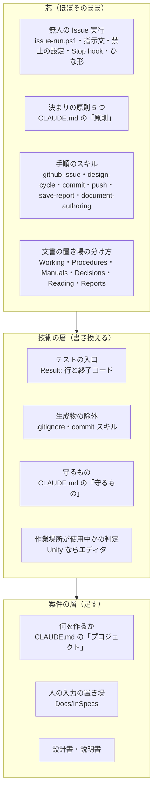
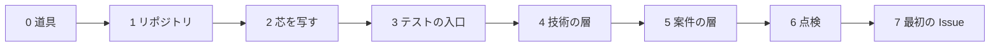

# 新しいリポジトリに Issue 駆動を入れる — そのまま持っていく物・書き換える物・足す物

> Generated by Claude Opus 5.5 — 2026年10月23日

この手順書は、このリポジトリ（KaedeScapeBuii）でうまくいった Issue 駆動の仕組みを、**別の技術（Web アプリ・業務アプリなど）の新しいリポジトリに入れる**ための元ネタです。記録 `Docs/Reports/2026/10/23/02-kaedevn-port-inventory.md`（UE の kaedevn から Unity のこのリポジトリへ、何をどれだけ変えて持ってきたか）を一般化しています。

> [!NOTE]
> - **読む前に**：Issue 駆動の考え方と、合格の条件・確認コマンドの書き方は [`issue-driven-guide-for-teams.md`](issue-driven-guide-for-teams.md) にあります。この手順書は「どのファイルをどう持っていくか」だけを扱います。各段で Claude Code に何と入力するかは [`issue-driven-prompt-manual.md`](issue-driven-prompt-manual.md)。
> - **確かめた範囲**：持っていき方そのものは、UE → Unity の 1 回で実際に動きました（Issue 13 件が全部合格）。Web アプリ・業務アプリへの持っていき方は、その 1 回を言い換えたものです。**付録 B のテストの入口の例は、まだどこでも回していません。**
> - **元にする版**：持っていくファイルは、kaedevn ではなく**このリポジトリの版**を元にしてください。このリポジトリで見つけて直した穴（5 章）が入っています。

---

## 0. 3 行で

1. 仕組みは 3 つの層に分かれます。**芯**（無人の Issue 実行の一式・決まりの原則・手順のスキル）は**ほぼそのまま**、**技術の層**（テストの入口・生成物の除外・守るもの）は**書き換え**、**案件の層**（何を作るか・置き場・設計書）は**新しく足し**ます。UE → Unity では、芯の差は数行〜数十行でした。
2. 新しく作らなければならないのは、実質 **テストの入口 1 本**です。「テストを回して、最後に `Result: PASS / FAIL / BLOCKED` の 1 行を出し、終了コードで合否を返す」形にすれば、残りの仕組みはそのまま乗ります。
3. 入れた後は、点検（`issue-run-doctor.ps1`・`issue-run.ps1 -DryRun`）を通し、**最初の Issue は「文書を書かせる」小さなもの**にします。このリポジトリも、最初の 3 件はガイドを書く Issue でした。

---

## 1. 3 つの層



| 層 | 何が入るか | UE → Unity での差（記録 23/02） | 新しいリポジトリでの作業 |
|---|---|---|---|
| 芯 | 無人の Issue 実行の一式、原則、手順のスキル、置き場の分け方 | Stop hook 1 行・禁止の設定 2 行・指示文 13 行・`issue-run.ps1` +51 −28・ひな形 4 行 | 技術の言葉を置き換えるだけ |
| 技術の層 | テストの入口、生成物、守るもの、使用中の判定 | テストの入口は新しく作った。`.gitignore` は 166 → 48 行に作り直し | 自社の技術に合わせて書く |
| 案件の層 | 作る物の説明、人の入力の置き場、設計書 | 作品に固有の文書・スキル・エージェントは持ってこなかった | 案件ごとに足す |

---

## 2. ファイルごとの持っていき方

ファイル名は、このリポジトリの名前です。

### 2.1 芯 — ほぼそのまま

| ファイル | 書き換える所 | 書き換えない所 |
|---|---|---|
| `Scripts/issue-run.ps1` | **作業場所が使用中かを見る関数**（`Get-UnityState`）。使用中の判定が要らない技術なら、いつも「使用中ではない」と返す関数にする。関数が返す文に出てくるテストの入口の名前 | Issue の読み方・合格の条件と確認コマンドの取り出し・守るファイルの指紋・前提の順番・ラベル・回数と時間の上限・Stop hook と禁止の設定の渡し方・結果のコメント・まとめの書き方 |
| `.claude/issue-run/prompt.md`（無人の Claude への指示文） | 「確かめ方」の節（テストの入口の名前と使い方）。「承認が要る操作」の表のうち技術に固有の行（`.meta`・`Packages/manifest.json` など）。`{{UNITY_STATE}}` の名前 | 無人であること・合格の条件がゴール・判定は別のエージェント・自分で決めて 1 行書く・報告の形・終わり方 |
| `.claude/issue-run/settings.json`（禁止の設定） | 案件で守る場所の行（このリポジトリでは `Docs/InSpecs/**`） | push・Issue への書き込み・削除・プロセスの停止・`//{{REPO}}/CLAUDE.md` と `.claude/` の書き換えの禁止。Stop hook の登録 |
| `.claude/issue-run/stop-hook.ps1` | なし | 全部 |
| `.github/ISSUE_TEMPLATE/claude-run.md` | 確認コマンドの例（テストの入口の名前）。「やらないこと」の例 | 欄の並び（やること・元の文書・合格の条件・確認コマンド・前提・先に決めておくこと・やらないこと） |
| `.claude/skills/github-issue/SKILL.md` | 確認コマンドの例の 1 行 | 作る・見る・回すの手順、外への書き込みは言われてから |
| `.claude/skills/design-cycle/SKILL.md` | テストのレベルの名前（Unity なら EditMode・PlayMode） | ゴール → 合格の条件 → 設計 → 実装 → テスト → 振り分け → 判定 |
| `.claude/skills/push/SKILL.md`・`save-report/SKILL.md`・`document-authoring/SKILL.md` | プロジェクトの名前・置き場の表 | 手順 |
| `CLAUDE.md` の「原則」 | なし（付録 A の 5 つをそのまま） | 全部 |
| `Docs/Guides/README.md`（置き場の分け方） | なし | 分け方（付録 A の「置き場」） |

### 2.2 技術の層 — 書き換える

| ファイル | 何を書くか | このリポジトリでの形 |
|---|---|---|
| **テストの入口**（`Scripts/<技術>-test.ps1`） | テストを回し、最後に 1 行 `Result: PASS ...`／`Result: FAIL ...`／`Result: BLOCKED ...` を出し、終了コード 0・1・3 を返す。`-Filter` で 1 本だけ回せる。**テストが 0 件なら FAIL** にする | `Scripts/unity-test.ps1`（Unity のバッチモードを起動し、結果の XML を数える。エディタが開いていれば BLOCKED） |
| `.gitignore`・`.gitattributes` | 生成物（`node_modules/`・`dist/`・`.venv/`・`__pycache__/` など）と、改行の決まり | Unity の `Library/`・`Temp/`・`*.csproj` など |
| `CLAUDE.md` の「守るもの」 | 技術で壊すと戻しにくい物（例：DB のマイグレーションの履歴・ロックファイル・生成されるコード・本番の設定） | `.meta` を本体と対で動かす・シーンの YAML を手で直さない・エディタを止めない |
| `.claude/skills/commit/SKILL.md` | コミットに入れない生成物の一覧 | Unity の生成物 |
| `.claude/skills/file-header/SKILL.md` | 言語ごとのファイルの頭書きの形 | C# |
| `Docs/Guides/Procedures/issue-goal-setting.md` | 確認コマンドの例をテストの入口に置き換える | `unity-test.ps1 -Filter` の例 |
| `Docs/Guides/Decisions/test-plan.md` | テストのレベル（単体・結合・E2E など）の名前 | EditMode・PlayMode |
| `Docs/Guides/Procedures/<技術>-test-procedure.md` | テストの入口の使い方・結果の読み方 | `unity-test-procedure.md` |
| `Scripts/issue-run-doctor.ps1`（点検） | 技術の点検（テストの入口が回るか・使用中か） | Unity の点検 |
| 作業場所が使用中かの判定（`issue-run.ps1` の関数） | 同じフォルダーで人が作業していると、テストが回らない・壊れる技術なら、それを見る（例：開発サーバーがポートを使っている・DB のマイグレーションが動いている） | Unity エディタがそのフォルダーを開いているか |

### 2.3 案件の層 — 足す

| ファイル | 何を書くか |
|---|---|
| `CLAUDE.md` の「プロジェクト」「コマンド」 | 何を作るか（1〜3 行）・使う技術と版・テストの入口の打ち方・`Result:` 行の読み方 |
| `CLAUDE.md` の「入口」の表 | 作業ごとに読む文書（手順書・設計書）へのリンク |
| `Docs/InSpecs/`（人が書く入力の置き場） | 人が置く入力（要件のメモ・一覧表など）。Claude は読むだけ。禁止の設定（2.1）にも入れる |
| 設計書（`Docs/Guides/Working/`） | 基本設計・詳細設計。Claude Code に書かせる（手順書 [`issue-driven-prompt-manual.md`](issue-driven-prompt-manual.md) の手順 1〜6） |
| 説明書（`Docs/Guides/Manuals/`） | 使う人に渡す物ができたら |

### 2.4 持っていかない物

| 物 | 理由 |
|---|---|
| 元のリポジトリの作品・製品に固有のスキル・エージェント・文書 | 案件の層。新しい案件で要るなら、そのとき作る |
| MCP の設定（`.mcp.json`） | 無人の回では MCP を使わない（方針 `genai-cli-mcp-policy.md`）。入れるかは案件で決める |
| 対話用の `.claude/settings.json` | このリポジトリにも無い。無人の回の設定は `.claude/issue-run/settings.json` で、起動のときだけ渡す |
| BACKLOG（あとでやることの一覧） | 原則 2「発見を自動で仕事にしない」。気づいたことは報告の「未採用の改善」に 1 行 |

---

## 3. 手順



### 手順 0：道具

| 道具 | 確かめ方 |
|---|---|
| Claude Code | `claude --version` |
| git | `git --version` |
| GitHub CLI（ログイン済み） | `gh auth status` |
| PowerShell 7 | `pwsh --version`（`issue-run.ps1` は 7 でしか動かない） |
| 無人の回用の長いトークン | Claude Code の外のターミナルで `claude setup-token` を回し、出た値は会話に貼らないで、自分で環境変数 `CLAUDE_CODE_OAUTH_TOKEN` に入れる |

道具を入れるのも Claude Code に頼めます（「gh を入れて」「pwshを入れて」）。ログインのようにブラウザで承認する操作だけは、人が `! gh auth login` のように `!` を付けて入力します。

### 手順 1：リポジトリ

GitHub に private のリポジトリを作り、`origin` にします。`issue-run.ps1` はリポジトリの名前を `origin` から読みます。

```text
GitHubにリポジトリ作ってpushして
```

### 手順 2：芯を写す

このリポジトリを手元に clone し、新しいリポジトリの Claude Code にこう入力します。

```text
C:\work\KaedeScapeBuii の Docs/Guides/Manuals/issue-driven-repo-setup.md を読んで、
2.1 の「芯」のファイルを、このリポジトリに写して。書き換える所だけ直して。
このリポジトリは <技術>（例: Next.js と PostgreSQL）で、テストは <呼び方>（例: npm test）。
2.2 と 2.3 はまだやらないで。
```

**元のリポジトリの最新を確かめてから写します。** このリポジトリでは、最初に写した無人の一式が古い版でした（手元の kaedevn が GitHub より 196 コミット遅れていた。記録 23/02 の 1 章）。clone したばかりなら問題ありません。手元にある古い clone から写すときは、先に `git pull` します。

### 手順 3：テストの入口

テストの入口は、芯が合否を読む唯一の口です。付録 B の形を元に書かせ、**3 つの場合を必ず回して確かめます**。

| 回し方 | 期待する最後の行 | 終了コード |
|---|---|---|
| 全部回す（テストが 1 本以上ある） | `Result: PASS <件数>/<件数>` | 0 |
| 無い名前を `-Filter` に渡す（0 件） | `Result: FAIL ... 0/0` | 1 |
| わざと落ちるテストを 1 本足して回す | `Result: FAIL` | 1 |

```text
テストの入口を付録 B の形で作って。テストが 0 件のときと、落ちるテストがあるときも回して、Result: 行と終了コードを見せて
```

このリポジトリでは、テストの入口を作った後、テストが 0 件のときに合格にならないことまで確かめてから先に進みました（記録 23/01 の P17）。

### 手順 4：技術の層

2.2 の表を上から書き換えさせます。

```text
issue-driven-repo-setup.md の 2.2 を、このリポジトリの技術に合わせて書いて。守るものは <例: マイグレーションの履歴とロックファイル>
```

### 手順 5：案件の層

`CLAUDE.md` の「プロジェクト」「コマンド」と、人の入力の置き場を決めます。

```text
Docs\InSpecs　人が書く文書はここだけ、ここに保存する、主にインプット文書
```

（このリポジトリで実際に入力した言い方です。Claude Code は `CLAUDE.md`・スキル・無人の回の禁止の設定に反映しました。）

### 手順 6：点検

```text
issue-run-doctor を回して
```

```text
pwsh Scripts\issue-run.ps1 -DryRun を回して
```

| 点検 | 通る状態 |
|---|---|
| 道具・ログイン・`origin`・ラベル・部品のファイル | doctor が NG 0 |
| 禁止の設定 | 裸の `CLAUDE.md`（`Edit(CLAUDE.md)`）の禁止が無い。`//{{REPO}}/CLAUDE.md` の形になっている |
| テストの入口 | doctor から回せて `Result: PASS` |
| DryRun | 「対象 0 件」で終了コード 0（Issue がまだ無いので） |

### 手順 7：最初の Issue

最初は**文書を書かせる Issue**にします。合格の条件が「字数・章・リンク先が実在」のように機械で測れ、実装の失敗に引きずられません。

```text
<作るもの> の基本設計書を書いて、その後どこから Issue 駆動にするか検討して
```

このリポジトリの最初の 3 件（#1〜#3）は、チーム向けガイドを 3 段に分けて書かせる Issue で、3 件とも 1 回目の起動で合格しました（6・10・7 分）。そのあと、設計書を書かせる Issue（#4）→ 実装の Issue（#5〜#9）の順に進めました。

---

## 4. 動かしてから足したもの（このリポジトリで直した穴）

写した後、使い始めてすぐに見つかった穴です。このリポジトリの版には直しが入っています。kaedevn の版から写す場合は、同じ直しが要ります。

| 穴 | 直し | どこで見つかったか |
|---|---|---|
| 守るファイルのパスの頭の `./` を取る処理が、`.github` のように点で始まるフォルダーの点まで取っていた（守れていなかった） | 頭の `./` と `/` だけを取る（`issue-run.ps1`） | 最初の Issue を作るときの DryRun |
| 結果のコメントに開始〜終了の時刻が無かった | 分の単位で入れる（`issue-run.ps1`） | 人の依頼 |
| 人が書く入力を、無人の Claude が書き換えられた | 禁止の設定・指示文・点検に、人の入力の置き場を足す | 人の決定 |
| テストを初めて回したときにツールが設定ファイルを自動で作り、確認コマンドの「設定を変えていない」が全部落ちる | **実装の Issue を作る前に、確認コマンドを 1 回回し、増えたファイルを先にコミットする**（または `.gitignore` に入れる） | 実装の Issue の確認コマンドを回したとき |

---

## 5. 移すときの落とし穴

| 落とし穴 | 起きたこと | 防ぎ方 |
|---|---|---|
| 古い版を写す | 手元の元のリポジトリが 196 コミット遅れていて、古い無人の一式を写した | 写す前に元を `git pull`。写した後に元の `origin/main` と比べる |
| 裸の `CLAUDE.md` の禁止 | 禁止の設定に `Edit(CLAUDE.md)` と書くと、どの深さの `CLAUDE.md` にも効き、作る物の中の `CLAUDE.md` まで断られる（kaedevn で 5 回落ちた） | `//{{REPO}}/CLAUDE.md` の形にする（このリポジトリの版はそうなっている）。doctor が見る |
| 日本語が化ける | Windows PowerShell 5.1 は BOM の無い UTF-8 の脚本を化けて読む | 脚本の先頭に BOM。無人の回は PowerShell 7 で動かす |
| `gh` が見つからない | 入れた直後のシェルは PATH に `gh` が無い | 新しい窓を開く。または `$env:PATH = "C:\Program Files\GitHub CLI;$env:PATH"` |
| 長いパス | Windows のパスの上限（260 字）を超えるファイルが取り出せず、git の台帳が無くなっていた | `git config core.longpaths true` |
| 無人の回の間に同じフォルダーを触る | 無人の回のコミットに混ざる | 回っている間は書き換えを頼まない（手順書の手順 4） |
| ネットの切断 | 切れると 4 回の起動を数分で使い切る（#7） | まだ仕組みで塞いでいない。安定した回線で回す |

---

## 6. 入れ終わったかの点検表

- [ ] `CLAUDE.md` に、付録 A の「原則」5 つと「守るもの」（技術ごと）と「入口」「置き場」がある
- [ ] `.claude/skills/` に `github-issue`・`design-cycle`・`commit`・`push`・`save-report`・`document-authoring` がある
- [ ] `.claude/issue-run/` に `prompt.md`・`settings.json`・`stop-hook.ps1` がある
- [ ] `.github/ISSUE_TEMPLATE/claude-run.md` がある
- [ ] テストの入口が、全部・0 件・落ちるの 3 つで期待どおりの `Result:` 行と終了コードを返す
- [ ] `issue-run.ps1` の使用中の判定を、技術に合わせて書き換えた（要らなければ「使用中ではない」を返す）
- [ ] 指示文の「確かめ方」が、新しいテストの入口を指している
- [ ] 禁止の設定に、人の入力の置き場がある。裸の `CLAUDE.md` の禁止が無い
- [ ] `issue-run-doctor.ps1` が NG 0、`issue-run.ps1 -DryRun` が終了コード 0
- [ ] `origin` が GitHub の private のリポジトリで、ラベル `claude-run` を作れる（最初の実行で自動で作られる）

---

## 付録 A `CLAUDE.md` の最初の形

このリポジトリの `CLAUDE.md` から、技術と案件に依らない所だけを残した形です。`<…>` を書き換えます。

```markdown
# CLAUDE.md

エージェント向けの規約。**短く保つ。** 理由・経緯・手順はここに書かず、下の「入口」へ置く。

## プロジェクト

- <何を作るか。1〜3 行>
- <使う技術と版>

## コマンド

    pwsh -NoProfile -File Scripts/<技術>-test.ps1                 # 全部
    pwsh -NoProfile -File Scripts/<技術>-test.ps1 -Filter '<名前>' # 1 本
    pwsh Scripts\issue-run.ps1 -DryRun                            # Issue の無人実行の点検（本番はユーザーが別の窓で）

合否は最後の `Result:` 行（PASS 0・FAIL 1・BLOCKED 3）。

## 原則（常時）

1. **依頼の目的と範囲で働く。** 範囲内で `git` で戻せる判断は自分で決めて進み、**選んだ結果を1行で書く**（何を選んだか・違っていたらどう戻すか）。取り返しのつかないもの（削除・push・Issue の作成や閉じる等の外への書き込み・worktree の追加削除）だけ先に確認する。
2. **着手した修正は直し切る。発見を自動で仕事にしない。** 新しく気づいたものは、ブロッカーに当たるときだけ直す。当たらないものは「未採用の改善」として報告に1行残す。
3. **現行の挙動はソースと実行結果で確かめる。** 文書と違えば差を示し、どちらを直すか目的から決める。答えが実測で決まるなら、測ってから選ぶ。
4. **合否を感想で上書きしない。** スクリプトの測定結果（`Result:` 行）を使う。出力に合わせてテストや合格条件を変えない。機械で測れない実感・見た目は観測記録として区別し、ユーザーが決める。**合格まで「できた」と言わない。**
5. **一つの契約は一か所で定義する。** 変えるときは旧文を置き換える（例外を追記しない）。日付つきレポートは記録であって現況ではない。

## 守るもの（変えない）

- <技術で壊すと戻しにくい物>
- **push は明示されたときだけ・force しない。** `git worktree add` / `remove` を勝手に実行しない。

## 入口（作業別に読む。ここから先を CLAUDE.md へ写さない）

| 作業 | 読む |
|---|---|
| 機能・改善を作る | `.claude/skills/design-cycle/SKILL.md` |
| Issue を作る・見る・無人で回す | `.claude/skills/github-issue/SKILL.md` |
| 合格の条件と確認コマンドを書く | `Docs/Guides/Procedures/issue-goal-setting.md` |
| 無人で回す仕組み | `Docs/Guides/Working/issue-run.md` |

## 置き場

| 置き場所 | 何を置くか |
|---|---|
| `Docs/Guides/Working/` | 作業中に参照する仕組み・設計の正 |
| `Docs/Guides/Procedures/` | 手順 |
| `Docs/Guides/Manuals/` | 使う人に渡す説明書 |
| `Docs/Guides/Decisions/` | 方針・決定 |
| `Docs/Guides/Reading/` | 読み物（作業中には引かない） |
| `Docs/Reports/YYYY/MM/DD/` | その時点の記録（更新しない） |
| `Docs/InSpecs/` | 人が書く入力の唯一の置き場。Claude は読むだけ |
```

---

## 付録 B テストの入口の最初の形（例・未検証）

pytest の例です。テストの結果を JUnit 形式の XML に書かせて、件数を数えます。Node.js なら `vitest --reporter=junit --outputFile=...` や `jest-junit` で同じ XML を出せます。

> [!WARNING]
> この例は、この手順書のために書いたもので、まだどこでも回していません。手順 3 の 3 つの場合で必ず確かめてください。

```powershell
#Requires -Version 7
# Scripts/py-test.ps1 — テストを回し、最後に Result: 行を出す。合否は終了コード（PASS 0・FAIL 1・BLOCKED 3）
param([string]$Filter = '')
$ErrorActionPreference = 'Stop'
$root = Split-Path $PSScriptRoot -Parent
$xml = Join-Path $root 'Logs/test/result.xml'
New-Item -ItemType Directory -Force (Split-Path $xml) | Out-Null
Remove-Item $xml -ErrorAction SilentlyContinue

$args2 = @('-m', 'pytest', "--junitxml=$xml", '-q')
if ($Filter) { $args2 += @('-k', $Filter) }
& python @args2
$code = $LASTEXITCODE

if (-not (Test-Path $xml)) { Write-Host "Result: FAIL (結果の XML が無い・pytest の終了コード $code)"; exit 1 }
[xml]$r = Get-Content $xml -Raw
$s = $r.SelectSingleNode('//testsuite')
$total = [int]$s.tests; $bad = [int]$s.failures + [int]$s.errors; $skip = [int]$s.skipped
$ran = $total - $skip
if ($ran -eq 0) { Write-Host "Result: FAIL 0/0（テストが 0 件）"; exit 1 }
if ($bad -gt 0 -or $code -ne 0) { Write-Host "Result: FAIL $($ran - $bad)/$ran"; exit 1 }
Write-Host "Result: PASS $ran/$ran"
exit 0
```

| 決まり | 理由 |
|---|---|
| 最後の 1 行が `Result:` | 確認コマンドと無人の Claude が、ここだけを読んで合否を決める（原則 4） |
| 0 件は FAIL | 名前の打ち間違いやテストの消し忘れで「合格」にならないように |
| 終了コードで返す | 確認コマンドは `exit 0` で合格を決める |
| BLOCKED 3 | 同じフォルダーを人が使っていてテストが回せないとき。合格ではない。要らない技術なら使わない |

---

## 付録 C 元にした記録

| 記録 | 中身 |
|---|---|
| `Docs/Reports/2026/10/23/02-kaedevn-port-inventory.md` | UE → Unity で、ファイルごとに何をどれだけ変えて持ってきたか（この手順書の元） |
| `Docs/Reports/2026/10/23/01-prompt-log.md` | 持ってきた日からの、人の入力 118 件と処理 |
| `Docs/Guides/Working/issue-driven-development.md` | このリポジトリの仕組みの全体と、別の PC で同じものを動かす手順 |
| `../Reading/kaedescape-case-study.md` | 入れた仕組みで、空のプロジェクトから EXE まで作った事例 |

---

> この文書は Claude Opus 5.5 が生成しました。内容の正確性は人間のレビューを経て確認してください。
>
> Claude Opus 5.5 — Anthropic
