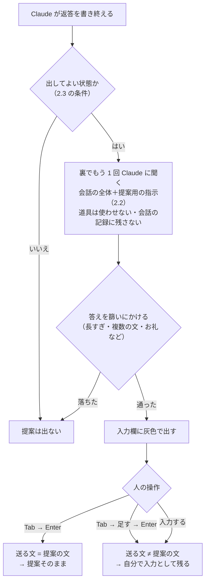
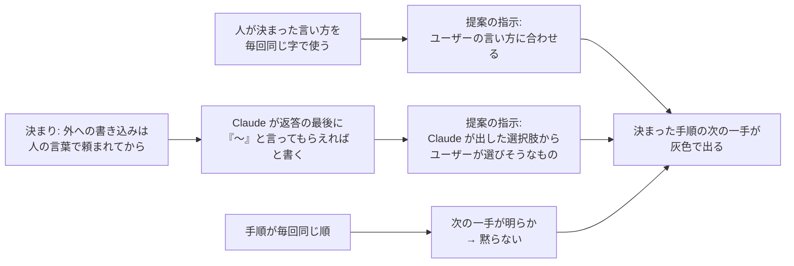

# Claude Code の灰色の提案 — 出る仕組み・出やすくする設定・このリポジトリで出やすかった理由

> Generated by Claude Opus 5.5 — 2026年10月23日

Claude Code は、返答を書き終えると、入力欄に**次に入力しそうなプロンプトを灰色の文字で提案**します。この説明書は、その提案がどう作られるか、どうすれば出やすくなるか、そしてこのリポジトリではなぜよく出たのかを、テストユーザーの方向けにまとめたものです。

> [!NOTE]
> - **確かめ方**：提案の仕組みは、この PC に入っている Claude Code の本体（版 **2.1.307**、`~/.local/bin/claude.exe`）の中身を読んで確かめました。公式の説明書の言い換えではありません。版が変わると、数字や条件が変わることがあります。
> - **数字の出どころ**：このリポジトリで KaedeScape を作ったセッションの記録 `Docs/Reports/2026/10/23/01-prompt-log.md` です。人の入力 118 件のうち 47 件が「提案そのまま」でした。
> - **関係する手順書**：Issue 駆動で各段に何と入力するかは [`issue-driven-prompt-manual.md`](issue-driven-prompt-manual.md)。

---

## 0. 3 行で

1. 提案は、返答が終わるたびに Claude Code が**裏でもう 1 回 Claude に「この人が次に打ちそうな文は？」と聞いて**作っています。答えは、ユーザーの言い方に合わせた 2〜12 語の短い文です。次の一手がはっきりしないときは、何も出しません。
2. 設定は `/config` の **Prompt suggestions**（`settings.json` では `promptSuggestionEnabled`）で、**最初からオン**です。窓が前に出ていない・plan モード・許可の確認待ち・会話の始めなどのときは出ません。使わない提案が 20 回続くと、出る回数が減ります。
3. このリポジトリでよく出たのは、決まり（`CLAUDE.md`・スキル）が「外への書き込みは人の言葉で頼まれてから」と決めているためです。そのため Claude が毎回、**返答の最後に次の言い方を「『作って』と言ってもらえれば」の形で書き**、人もその言い方を**毎回同じ字で**使いました。提案はこの 2 つを手がかりに作られるので、決まった手順の次の一手が、そのまま灰色で出ました。

---

## 1. 提案とは

### 1.1 見え方

```text
 ● #13 は合格しました。…閉じるなら「done は close して」と言ってください。

 > doneはcloseして            ← 灰色の文字（提案）。まだ送られていない
```

提案は見本として出ているだけで、まだ入力されていません。何もしなければ送られません。

### 1.2 人ができること

| 操作 | 何が起きるか | 記録での呼び方 |
|---|---|---|
| **Tab** → **Enter** | 灰色の文字が普通の文字になり、そのまま送られる | 提案そのまま |
| **Tab** → 言葉を足す → **Enter** | 提案の文に人の言葉が付いて送られる | 提案に追加 |
| 提案を使わずに入力 → **Enter** | 灰色の文字は消え、入力した文が送られる | 自分で入力 |

> [!IMPORTANT]
> 会話の記録（`~/.claude/projects/…/<セッション>.jsonl`）に「提案そのまま」（`promptSource: suggestion_accepted`）と残るのは、**送った文が提案の文と一字も違わないとき**だけです。少しでも書き足したり直したりすると、「自分で入力」（`typed`）として残ります。

---

## 2. 出る仕組み

### 2.1 流れ



- **会話の全体を読んで作る**：裏の問い合わせは、いまの会話と同じ中身（作業の記録・返答）を読みます。会話の中身を使い回す仕組み（プロンプトのキャッシュ）を使うので、速く・安く作れます。
- **道具は使えない**：裏の Claude にはファイルを読んだりコマンドを実行したりさせません（「提案だけ」）。
- **会話の記録には残らない**：提案の文そのものは、会話の記録にも入力の履歴（`~/.claude/history.jsonl`）にも残りません。残るのは、送った文が提案と同じだったかどうか（1.2）だけです。

### 2.2 提案を作る指示の中身

本体に入っている指示（英語）を、要点だけ日本語にしました。

| 指示 | 中身 |
|---|---|
| 何を当てるか | **ユーザーが次に打ちそうな文**。Claude が「するべきだ」と思うことではない |
| 合格の目安 | ユーザーが「ちょうどそれを打とうとしていた」と思うか |
| 例 | 「直してテストして」と頼まれ、直し終えた →「テストを回して」／Claude が続けるか聞いた →「はい」「進めて」／**Claude が選択肢を出した → ユーザーが選びそうなもの**／**作業が終わり、次が明らか →「コミットして」「push して」**／誤りや食い違いの後 → 何も出さない |
| 出さないもの | 評価（「いいですね」「ありがとう」）・質問・Claude の口調（「〜します」）・頼まれていない新しい案・2 文以上 |
| 形 | **2〜12 語、ユーザーの言い方に合わせる**。または何も出さない |
| 黙るとき | 次の一手がユーザーの言葉からはっきりしないとき。危ない・人に見せにくい話題になりうるとき |

返ってきた答えは、さらに次のもので落とされます。「完了」「提案なし」のような答え、括弧で囲んだだけの文、エラーの文、`〜:` で始まる見出しの付いた文、1 語だけの文（`yes`・`push`・`commit` などは通る）、13 語以上、**100 字以上**、2 文以上、改行や `**` を含む文、お礼や評価の言葉。

### 2.3 提案が出ないとき

| 条件 | 説明 |
|---|---|
| 設定で切っている | `/config` の Prompt suggestions がオフ（`promptSuggestionEnabled: false`） |
| 会話の窓ではない | `claude -p`（会話なしの起動）では出ない。**無人の回（`issue-run.ps1`）の Claude には提案は無い** |
| 窓が前に出ていない | 返答が終わったときにターミナルの窓が前に出ていないと作らない（別の窓を見ている間など） |
| 会話の始め | Claude の返答がまだ 2 つ未満 |
| 直前の返答がエラー | API のエラーで終わった返答の後 |
| 許可の確認待ち | 道具を使ってよいかの確認や、MCP からの質問が出ている間 |
| plan モード | 計画を立てるモードの間 |
| 使用量の上限 | 上限に当たっている・近い（警告中）とき |
| キャッシュが冷えている | 直前の返答で、新しく読み込んだ量が多すぎた（目安 1 万トークンを超えた）とき |
| 使われない提案が続いた | 使われない提案が **20 回続く**と「Showing fewer prompt suggestions · use one to bring them back」と出て、**10 回に 1 回**しか作らなくなる。提案を 1 回使うと元に戻る。Claude Code を初めて使ってから 14 日の間は、この間引きをしない |
| 答えが篩いに落ちた | 2.2 の篩い |
| 機能そのものが配られていない | 提案はサーバー側の切り替えでも出す・出さないが決まる。利用者の側では変えられない |

---

## 3. 出やすくする設定と使い方

### 3.1 設定

| 方法 | 書き方 | 効き方 |
|---|---|---|
| 画面で切り替える | `/config` を入力して **Prompt suggestions** を選ぶ | オン／オフ。**最初からオン** |
| 設定ファイル | `~/.claude/settings.json` に `"promptSuggestionEnabled": true`（オフは `false`） | 書かなければオン |
| 環境変数 | `CLAUDE_CODE_ENABLE_PROMPT_SUGGESTION=true`（止めるなら `false`） | 設定ファイルより優先。`true` のときは、**使われない提案が続いたときの間引きをしない**。使用量の警告中も作る |

> [!NOTE]
> このリポジトリでは、提案の設定を何も書いていません（`~/.claude/settings.json` にも `.claude/` にも無い）。**最初からの設定のままで**、2.3 の条件にかからなかっただけです。

### 3.2 使い方

| こつ | 理由（2.3） |
|---|---|
| 返答が終わるまで、Claude Code の窓を前に出しておく | 窓が前に出ていないと作らない |
| 道具の許可の確認に早く答える。確認の少ない許可のモードで使う | 確認待ちの間は作らない（このセッションは auto モード） |
| plan モードを抜けてから進める | plan モードの間は作らない |
| 合う提案は使う | 使わない提案が 20 回続くと間引かれる |
| 同じことは、毎回同じ言い方で頼む | 提案は「ユーザーの言い方に合わせて」作られる |
| 返答の最後に、次に頼む言い方を書いてもらう | 提案は「Claude が出した選択肢から、ユーザーが選びそうなもの」を当てる（3.3） |

### 3.3 決まりに書くなら

このリポジトリの `CLAUDE.md` には「返答の最後に次の言い方を書く」とは書いていません。それでも毎回そうなった理由は 4 章です。自社のリポジトリで同じ効き目を確実にしたいなら、たとえば次の 1 行を足す方法があります（このリポジトリでは足していません）。

```markdown
- 人の言葉が要る次の一手（外への書き込み・決めること）は、返答の最後に「『<言い方>』と言ってもらえれば〜します」の形で 1 つだけ書く。言い方は Issue 駆動の決まった言い方（作って・様子見て・コミットしてpushして・doneはcloseして など）を使う。
```

---

## 4. このリポジトリで提案が出やすかった理由

### 4.1 数字

記録 23/01 の人の入力 116 件（`/init` と `!` のコマンドを除く）で数えました。

| 項目 | 値 |
|---|---|
| 提案そのまま | 47 件（4 割） |
| 直前の返答の終わり（300 字）に「『〜』と言って」「言ってください」などがあった入力 | 53 件。そのうち **29 件（55%）が提案そのまま** |
| それが無かった入力 | 63 件。そのうち 18 件（29%）が提案そのまま |
| 提案そのままの文が、直前の返答の「」の言い方と同じ（空白を除いて） | 22 件 |
| 提案そのままが多かった言い方 | 「コミットしてpushして」11 回全部・「様子見て」9 回全部・「コミットしてpushしてから作って」4 回全部 |
| 提案を使わずに続いた最も長い並び | 14 回（17:18 まで）。間引きの 20 回には届かなかった |

### 4.2 理由



| # | 理由 | このリポジトリの何がそうさせたか | 提案の仕組みのどこに当たるか |
|---|---|---|---|
| 1 | **Claude が返答の最後に、次の言い方をかぎ括弧で書いた** | `CLAUDE.md` の原則 1（外への書き込みは先に確認）と「push は明示されたときだけ」、スキル `github-issue` の「ユーザーが『作って』と言ったときだけ」「『閉じて』『出し直して』と言ったら」、スキル `lane-sync` の「『pushして』と言ったとき」。Claude は自分で外へ書き込めないので、毎回「『作って』と言ってもらえれば作ります」で返答を閉じた | 指示の例「Claude が選択肢を出した → ユーザーが選びそうなもの」「Claude が続けるか聞いた →『進めて』」 |
| 2 | **返答の最後が「まだコミットしていません」で終わることが多かった** | 記録 01 に作業を追記する決まり（作業のたびに記録が未コミットになる）と、コミットは言われてからの決まり | 指示の例「作業が終わり、次が明らか →『コミットして』『push して』」。「コミットしてpushして」は 11 回全部が提案そのまま |
| 3 | **人が決まった言い方を毎回同じ字で使った** | 「コミットしてpushして」「様子見て」「doneはcloseして」を、毎回同じ書き方で入力した | 指示の「ユーザーの言い方に合わせる」。Claude が返答に「done は close して」（空白入り）と書いても、提案は人の書き方の「doneはcloseして」で出た |
| 4 | **手順が毎回同じ順だった** | Issue 駆動の流れ（Issueにして → 作って → 起動 → 様子見て → コミットしてpushして → doneはcloseして）を何度も繰り返した | 指示の「次の一手がはっきりしないときは黙る」に当たらない。Claude が言い方を書いていない場面でも、たとえば「別の窓で `pwsh Scripts\issue-run.ps1` を起動してください」の後に「issue-run を起動した」が最初の回から提案された |
| 5 | **次の一手が短い言い方で済んだ** | 決まった言い方の意味をスキルが決めているので、長い説明が要らない | 2〜12 語・100 字未満の篩いを通る。要件や感想のような長い文は、提案では出ない |
| 6 | **提案が止まる条件にかからなかった** | auto モードで使い、許可の確認待ちがほとんど無かった。plan モードを使わなかった。提案を使い続けたので、間引き（20 回）が起きなかった | 2.3 の条件 |

なぜこれらが効いたのかを、Claude Code の作り（戻せる作業は任せ、外に出る作業は人が承認する）から説明した読み物は [`../Reading/why-suggestions-worked.md`](../Reading/why-suggestions-worked.md) です。

### 4.3 提案が役に立たなかった所

| 場面 | 理由 |
|---|---|
| 要件・感想・訂正・質問（P54・P112・P90〜P94 など） | 次の一手が人の頭の中にしかない（指示の「黙る」）。長い文は篩いに落ちる |
| 提案と違うことをしたいとき（P18・P115） | 提案は「いつもの次の一手」を出すので、人は提案を使わずに入力した |
| 無人の回 | `claude -p` なので提案そのものが無い。代わりに、`issue-run.ps1` が組み立てた指示文と Stop hook が次の一手を決める |

---

## 5. 気をつけること

| 注意 | 理由 |
|---|---|
| **Tab の前に、提案が今の段の言い方かを見る** | 提案は会話からの推測で、手順を知っているわけではない |
| 外への書き込み（「作って」「doneはcloseして」「コミットしてpushして」）は、下書きや結果の報告を読んでから送る | 提案があると、読まずに Enter を押しやすい |
| 提案が出ないからといって、手順が違うわけではない | 2.3 の条件で出ないだけのことが多い。手順書の付録 A の言い方を入力すれば同じに動く |
| 版で変わる | この説明書は 2.1.307 の中身。数字（20 回・10 回に 1 回・100 字・12 語）や条件は変わりうる |

---

## 付録 本体で確かめた所

| 確かめたこと | 本体の中で見た所（2.1.307） |
|---|---|
| 設定の名前と既定 | 設定の説明「When false, prompt suggestions are disabled. When absent or true, prompt suggestions are enabled.」（`promptSuggestionEnabled`）・画面の名前 `label:"Prompt suggestions"` |
| 環境変数 | `CLAUDE_CODE_ENABLE_PROMPT_SUGGESTION`（設定より先に読む） |
| 出さない条件 | 理由の名前 `disabled`・`pending_permission`・`elicitation_active`・`plan_mode`・`rate_limit`・`usage_credits`・`early_conversation`・`last_response_error`・`cache_cold`・`unused_streak`・`unfocused`・`non_interactive` |
| 間引き | 20 回続けて使われないと間引く・10 回に 1 回・14 日・「Showing fewer prompt suggestions · use one to bring them back」 |
| 作り方 | 指示文 `[SUGGESTION MODE: Suggest what the user might naturally type next into Claude Code.]`・道具を使わせない（`No tools needed for suggestion`）・記録に残さない（`skipTranscript`） |
| 記録の値 | 送る文と提案の文が同じで、Tab で確定していれば `suggestion_accepted` |

---

> この文書は Claude Opus 5.5 が生成しました。内容の正確性は人間のレビューを経て確認してください。
>
> Claude Opus 5.5 — Anthropic
