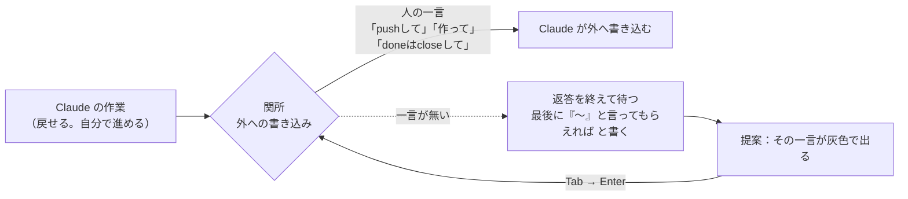
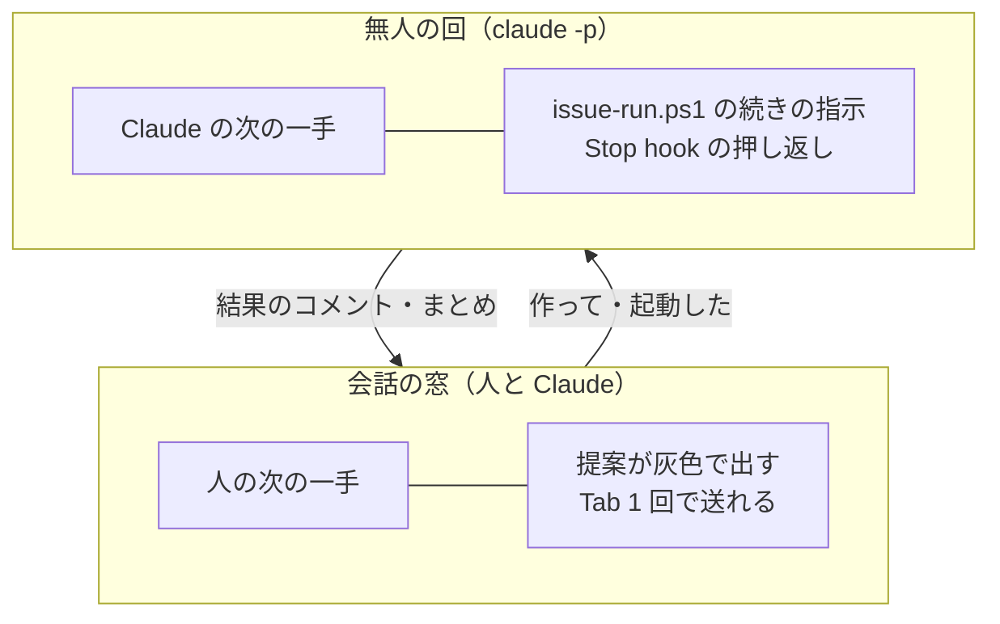

# なぜ「外への書き込みは頼まれてから」と「人に残る手順」で提案が効いたのか — Claude Code の作りとの関係

> Generated by Claude Opus 5.5 — 2026年10月23日

このリポジトリでは、人の入力 118 件のうち 47 件が、Claude Code が入力欄に灰色で出した提案をそのまま送ったものでした（記録 23/01）。kaedevn から持ってきたもののうち提案に効いたのは、次の 2 種類です。

1. **「外への書き込み（push・Issue の作成や閉じる）は、人の言葉で頼まれてから」という決まり**
2. **無人の Issue 実行の仕組みの中で、人の手に残る手順**（別の窓で起動する・閉じる）

この読み物は、**なぜこの 2 つが提案に効いたのか**を、Claude Code の作りから説明します。提案の仕組みそのもの（出る条件・設定）は説明書 [`prompt-suggestions-guide.md`](../Manuals/prompt-suggestions-guide.md) にあります。

> [!NOTE]
> 書いていることは 3 種類に分けて印を付けます。
> - **確かめた**：Claude Code の本体（版 2.1.307）の中身、またはこのリポジトリの記録で確かめた事実。
> - **推定**：確かめた事実から考えたこと。外れている可能性がある。
> - **数字**：記録 23/01 から数えたもの。

---

## 0. 3 行で

1. 提案は「**ユーザーが次に打ちそうな文**」を当てる仕組みです。当たりやすいのは、次の一手が**はっきりしていて・短く・いつも同じ言い方**のときです。
2. 「外への書き込みは頼まれてから」の決まりは、Claude の作業を**必ず人の一言で止まる所（関所）**で区切ります。関所で人が言うことは「進めて」「push して」のように決まっているので、次の一手がはっきりします。無人の仕組みで人に残る手順（起動した・閉じて）も、同じ関所になります。
3. これは偶然ではなく、Claude Code の作りと噛み合っています。Claude Code は**戻せる作業は Claude に任せ、取り返しのつかない作業と外に出る作業は人に確かめる**作りで、提案を作る指示にも「作業が終わったら『コミットして』『push して』」という例が入っています。**人が承認する一手を、Tab 1 回で済ませるための仕組み**だと読めます。

---

## 1. 提案が当たる条件

提案を作る指示（**確かめた**。本体の `[SUGGESTION MODE: ...]` の文）の要点です。

| 指示 | 意味 |
|---|---|
| ユーザーが次に打ちそうな文を当てる。Claude がするべきだと思うことではない | 当てる相手は人 |
| ユーザーが「ちょうどそれを打とうとしていた」と思うか | 合格の目安 |
| Claude が続けるか聞いた →「はい」「進めて」 | **Claude が止まって人に聞いた所**は当てやすい |
| Claude が選択肢を出した → ユーザーが選びそうなもの | **Claude が言い方を示した所**は当てやすい |
| 作業が終わり、次が明らか →「コミットして」「push して」 | **コミットと push は、例として名指しされている** |
| 次の一手がはっきりしないときは黙る | はっきりしない所では出ない |
| 2〜12 語、ユーザーの言い方に合わせる | 短く、人の癖どおりの言い方 |

つまり提案は、**Claude が止まって人の一言を待っている所**で、**その一言が短く決まっている**ときに、いちばん当たります。

---

## 2. 理由 1：決まりが「関所」を作った

### 2.1 関所とは

この読み物では、**Claude が自分では進めず、人の一言が無いと先へ進めない所**を「関所」と呼びます。

### 2.2 決まりが関所を作るしくみ

| 持ってきた決まり（**確かめた**） | 関所 | 人の一言 |
|---|---|---|
| `CLAUDE.md` の原則 1「取り返しのつかないもの（削除・push・Issue の作成や閉じる等）だけ先に確認する」 | 外への書き込みの前 | 「作って」「進めて」 |
| `CLAUDE.md`「push は明示されたときだけ」・スキル `push`「push はユーザーが言ったときだけ」 | push の前 | 「pushして」「コミットしてpushして」 |
| スキル `commit`（コミットは頼まれてから） | コミットの前 | 「コミットして」 |

決まりが無ければ、Claude は auto モードでそのまま push まで進めてしまい、そこで止まる理由がありません（**推定**）。決まりがあるから、Claude は**作業の区切りで必ず返答を終え**、最後に「『コミットして』と言ってもらえれば」と書きます。

### 2.3 関所が提案に効く 3 つの理由

| 理由 | 説明 | 印 |
|---|---|---|
| **次の一手が 1 つに絞られる** | 関所では、人がすることは「許す」か「直させる」のほぼ 2 つで、多くは許す。指示の「次の一手がはっきりしないときは黙る」に当たらない | 推定 |
| **Claude が言い方を返答に書く** | Claude は関所で止まるたびに、次の言い方をかぎ括弧で書いた。指示の「Claude が選択肢を出した → ユーザーが選びそうなもの」に当たる | 数字：返答の終わりにこの形があった入力は 53 件中 29 件（55%）が提案そのまま。無い入力は 63 件中 18 件（29%） |
| **言い方が短く、毎回同じ** | 「コミットしてpushして」「doneはcloseして」は 2〜12 語・100 字未満に収まる。人が毎回同じ字で使うので、指示の「ユーザーの言い方に合わせる」と重なる | 数字：「コミットしてpushして」は 11 回全部が提案そのまま |

### 2.4 Claude Code の作りとの関係

| Claude Code の作り | 関所との関係 | 印 |
|---|---|---|
| **1 回の返答は、Claude が道具を呼ばずに止まったときに終わる** | 提案は返答が終わるたびに作られる。関所は、返答が終わる所を「人の一言を待つ所」にそろえる | 確かめた（提案は返答の終わりに作る） |
| **戻せる作業は任せ、取り返しのつかない作業・外に出る作業は人に確かめる**（Claude Code が Claude に与えている基本の指示の方針） | このリポジトリの原則 1 は、同じ方針をリポジトリの決まりとして書いたもの。基本の方針と決まりが同じ向きなので、Claude は迷わず関所で止まる | 推定（基本の方針の言い回しは版で変わりうる） |
| **提案の指示に「作業が終わったら『コミットして』『push して』」の例がある** | Claude Code は、人がコミットや push を承認する一手を、提案で短くすることを最初から見込んでいる | 確かめた（指示の文） |
| **許可の確認待ちの間は提案を作らない** | auto モードで使ったので、道具の許可で止まらず、止まるのは決まりの関所だけになった。関所で止まった所では提案が作られる | 確かめた（`pending_permission` のときは作らない）・推定（その効き方） |

まとめると、Claude Code は「**Claude が自分で進める作業**」と「**人が承認する一手**」を分ける作りで、提案は後者を 1 回のキーで済ませるための道具です。持ってきた決まりは、この分け目を**いつも同じ場所・同じ言い方**にしたので、提案がよく当たりました（**推定**）。

---

## 3. 理由 2：無人の仕組みが「人に残る手順」を決まった形にした

### 3.1 人に残る手順

無人の Issue 実行（`Scripts/issue-run.ps1`）は、Issue の中身の作業を全部 Claude に任せます。それでも、次の手順は**人の手に残します**（**確かめた**）。

| 人に残る手順 | 決めている所 | 人の一言（会話の窓で） | 提案そのまま（数字） |
|---|---|---|---|
| 無人の回を**別の窓で起動する** | `CLAUDE.md` のコマンド欄「本番はユーザーが別の窓で」・スキル `github-issue` の C | 「issue-run を起動した」 | 4/5 |
| 回っている間に**様子を聞く** | スキル `github-issue` の C（会話の中では回さない・読むだけ） | 「様子見て」「終わったみたい」 | 「様子見て」9/9 |
| 合格した Issue を**閉じる** | `issue-run.ps1` のラベル「claude-done＝確認待ち（閉じるのはユーザー）」 | 「doneはcloseして」 | 3/4 |
| 結果を **push する** | 指示文 `prompt.md`「push はユーザー」 | 「コミットしてpushして」 | 11/11 |

### 3.2 なぜ効いたか

| 理由 | 説明 | 印 |
|---|---|---|
| **人の作業が会話の外で起きる** | 起動は別の窓、待つ間は会話の外。人は戻ってきて「起動した」「終わったみたい」と知らせるしかない。知らせる言い方は毎回同じ | 推定 |
| **手順が毎回同じ順で回る** | Issueにして → 作って → 起動した → 様子見て → コミットしてpushして → doneはcloseして。前の一手から次の一手がほぼ決まる | 数字：13 件の Issue で同じ並びを繰り返した |
| **Claude が人の手順を言葉で渡した** | 「別の窓で `pwsh Scripts\issue-run.ps1` を起動してください」「閉じるなら『done は close して』と言ってください」 | 確かめた（会話の記録）。「issue-run を起動した」は、Claude がこの言い方を書いていないのに、最初の回から提案に出た |

### 3.3 Claude Code の作りとの関係

| Claude Code の作り | 人に残る手順との関係 | 印 |
|---|---|---|
| **会話なしの起動（`claude -p`）には提案が無い** | 無人の回の Claude には提案が出ない。代わりに、`issue-run.ps1` が「まだ合格していない。続けて。」という次の指示を組み立て、Stop hook が返答を終えさせない | 確かめた |
| **会話の窓では、提案が人の次の一手を埋める** | 無人の回では脚本が次の一手を決め、会話の窓では提案が人の次の一手を出す。**次の一手を誰が出すか**が、窓ごとに決まっている | 推定（作りの読み方） |

### 3.4 定型でない提案も効いた

「提案そのまま」47 件のうち、決まった言い方（コミットして・様子見て・作って など）ではないものが 10 件ありました（**確かめた**。10/23 11:58 の「一般化して」を含む）。どれも、Claude が返答の中で**次の仕事を申し出て、人の許しを待っていた所**です。

| 型 | 提案（そのまま送った） | 直前の Claude の返答 | 起きたこと |
|---|---|---|---|
| **文の中の申し出を、短い依頼にまとめた** | GitHubにリポジトリ作ってpushして（10/22 07:49） | 「private のリポジトリ `mkanakureon/KaedeScapeBuii` を作って push してよければ、言ってください」（かぎ括弧の言い方は無い） | リポジトリを作って push した |
| 同上 | pwshを入れて（07:50） | 「PowerShell 7（`pwsh`）のインストール…『入れて』と言ってもらえれば `winget` で入れます」 | 示された「入れて」に、何を入れるかを足した形で出た |
| 同上 | 一般化して（10/23 11:58） | 「次の一般化について…分け方の案は次のとおりです」 | 新しいリポジトリに入れる手順書を書いた |
| **前に出た申し出を、後で拾った** | 全部コミットして（10/22 07:48） | 直前の返答には無い。**2 つ前**の返答に「『全部コミットして』と言ってもらえれば」 | Unity が作ったファイルも含めて全部コミットした |
| 同上 | **Docs/InSpecs のCSVを読んで**（10:42） | 「`Docs/InSpecs/` の CSV は未追跡のままで、送っていません」。その前の返答に「読んでほしいファイルなら、そう言ってください」 | **CSV を読む → Built-in で使えるアセットの一覧（10:44）→ 撮影ツールの基本設計（10:51）と続き、KaedeScape の開発が始まった** |
| **推しの案を選んだ** | おすすめで（17:20） | 一人称と三人称を表で比べ「おすすめ: 歩くのは三人称、撮るときは一人称」「『おすすめで』と言ってもらえれば、基本設計書の D3 を書き換えて、Issue の下書きを作ります」 | 基本設計を書き換え、詳細設計の Issue を下書きした |
| 同上 | おすすめで決めて（18:05） | 設計で決まったことの表と「『おすすめで決めて』と言ってもらえれば、見直しから下書きまで進めます」 | 別のエージェントの見直し・6 つの直し・実装の Issue 2 件の下書き |
| **番号つきの計画を、一言で許した** | 進めて（14:32） | 「出し直すときのおすすめ 1. 作りかけを消す 2. ラベルを戻してコメント 3. 別の窓で起動…1 は削除、2 は GitHub への書き込みなので、まだ何もしていません。『進めて』と言ってもらえれば」 | ネットの切断で落ちた #7 を出し直せる状態に戻した |
| 同上 | 出し直して（20:32） | 「出し直す手順（GitHub への書き込みなので、まだしていません）1. … 2. … 『出し直して』と言ってもらえれば」 | 確認コマンドの誤りで落ちた #11 を出し直した |
| 同上 | 書いて（22:55） | 「『書いて』と言っていただければ、事例集 → ガイドの更新 → README の順に書きます」 | 事例集・ガイドの更新・README を書いた |

#### 3.4.1 なぜ効いたか

| 理由 | 説明 | 印 |
|---|---|---|
| **関所が、定型の手順の外にもあった** | 計画の中に削除や GitHub への書き込みが入っていると、Claude は計画を書いたところで止まり、許しを待つ（2 章の関所）。中身が定型でなくても、人の一言は「進めて」「出し直して」「書いて」で済む | 確かめた（返答の文）・推定（効き方） |
| **Claude が推しの案を必ず付けた** | 比べる表の後に「おすすめ」を書き、選ぶ言い方まで示した。提案の指示の「Claude が選択肢を出した → ユーザーが選びそうなもの」に当たる | 確かめた（指示の文） |
| **提案は会話の全体を読む** | 直前の返答だけでなく、少し前の申し出（「全部コミットして」）や、何度か触れた物（未追跡の CSV）も拾った | 確かめた（会話の記録）・推定（全体を読む作りのため） |
| **言い方が書かれていなくても、申し出を依頼の形にまとめた** | 「作って push してよければ」→「GitHubにリポジトリ作ってpushして」。指示の「ユーザーの言い方に合わせる」で、人の短い依頼の形になった | 確かめた |

#### 3.4.2 気をつけること

定型でない提案は、**仕事の向きを変えることがあります**。「Docs/InSpecs のCSVを読んで」は、Claude が未追跡のファイルとして触れただけの物を、提案が次の仕事にしました。結果としてそれが KaedeScape の始まりになりましたが、提案を送ったのは人です。提案は「ユーザーが打ちそうな文」なので、**それが自分のしたいことかを見てから Tab を押す**のは、定型の提案と同じです。

---

## 4. 効かなかった所から分かること

| 場面 | 提案 | 理由 | 印 |
|---|---|---|---|
| 要件（P54）・感想（P112）・説明書の直し（P90〜P94） | 出ても使われなかった・出なかった | 関所ではない。次の一手が人の頭の中にしかない。長い | 推定 |
| 提案と違うことをしたいとき（P18・P115） | 使わなかった | 関所でも、人が別のことを選んだ | 確かめた（会話の記録） |
| 無人の一式の中身（Stop hook・禁止の設定・指示文） | 関係しない | `claude -p` には提案が無い | 確かめた |

提案が効くのは**関所だけ**で、関所の外の仕事（何を作るか・何が違うか）は、人の言葉で書くしかありません。逆に言えば、**人の言葉が要る所は関所の外に集まり、関所では Tab 1 回で済む**ように分かれました（**推定**）。

---

## 5. 別のリポジトリで同じ効き目を出すには

| すること | 理由 |
|---|---|
| 外への書き込み（push・Issue の作成や閉じる・公開）は、人の言葉で頼まれてからにする決まりを `CLAUDE.md` に書く | 関所ができる（2 章） |
| 関所で人が言う言い方を、スキルの説明（`Triggers on "コミットして"` など）と手順書で決めておく | 言い方が毎回同じになる |
| 無人の回の起動・閉じる・push は人に残す | 人に残る手順が決まった形になる（3 章） |
| auto モードなど、道具の許可で止まりにくい使い方にする | 止まるのが関所だけになる |
| 提案が合えば使う | 使わない提案が 20 回続くと間引かれる（説明書の 2.3） |

ファイルごとの持っていき方は手順書 [`issue-driven-repo-setup.md`](../Manuals/issue-driven-repo-setup.md) にあります。

---

## 6. 出典

| もの | 場所 |
|---|---|
| 提案の仕組み（出る条件・作り方・設定） | [`../Manuals/prompt-suggestions-guide.md`](../Manuals/prompt-suggestions-guide.md)（Claude Code 2.1.307 の本体で確かめた） |
| 入力ごとの入力の仕方と数 | `Docs/Reports/2026/10/23/01-prompt-log.md` |
| kaedevn から持ってきたもの | `Docs/Reports/2026/10/23/02-kaedevn-port-inventory.md` |
| 関所を作っている決まり | `CLAUDE.md`（原則 1・守るもの）・`.claude/skills/push/SKILL.md`・`.claude/skills/github-issue/SKILL.md`・`Scripts/issue-run.ps1`（ラベルの決まり） |

---

> この文書は Claude Opus 5.5 が生成しました。内容の正確性は人間のレビューを経て確認してください。
>
> Claude Opus 5.5 — Anthropic
