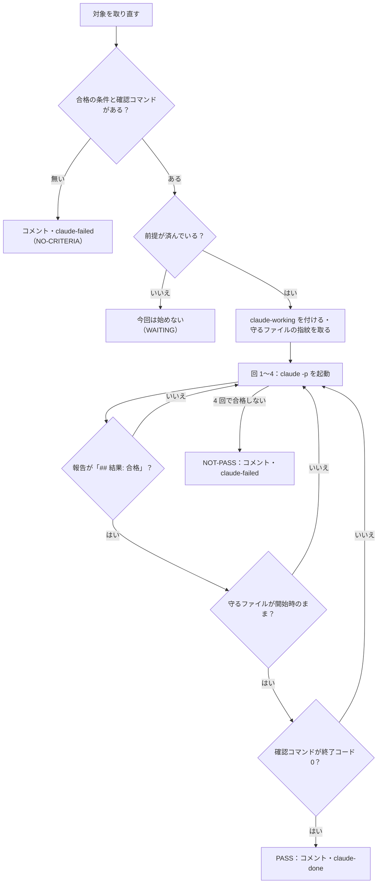

# 無人の Issue 実行の仕様（2 つの版の正）

> Generated by Claude Opus 5.5 — 2026年10月23日

Unity 版（`Scripts/issue-run.ps1`・PowerShell）と Node 版（`scripts/issue-run/issue-run.mjs`・Node.js）は、**この文書の決まりを実装する**。決まりを変えるときは、まずこの文書を書き換え、次に両方の実装と見本（`shared/fixtures/`）を直す。

元にしたのは、KaedeScapeBuii の `Scripts/issue-run.ps1`（2026-10-23 の版。Issue 13 件を合格させた実物）。版ごとの違いは 9 章にだけ書く。

---

## 1. 対象にする Issue

| 決まり | 中身 |
|---|---|
| 札 | 開いていて、ラベル `claude-run` が付いていて、**作った人がそのリポジトリに書き込みの権限を持つ** Issue（1.2） |
| 外すもの | `claude-working`・`claude-done`・`claude-failed` のどれかが付いている Issue |
| 順 | 番号の小さい順 |
| 1 回の実行で進める数 | 最大 20 件（引数で変えられる） |
| 取り直し | **1 件ごとに GitHub から取り直す**（起動した後に直した本文・足した Issue も拾う） |
| 1 件だけ | 番号を指定したら、その 1 件だけ（札を見ない。書き込みの権限は見る） |

### 1.1 ラベル

| ラベル | 色 | 説明 | 付け外しするもの |
|---|---|---|---|
| `claude-run` | `1d76db` | Claude に無人で進めさせてよい | 人 |
| `claude-working` | `fbca04` | 実行中 | 脚本 |
| `claude-done` | `0e8a16` | Claude が合格させた・確認待ち（閉じるのは人） | 脚本 |
| `claude-failed` | `b60205` | 合格の条件が無い・回数切れ・異常終了 | 脚本（外すのは人） |

ラベルが無ければ、実行の最初に作る。前回の実行が途中で落ちて残った `claude-working` は、対象が 1 件以上ある実行の最初に外す（ほかの worktree の実行が進めている Issue は外さない）。対象 0 件の実行は札を外さずに終えるので、止めた Issue のほかに対象が無いと札は残る。残った札は `--issue <番号>` の起動で外れる（`--issue` は札を見ずにその Issue を対象にし、そのあと前回の札を外す）。ただし `--issue` の起動でも 1.2 の書き込みの権限は確かめるので、その Issue を作った人に権限が無いと対象 0 件になり、札は外れずに残る。

### 1.2 書き込みの権限

公開のリポジトリでは、だれでも Issue とコメントを書ける。ラベルを付けられるのは書き込みの権限のある人だけだが、Issue のひな形の `labels:` は作った人の権限を問わずにラベルを付ける。無人の回は、**書き込みの権限のある人が書いたものだけ**を指示と結果として読む。

| 決まり | 中身 |
|---|---|
| 書き込みの権限 | GitHub の `repos/<owner>/<name>/collaborators/<login>/permission` の `permission` が `write` か `admin`（読むだけ）。この欄の値は `admin`・`write`・`read`・`none` だけで、Maintain のロールの人は `write`、Triage のロールの人は `read` として返る（ロールの名前は `role_name` の欄） |
| 使い回し | 1 回の起動の中では、同じ人の結果を使い回す |
| 読めないとき | ネットの誤りなどで読めなければ、権限が無い側に倒す（Issue は拾わない・コメントは数えない） |
| 外した Issue | 対象の一覧を出す行（DryRun と本番の最初の行）に、外した Issue の番号と理由（作った人に書き込みの権限が無い・権限が読めない）を出す |
| 前提のコメント | 2.2 の「最後の結果のコメント」は、書き込みの権限のある人が書いたものだけから選ぶ |

---

## 2. 本文の読み方

読む前に、本文の `\r` を消し、HTML のコメント（`<!-- … -->`）を消す。

### 2.1 合格の条件

| 決まり | 中身 |
|---|---|
| 節 | 行頭の `## 合格の条件`（前後の空白は可）から、次の行頭の `## ` か本文の終わりまで |
| 確認コマンド | 節の中の最初の、版ごとの言語のコードの塊（9 章）。中身は前後の空白を取る |
| 条件の行 | 節からコードの塊を全部除いた残りの各行を前後の空白を取って見て、`- `・`* `・`<数字>. ` で始まり、その後に空白でない字が続く行 |
| 起動しない | 条件の行が 0 か、確認コマンドが無い。Issue に理由をコメントし、`claude-failed` を付ける |

### 2.2 前提

| 決まり | 中身 |
|---|---|
| 節 | 行頭の `## 前提` から、次の `## ` か終わりまで |
| 番号 | 節の中の `#<数字>` を全部、重複を除いて出てきた順 |
| 済んでいる | その Issue が閉じている。または `claude-done` が付いていて、最後の結果のコメント（脚本の名前で始まり、**書き込みの権限のある人が書いた**もの。1.2）に書いた `・HEAD <sha>）` のコミットが、いまのブランチにある |
| 済んでいない | それ以外（`claude-done` が付いていても、書き込みの権限のある人の結果のコメントが無ければ済んでいない）。その Issue は今回は始めない（結果は WAITING） |

### 2.3 守るファイル

| 決まり | 中身 |
|---|---|
| 語に分ける | 確認コマンドを、空白・`;`・`|`・`&`・`(`・`)`・`{`・`}`・`=`・`,` の 1 つ以上の並びで分ける |
| 語を整える | 前後の `"`・`'`・`` ` `` を取る。空、または `-` で始まる語は捨てる |
| パスにする | `\` を `/` に変え、頭の `./` と `/` だけを取る（**`.github` の頭の点は取らない**） |
| 守る | そのパスが、作業場所に実在するファイルで、**git が管理している**（`git ls-files` にある。大文字と小文字は区別しない）もの。重複を除いて出てきた順 |
| 守らない | 管理外のファイル（ビルドで作り直される物）。確認コマンドの中で変数を通して指したファイル |
| 指紋 | 守るファイルの SHA-256。開始時に取り、「指紋<TAB>パス」の行で書く |

---

## 3. 1 件の進め方



| 決まり | 中身 |
|---|---|
| 回の数 | 最大 4 回。1 回は最大 90 分 |
| 1 回目 | 指示文（`shared/` のひな形に、番号・リポジトリ・ブランチ・使用中の判定・守るファイル・報告ファイルの場所を埋めたもの）を渡す |
| 2 回目から | 同じ会話を続ける（会話の ID を 1 回目に決めておき、続きとして起動する）。渡すのは 4 行：「まだ合格していない。続けて。」・「理由: <理由>」・使用中の判定・「合格の条件を全部、実行結果で満たすまで進める。報告ファイルを最新にし、全部満たしたら「## 結果: 合格」と書く。」 |
| 会話が無い | 続きの起動で「no conversation found」と返ったら、新しい会話で 1 回目からやり直す（回の数に数えない） |
| 時間切れ | 理由「1 回の上限 90 分を超えて打ち切った。途中から続ける。」で次の回へ |
| 合格の宣言が無い | 報告ファイルに行 `## 結果: 合格` が無ければ、理由に最後の返答の末尾（400 字）を付けて次の回へ |
| 守るファイルが変わった | 理由「確認コマンドが使うファイルを変えた: <一覧>。合格の判定に使うファイルは変えない。git で開始時の中身に戻してから、作る側を直す。」で次の回へ |
| 確認コマンド | 作業場所で 1 回だけ回す。終了コード 0 で合格。落ちたら、理由に終了コードと出力の末尾 30 行を付けて次の回へ |
| 認証切れ | 返答に「Failed to authenticate」「OAuth session expired」「Invalid API key」「/login」のどれか → 実行全体を止める（ABORTED） |
| 利用上限 | 結果の JSON の `api_error` が `usage_limit_reached`、`api_error_status` が 429、または文に「usage limit」「rate limit」「session limit」「limit reached」「limit will reset」「resets at」「resets <数字>」 → 30 分待ってやり直す（回の数に数えない・最大 16 回） |

### 3.1 claude -p の起動

| 決まり | 中身 |
|---|---|
| 引数 | `-p --output-format json --permission-mode auto --permission-prompts none --disallowed-tools AskUserQuestion --settings <実行用の設定> --model <モデル>`。1 回目は `--session-id <ID>`、2 回目から `--resume <ID>` |
| モデル | 既定は `claude-opus-5-5` |
| 指示文 | **標準入力から渡す**（引数だと改行と引用符が壊れる） |
| 文字コード | 標準入出力は UTF-8 |
| 作業場所 | リポジトリの直下 |
| 環境変数 | `ISSUE_RUN_ROOT`（直下）・`ISSUE_RUN_REPORT`（報告ファイル）・`ISSUE_RUN_PROTECT`（指紋のファイル）・`ISSUE_RUN_STATE`（押し返しの回数のファイル）・`ISSUE_RUN_MAXBLOCKS`（30） |

### 3.2 実行用の設定

ひな形（`.claude/issue-run/settings.json`）の `{{STOP_HOOK}}` を Stop hook の絶対パス（`/` 区切り）に、`{{REPO}}` を作業場所の POSIX 形（Windows の `D:\x\y` は `d/x/y`、Mac の `/Users/x/y` は `Users/x/y`）に置き換え、JSON として読めることを確かめてからログの置き場に書く。禁止の `//{{REPO}}/CLAUDE.md` は、この作業場所の直下だけに効く（裸の `CLAUDE.md` はどの深さにも効いてしまう）。

### 3.3 起動前の点検

最初の Issue の前に 1 回だけ、`claude -p` に「これは点検。Bash ツールで `git stash list` を1回だけ実行し、結果を1行で答えて終わる。断られたら、断られたと1行で答えて終わる。」を渡し（5 分）、次の 3 つを確かめる。どれかが駄目なら止める。

1. 認証が通る（JSON が返り、エラーでない）
2. Stop hook が呼ばれた（環境変数 `ISSUE_RUN_PROBE` の場所に印のファイルができた）
3. 禁止が効いた（結果の JSON の `permission_denials` が 1 件以上）

---

## 4. Stop hook

返答を終えようとしたときに呼ばれる。標準入力は読み切って捨てる。

| 決まり | 中身 |
|---|---|
| 点検のとき | `ISSUE_RUN_PROBE` があれば、そこに「stop-hook ran」と書いて終わる |
| 対象外 | `ISSUE_RUN_REPORT` が無ければ何もしない |
| 終わってよい | 報告ファイルに行 `## 結果: 合格` があり、指紋のファイルの全部のファイルが開始時と同じ |
| 押し返す | それ以外。標準出力に `{"decision":"block","reason":"<理由>\nまだ終われない（無人実行・<n>/<上限> 回目の押し返し）。質問せず、自分で選んで進める。断られた操作は使わずに、できる作業を続ける。"}` |
| 上限 | 押し返した回数を `ISSUE_RUN_STATE` のファイルで数え、`ISSUE_RUN_MAXBLOCKS`（既定 30）を超えたら押し返さない |
| 確認コマンド | **回さない**（重いので、脚本が回の後に 1 回だけ回す） |

---

## 5. 結果のコメント

1 行目（**形を変えない**。2.2 の前提の判定がこの形を読む）：

```text
<脚本の名前>: **<PASS|NOT-PASS|ABORTED>** — <分> 分（<開始>〜<終了>）・<回> 回・コミット <件数> 件・作業場所 <フォルダー名>（<ブランチ>・HEAD <8 桁の sha>）・ログ <ログの置き場>/<実行の時刻>/
```

| 部分 | 決まり |
|---|---|
| 分 | 開始〜終了を分に丸めた整数 |
| 開始〜終了 | `yyyy-MM-dd HH:mm〜HH:mm`。日をまたいだら終わりにも日付（`yyyy-MM-dd HH:mm`） |
| 2 行目から | 合格しなかったら「合格しなかった理由: <理由>」、断られたツールがあれば「auto mode に断られたツール: <一覧>」、空行、報告ファイルの全文 |
| 長さ | 60,000 字を超えたら切り、「…（長いので切った。全文は <報告ファイル>）」 |
| ラベル | PASS は `claude-done`、ほかは `claude-failed`。`claude-working` を外す |

---

## 6. 実行のまとめ

実行の終わりに、記録の置き場の `<年>/<月>/<日>/` に、その日の次の番号で `<番号 2 桁>-issue-run.md` を書く。

| 部分 | 決まり |
|---|---|
| 題 | `# Issue の無人実行のまとめ（<実行の時刻>）` |
| 頭の行 | 「`<脚本のパス>` が自動で書いた。リポジトリ <owner/name>・作業場所 <フォルダー名>（<ブランチ>）・ログ <ログの置き場>/<実行の時刻>/」。作業場所は 5 章の 1 行目と同じくフォルダー名だけで書き、**絶対パスを書かない**（まとめはコミットされるので、ホームのユーザー名が公開のリポジトリに出る） |
| 表 | `| Issue | 結果 | 分 | 時刻 | 回 | コミット | 断られたツール |`。並びは ABORTED → NOT-PASS → NO-CRITERIA → WAITING → PASS、同じなら番号順 |
| 各 Issue | `## #<番号> <題> — <結果>`、合格しなかった理由、コミットの一覧、報告ファイル（見出しを 1 段下げる） |

### 6.1 履歴

回ごとに、ログの置き場の `runs.log`（Node 版は `.issue-run/logs/runs.log`）へ 1 行足す。**対象 0 件の回も足す**（前の回で済んでいたのか、ラベルを付け忘れたのかを後で見分けるため）。DryRun は何も書かない。

| 部分 | 決まり |
|---|---|
| 1 行 | タブ区切りで `<実行の時刻>`・`対象 <N> 件`・結果・まとめの相対パス |
| 結果 | `#7 PASS #8 NOT-PASS` のように番号と結果を並べる。0 件は `なし`。中断したら後ろに ` 中断: <理由>` |
| まとめの相対パス | 作業場所からの相対パス（`/` 区切り）。まとめを書かない回（対象 0 件）と、まとめを書けなかった回は `-` |
| 対象 0 件のとき | 窓に、`claude-done` の付いた Issue（閉じたものも含む）のうち更新がいちばん新しい 1 件を「直近に合格した Issue: #<番号> <題>（更新 <日時>）」と出す。無ければ「直近に合格した Issue: まだ無い」 |

まとめを書けなかったときも 1 行足し、知らせも出す（窓に「まとめを書けなかった: <理由>」）。回の終了コードは変えない。

### 6.2 終わりの知らせ

1 件以上回した回の終わり（中断も含む）に、起動した人へ知らせる。PC の中の知らせだけで、外（メール・Slack・Webhook など）へは送らない。

| 部分 | 決まり |
|---|---|
| 窓 | ベル（`\x07`）と「issue-run 終わり: <結果>」（結果は 6.1 と同じ並び。中断なら後ろに「（中断: <理由>）」） |
| Mac | 加えて `osascript -e 'display notification "<文>" with title "issue-run"'`。文の中の `\` と `"` は逃がし、改行は空白にする |
| Windows・Linux | ベルだけ |
| 止める | 引数で止める（Node 版は `--no-notify`） |
| 失敗 | 知らせが失敗しても、回の結果（終了コード・ラベル・まとめ）は変えない |

---

## 7. 並んで動かすとき（worktree）

| 決まり | 中身 |
|---|---|
| 二重起動 | 作業場所のロックのファイルに PID を書く。そのプロセスが生きていれば、新しい実行は止める（終了コード 3） |
| 取り合い | いま進めている Issue の番号をファイルに書く。ほかの worktree の実行が同じ番号を書いていれば、その Issue を飛ばす |
| 作業場所の選び方 | 引数で指定 → それ。窓から起動 → worktree の一覧から選ばせる（Enter で起動したフォルダー）。窓でない → 起動したフォルダー。**脚本の置き場では決めない** |

---

## 8. DryRun

Claude を起動しない。対象の一覧と、各 Issue の「合格の条件の行数・確認コマンドのあり無し・守るファイル・前提（済んでいないもの）」と、1 件目に渡す指示文を出して、終了コード 0。

合格の条件（箇条書きと確認コマンド）に、実行用の設定（3.2）の deny が書き換えを断るパス（`Edit(…)`・`Write(…)` の作業場所の下のパス。いまは直下の `CLAUDE.md`・`.claude/**`・`docs/inspecs/**`）に当たる語があれば、Issue ごとに 1 行知らせる。パスは脚本に書かず、設定から読む。当たるのは、バッククォート・空白・`・`・`、`・引用符などで区切った語が、頭の `./` を外して deny のパスに一致するもの（`**` はその下全部）。頭にフォルダーが付いた語（`editions/node/files/CLAUDE.md` など）は当たらない。知らせるだけで、起動を止めない（本番の回も止めない。変えないことを確かめるために書く Issue もあるため）。知らせの形は「無人の回では直せない。直す必要があれば人が直す。変えないことを確かめるだけなら無視してよい」。

---

## 9. 版ごとに違う所

| 所 | Unity 版 | Node 版 |
|---|---|---|
| 確認コマンドの塊 | ```` ```pwsh ```` か ```` ```powershell ```` | ```` ```js ```` か ```` ```javascript ```` か ```` ```mjs ```` |
| 確認コマンドの回し方 | `pwsh -NoProfile -Command <中身>`（作業場所で） | 中身を記録として `<ログ>/issue-<番号>-check.mjs` に書き、回すときは `node --input-type=module` に**標準入力から**渡す（作業場所で。`import './scripts/issue-run/check-lib.mjs'` のような相対の読み込みが作業場所の直下から解決される） |
| 守るファイルの印（人が読む用） | `# 守る: <パス>` | `// 守る: <パス>` |
| Stop hook の起動 | `pwsh -NoProfile -File <stop-hook.ps1>` | `node <stop-hook.mjs>` |
| 使用中の判定 | Unity エディタがこの作業場所を開いているか | 使用中にしない（`wrangler dev` などが動いていれば知らせだけ） |
| 眠らせない | Windows の `SetThreadExecutionState` | Mac は `caffeinate -i -w <PID>`。Windows は点検で知らせる |
| 窓の簡易編集モード | 実行中だけ切る（Windows） | しない |
| 二重起動の PID の確かめ | プロセスの名前が `pwsh`／`powershell` | プロセスの名前が `node` |
| 書き込みの権限（1.2） | まだ実装していない（元のリポジトリで直してから写す） | 実装している |
| まとめの作業場所（6 章） | まだ（絶対パスを書いている。元のリポジトリで直してから写す） | フォルダー名だけ |
| 履歴 `runs.log`（6.1） | まだ（元のリポジトリで直してから写す） | `.issue-run/logs/runs.log`。対象 0 件なら直近に合格した Issue を出す |
| 終わりの知らせ（6.2） | まだ（元のリポジトリで直してから写す） | ベル。Mac は `osascript` の通知も。`--no-notify` で止める |
| 脚本の名前（コメントの頭） | `issue-run.ps1` | `issue-run.mjs` |
| ログの置き場 | `Logs/IssueRun/` | `.issue-run/logs/` |
| 記録の置き場 | `Docs/Reports/` | `docs/reports/` |

---

## 10. 見本

`<番号>.md` は Issue の本文、`<番号>.expected.json` は 2 章の読み取りの答え（`items`・`check`・`prerequisites`・`protected`）。`checkLang` は確認コマンドの塊の言語、`source` は出どころ。`tracked` は、その本文を読んだリポジトリで git が管理していたファイルのうち、答えに要る物（別の実装は、これを「管理されているファイル」として与えて読ませる）。

| 置き場 | 版 | 出どころ |
|---|---|---|
| `shared/fixtures/issues/` | Unity 版（確認コマンドは pwsh） | KaedeScapeBuii の Issue #1〜#13 |
| `shared/fixtures/issues-node/` | Node 版（確認コマンドは js） | rpg-online-cloudflare の Issue #1〜#4（本文はそのまま。`tracked` はそのリポジトリの `git ls-files` から） |

両方の版が、自分の版の見本を答えどおりに読む。ほかの版の見本では、9 章の塊が違うので確認コマンドは無い（空）と読み、条件の行と前提は答えどおりに読む（K-3 を両方向に）。

---

> この文書は Claude Opus 5.5 が生成しました。内容の正確性は人間のレビューを経て確認してください。
>
> Claude Opus 5.5 — Anthropic
